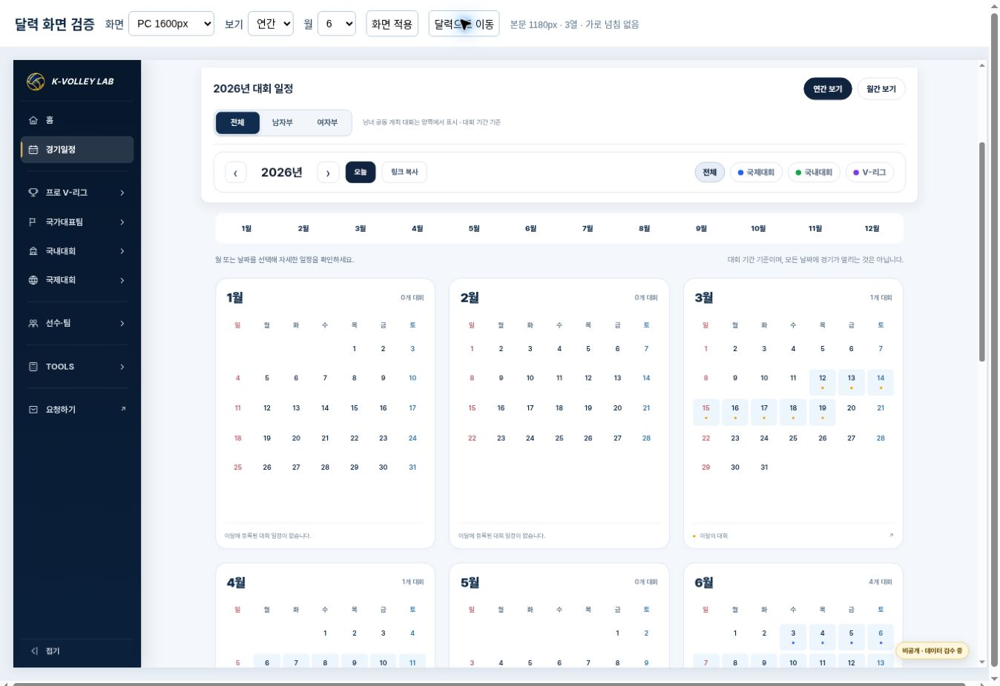
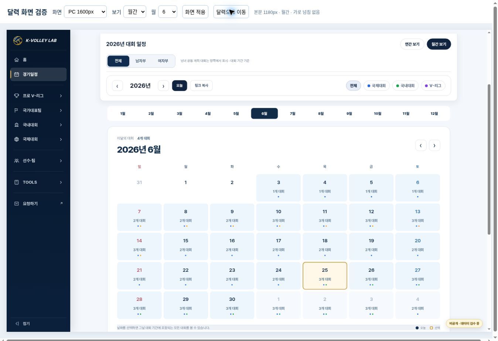
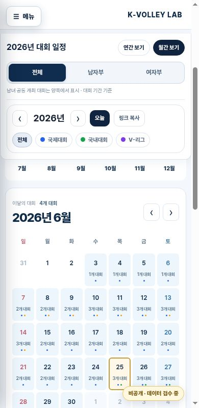
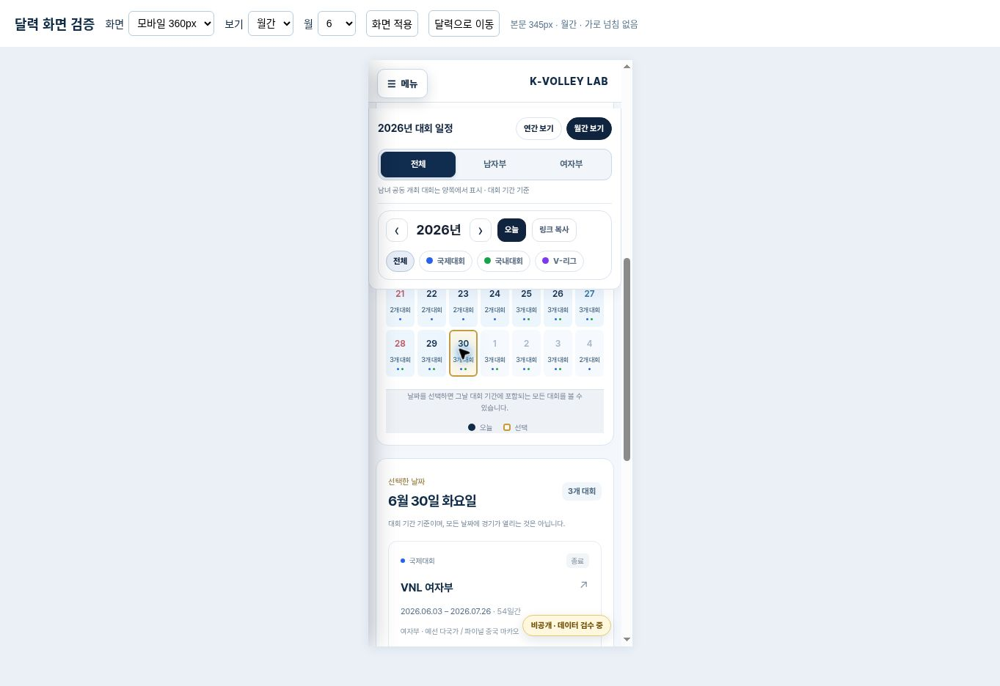

# 한국어 카드형 경기일정 달력 시안 — 2026-10-24

Status: **PROTOTYPE / VERIFIED / READY FOR REVIEW**. 운영 홈페이지 미반영, main 병합 금지.

검토용 주소: https://kvl-calendar-korean-cards-v1.blackisle17.chatgpt.site

## 기준과 범위

- 최초 확인한 main: `9e91dade1efa8086627c345e76c7151a2ee7f087`.
- 작업 중 추가된 중·고 허브 PR #158을 확인하고 최신 main `3a187f09f0d4f8a8bf72d6abc48367208cdb03e4`까지 작업 브랜치만 fast-forward했다. 해당 변경과 충돌하는 파일은 없다.
- 브랜치: `feature/calendar-sunday-cards-prototype`.
- `AGENTS.md`, `PROJECT_RULES.md`, `DESIGN_SYSTEM.md`, `docs/DEVELOPMENT_WORKFLOW_v1.md`, 결정 기록 및 Drive `KVL_운영원칙_MASTER_v14` 확인. 오래된 1440px 일반 규칙보다 최근 승인된 Home형 Hero·1180px 달력 구현을 유지한다.
- 기존 달력 Hero/1180px 관련 커밋 `5e16f13`, `961511f`, 성별 분류 `534c3b6`, `6de6afc`와 현재 실제 renderer를 재사용 기준으로 확인했다.
- 변경 범위는 별도 HTML, 달력 renderer/CSS, 검증/패키징 파일이다. 운영 `competition-calendar.html`, 공통 메뉴, 홈, 선수 DB, 대회 MASTER, 경기 결과, 이미지, 다국어 파일은 변경하지 않았다.

## 첨부 이미지와 비교

| 기준 | 시안 적용 |
| --- | --- |
| 첫 번째 `image(20261024-131654).png` | 큰 흰색 월간 카드, 네이비 제목, 날짜 사이 여백, 일정이 있는 날짜만 옅은 파란색, 선택 날짜 금색, 이전/다음 달 버튼 |
| 두 번째 `image(20261024-131735).png` | 월 제목과 대회 수를 상단에 표시하고 동일한 날짜 디자인을 축소 적용. 기존 12개월·PC 3열 유지 |
| 사용자 한국어·요일 요구 | 연간/월간 모두 `일 월 화 수 목 금 토`; 일요일 빨강·토요일 파랑·평일 네이비. 이미지의 예시 경기 수는 복사하지 않음 |
| 현재 홈페이지 | 공통 좌측 메뉴, Home형 Hero, 기존 이미지, 콘텐츠 1180px, 기존 필터·URL·공유·요약 창 유지 |

외부 캘린더 디자인을 추가로 참조하지 않았다. 기존 Hero의 영문 eyebrow는 원본 그대로 보존했고 달력 내부에 새 영문 카피를 넣지 않았다.

## 실제 데이터와 기능

- 기존 `data/calendar/2026-competition-periods.json` 26개 대회와 `2026-competition-genders.json`을 실행 시 fetch한다. 원본 파일의 바이트는 동일하다.
- 전체 26개 / 남자부 18개 / 여자부 16개. 공동 개최 8개는 양쪽 필터에 표시하며 전체에서 중복 생성하지 않는다.
- 6월 전체는 4개 대회, 6월 25일에는 3개 대회 기간이 겹친다. 고성대회는 6월 25일~7월 3일, 양 끝 날짜를 포함한다.
- 8월 29일의 6개 대회를 모두 선택 날짜 카드로 표시한다. 이 날과 8월 30일은 원본 `matches[].date`로 확인되는 경기 각각 1건만 경기 수로 표시한다.
- 기간만 있는 날짜는 `n개 대회`로 표시한다. 고성 총 47경기는 기존 대회 요약 창의 전체 결과 정보로만 유지하며 일별 경기 수로 사용하지 않는다.
- 겹치는 일정은 날짜 선택 아래에 전부 표시하고 `이달 전체 대회 보기`에서도 확인 가능하다.
- 고성·단양·중고대회 성별 분류, 기존 상세 페이지 path/query/hash, 고성 요약 창의 결과·공식 결과 링크를 보존한다.
- 연간→월간, 이전/다음 달, 연도 경계, 선택 날짜, 성별/분류 필터 및 링크 복사를 연결했다.
- 한국 날짜는 Asia/Seoul 기준, 날짜 격자는 UTC civil date로 계산해 시간대/DST에 의한 요일 이동을 막았다.
- 한국어 기본 사전과 선택적 `KVLCalendarTranslations[locale]` 확장 구조. `lang` URL 값/HTML 언어 코드 및 기존 번역 파일을 보존한다. 새 영문 번역 자체는 이번 범위에 포함하지 않는다.

## 검증

자동 검사 **19개 통과 / 실패 0**. 실행 결과: [automated-tests.txt](calendar-cards-20261024/automated-tests.txt).

```bash
KVL_JSDOM_PATH=/path/to/jsdom node --test tests/calendar-cards-prototype.test.cjs tests/competition-calendar-gender.test.cjs
```

| 항목 | 결과 |
| --- | --- |
| 연간 12개월, 365일 요일 위치 | 전수 통과. 2026-01-01 목요일(0-based 4), 2026-06-01 월요일(1) |
| 월간 12개월과 앞뒤 달 날짜 | 전수 통과. 2026년 1월 이전→2025년 12월, 12월 다음→2027년 1월 |
| 여러 주/달 대회 | 고성 6/25·6/28·7/3 포함, 6/24·7/4 제외 |
| 성별×분류 필터 | 36개 조합 및 고성·단양·CBS 공동 개최 유지 |
| 중첩 일정·경기 수 | 8/29 대회 6개 누락 없음, 날짜 확인 경기 1개만 표시 |
| URL·공유·언어 | 선택 날짜·성별·분류·lang 유지, 복사 주소 검사 통과 |
| 오늘/선택 날짜 | 별도 상태 유지. 오늘은 네이비 원, 선택은 금색 테두리 |
| 기존 링크·요약 창 | 모든 원본 상대 링크의 저장소 파일 존재 확인, path/query/hash 유지, 고성 요약 창 열기/닫기 및 결과 링크 검사 |
| 운영 파일·데이터 보호 | 기준 main 대비 보호 파일 diff 없음. Hero HTML 동일 |

브라우저에서 실제 iframe viewport로 검증했다. PC 캡처는 표시 공간에 맞춰 축소했지만 iframe 내부 CSS viewport와 측정값은 실제 크기다. 모바일의 15px 차이는 검증용 브라우저 세로 스크롤바다.

| 실제 viewport | 보기 | 본문 | 열 | 가로 넘침 / 날짜 셀 넘침 |
| --- | --- | --- | --- | --- |
| 1600px | 연간/월간 | 1180px | 연간 3열 | 없음 |
| 1180px | 연간 | 955px(좌측 메뉴 포함 화면) | 3열 | 없음 |
| 390px | 월간 | 375px | 날짜 7열 | 없음 |
| 360px | 월간/연간 | 345px | 날짜 7열 / 연간 1열 | 없음 |

브라우저에서 날짜 선택, 여자부+국내대회→고성 유지, 월간→연간→6월의 필터 유지, PC 사이드바 접기/복원, 모바일 메뉴 열기/닫기를 확인했다. 운영 고성대회 상세 URL도 실제로 열어 대회명·기간·47경기 원본 화면 연결을 확인했다. [측정 원본](calendar-cards-20261024/kvl-calendar-browser-qa-20261024.json).

다른 대회/홈에 대한 보호는 변경 파일 비교와 기존 링크 검사를 사용했다. 모든 운영 대회 상세 화면을 새로 방문해 전체 기능을 검사한 것은 아니다. 해당 운영 파일/데이터는 이 변경에 포함하지 않는다.

## 화면

연간 PC — 공통 메뉴, 필터, 3열 카드. 12개월은 아래로 이어진다.



월간 PC — 2026년 6월, 실제 4개 대회.



390px 모바일 — 월간 달력.



360px 모바일 — 날짜 선택 후 겹치는 대회 목록으로 이어지는 화면.



## 게시 상태와 남은 제약

- 별도 소유자 비공개 Sites 시안 게시 성공. 운영 도메인 배포 없음.
- Sites source commit: `8b50115644acdf1332d3147481876fd60833793c`.
- Deployment: `appgdep_6adcc09ff450819187fe5b3acbae1629`, status `succeeded` (2026-10-24).
- 게시 주소는 ChatGPT 로그인 후 소유자가 열 수 있다. 별도 브라우저에서는 로그인 안내를 확인했으며, 실제 UI/동작 검증은 동일 파일의 managed preview에서 수행했다.
- 현재 원본에 V-리그 기간 대회가 등록되어 있지 않아 해당 필터는 빈 달력으로 표시한다. 자료를 추정해 추가하지 않았다.
- 현재 2026년 자료만 있다. 다른 연도 이동은 정상 URL을 생성하고 자료 없음/2026년 복귀를 안내한다.
- 기존 일부 대회 링크는 개별 상세가 아닌 기존 허브를 가리킨다. 원본 연결을 유지했다.
- 시안의 JSON은 위 main의 동일 바이트 사본이다. 운영 데이터가 갱신되면 패키징 스크립트로 새 snapshot을 게시해야 하며 자동 동기화 서비스는 추가하지 않았다.

## 수정 파일 및 운영 적용 최소 범위

시안 구현은 다음 세 파일이다.

1. `competition-calendar-cards-prototype.html`
2. `assets/js/competition-calendar-cards-prototype-v1.js`
3. `assets/css/competition-calendar-cards-prototype-v1.css`

그 외 패키징 스크립트, 자동 검사, 반응형 QA HTML, 결정 기록, 이 보고서와 캡처를 추가했다.

추후 운영 승인 시에도 최소 **3개 파일**이면 된다: 새 JS/CSS 두 파일을 추가하고 기존 `competition-calendar.html`에서 renderer import 교체·CSS import 추가·`cc-cards-prototype` scope class 추가만 한다. 시안 HTML의 제목/noindex/검증용 주소는 운영 파일로 복사하지 않는다. JS는 현재 pathname을 사용하므로 운영 주소를 유지한다. 선수/대회 데이터, 공통 사이드바, Hero 이미지를 수정할 필요가 없다.

복구는 기존 renderer import와 scope class/CSS import를 원복하는 방식이다. 이번 PR은 병합하지 않고 소유자의 디자인 검토용으로 남긴다.
