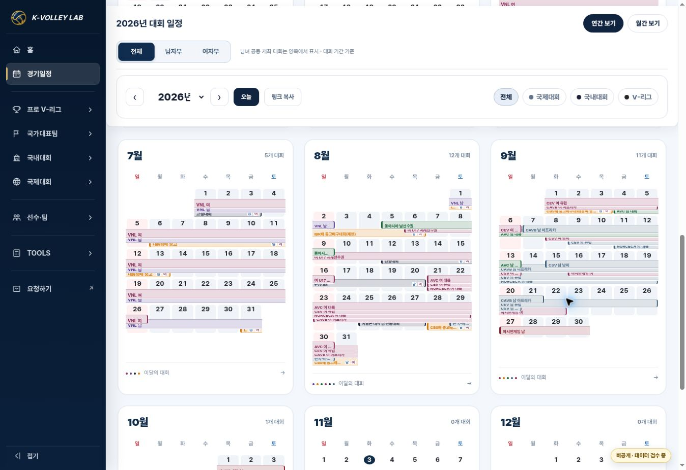

# 통합달력 월 카드 디자인 이식 · 검수 기록

Status: PROTOTYPE / READY FOR REVIEW / OPERATING SITE NOT DEPLOYED.

## 기준과 범위

- 현재 main: `f7d51ee1264b8f2811fef618e4f01f597acdb154` (작업 전 및 제출 전 재확인).
- 재사용: PR #159 `feature/calendar-sunday-cards-prototype`, `5c371b229198a380bd3b84527a968ce9617408eb`.
- 검수용 비공개 한국어 카드형 시안: https://kvl-calendar-korean-cards-v1.daewook1029.chatgpt.site
- 동일 Site의 현재 저장 소스: `fabb0d0e7fd0645c3621faad4c94a14e6184211a`. 비공개 시안 저장/게시 성공. 운영 홈페이지에는 미반영.
- 변경 전 시안 소스: `00df4fa1b57d7857f028519c403783f0bf3e6b37` (저장 버전 2).
- 새 작업 브랜치: `feature/calendar-layer-preview-20261103`.
- Google Drive 운영원칙 MASTER v18, 대회일정 MASTER를 읽기 확인했다. 구형 일정표의 값으로 현재 통합 데이터나 대회 ID를 덮어쓰지 않았다.
- 사용자 요청은 시안 제작 및 검수까지다. 운영 `competition-calendar.html`, 공통 UI, MASTER, 일정 JSON, ID 연결을 변경하지 않았다. 병합과 운영 반영은 별도 승인 대상이다.

## 실제 공통 달력 기준

2026-11-02에 정리된 `assets/css/kvl-match-calendar-v1.css`와 공통 JS를 기준으로 했다. `docs/validation/competition-calendar-standard-20261102.md` 및 모바일 후속 검수 기록과 대조했다.

운영 UI에서 V-리그, 대학배구, 국내 중고대회, 국제 VNL을 각각 확인했다. 모두 일요일 시작·열 간격 0·7px 날짜 셀·중앙 날짜·일정 셀의 옅은 배경과 흰색 내부 구분을 공유한다. 이 구조를 기존 연간 카드 안에 축소 적용했다. 토요일 파랑, 일요일 빨강, 13px 날짜 숫자를 사용한다.

공통 메뉴, HERO, 2026년 대회 일정, 연간/월간 보기, 남녀/대회 분류 필터, 연도 이동, 오늘, 링크 복사, 월 바로가기 및 3×4 월 카드 골격을 유지한다. 연도는 선택 가능한 select로 제공한다. 모든 월 카드 하단에 ‘이달의 대회 →’가 있다.

## 기간 표시

| 분류 | 기본 색 |
| --- | --- |
| FIVB 남자 | Purple #5B3A8E |
| AVC 남자 | Green #176638 |
| 대학 남자 | Navy #1B223A |
| 중고 남자 | Orange #D97706 |
| V-리그/KOVO컵 남자 | Charcoal #252525 + Gold #C9A44C |
| 별도 여자대회 | Rose #8E315E |
| 남녀공통 | 계열색의 한 막대 + 작은 남/여 배지 |

기존 데이터에 있는 아시안게임은 계열색 Deep Red, 기타 국제연맹은 Slate를 유지한다. 국제대회를 삭제하지 않는다. 분류/색은 표시 어댑터에서 결정하며 원본 category/ID/기간은 변경하지 않는다.

막대 높이/세로 간격은 연간 18/9px, 고밀도 월 16/8px, 월간 26/13px(모바일 월간 24/12px)이다. 50% 겹침을 적용하며 각 막대 아래쪽 절반과 시작·끝 색상 경계가 노출된다. 높은 우선순위가 앞에 있고, Hover 또는 키보드 focus 시 해당 대회의 모든 주간 조각을 강조한다. Tooltip에는 전체 대회명, 실제 시작~종료일, 남/여/공통, 대회 계열이 나타난다. 터치 첫 선택은 정보, 다음 선택은 기존 대회 링크로 연결한다.

우선순위는 프로 → 국제 → 대학 → 중고. `window.KVLCalendarLayerPriority` 설정으로 검수 중 순서를 바꿀 수 있다. 매주 빈 줄을 재활용한다. 대회를 `+N`으로 숨기지 않는다. 긴 이름은 표시만 축약한다.

## 검증 결과

`KVL_JSDOM_PATH=<jsdom 설치 경로> node --test tests/calendar-cards-prototype.test.cjs` — **23/23 PASS**, jsdom 26.

- 12개월/365일의 요일, 일요일 첫 열, 월간 인접 날짜.
- 윤년 2028-02-29, 연도/월/주 경계의 inclusive 기간 커버리지.
- 모든 성별×분류 조합, 남녀공통 대회 양쪽 필터 포함.
- 8월 29일 동시 6개 대회 모두 유지, 확정 경기와 기간 구분.
- 기존 링크 경로/query/hash, 고성 요약 모달, 연도/월 이동, 오늘, 링크 복사.
- 모든 26개 원본 대회의 Tooltip 정보, focus/escape 및 모바일 첫/두 번째 탭 동작.
- 별도 여자 Rose, 모든 남자 계열색, 남녀공통 단일 막대, 우선순위와 설정 변경(격리 fixture 검증).
- 자료가 없는 연도는 복귀 안내와 연도 선택 유지. 필터를 눌러도 자료 미등록 상태가 사라지지 않는다.
- 운영 페이지/공통 스타일/이미지/MASTER/data 경로 변경 없음.

브라우저 렌더링 검수: PC 1600px 본문 1180px·3열, PC 1180px 본문 955px·3열, 모바일 390px 연간 1열/12개 카드, 모바일 360px 월간. 모두 페이지 가로 넘침 없음. PC 고밀도 월 카드의 같은 행 높이는 최대 509px로 유지되었으며 무제한으로 별도 줄을 추가하지 않는다. 8~9월 대회 레이어, AVC 남자 전체 Tooltip, 여자부 필터를 실제 화면에서 확인했다.

실제 저장된 시안 배포 상태는 성공이다. 현재 비공개 주소는 소유자 ChatGPT 로그인이 필요하며, 이 브라우저에서는 로그인 벽까지만 확인했다. 화면 QA는 같은 소스 커밋의 로컬 미리보기에서 수행했다.

## 남은 조건 / 한계

현재 `data/calendar/2026-competition-periods.json` 26개 대회에는 V-리그·KOVO컵 기간 레코드가 없다. 이번 UI 작업에서 임의 일정을 추가하지 않았다. 따라서 실제 시안의 V-리그 필터는 비어 있으며 Charcoal/Gold 및 프로 여자 Rose 규칙은 격리된 테스트 fixture로 검증했다. 프로 대회 실제 막대를 운영에 표시하려면 별도 데이터 연결 검증이 필요하다.

2026년 외 일정 자료는 현재 제공되지 않는다. 연도 이동은 정상이며 미등록 안내가 표시된다. 모든 대회의 원본 기간이 최신 공식 일정과 일치하는지를 재수집하는 작업은 이번 UI 검수 범위에 포함하지 않는다.

## 변경 파일 / 복구 / 다음 단계

- `competition-calendar-cards-prototype.html`
- `assets/css/competition-calendar-cards-prototype-v1.css`
- `assets/js/competition-calendar-cards-prototype-v1.js`
- `tests/calendar-cards-prototype.test.cjs`
- 이 검수 기록·PC 검수 이미지 및 `docs/KVL_DECISION_LOG.md`

운영 복구는 필요 없다(운영 파일 변경 없음). 시안 복구는 비공개 시안 저장 버전 2 또는 위 변경 전 소스 커밋으로 되돌린다. 현재 Draft PR은 병합하지 않고 유지한다. 사용자는 PC의 6~9월 색상/밀도/레이어를 검수하고, 승인 후 별도 운영 적용 범위를 정한다.
