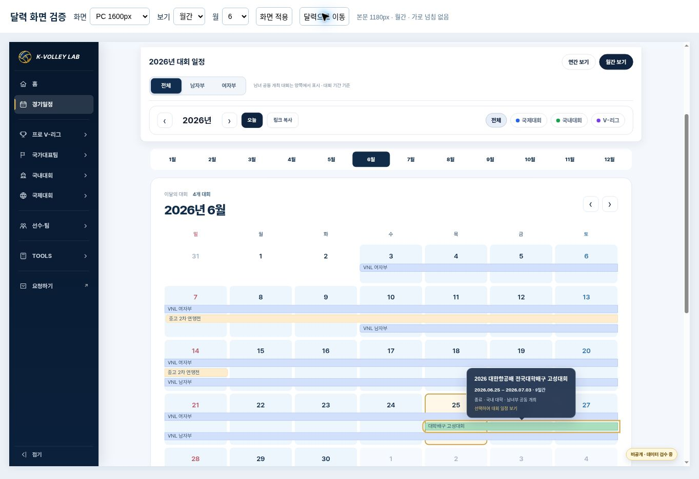
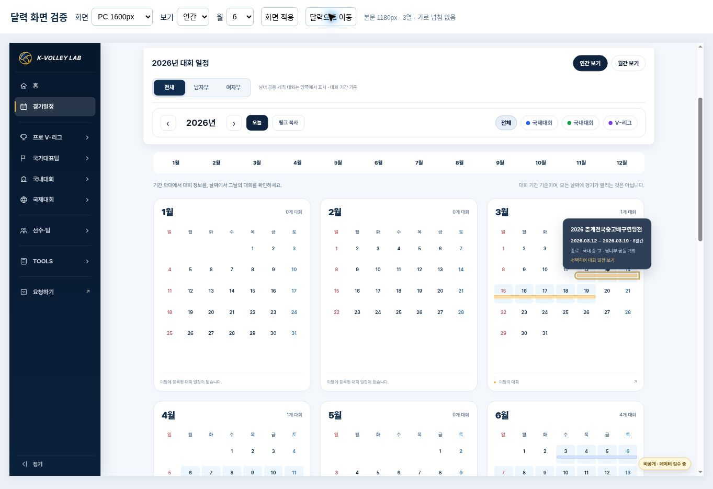
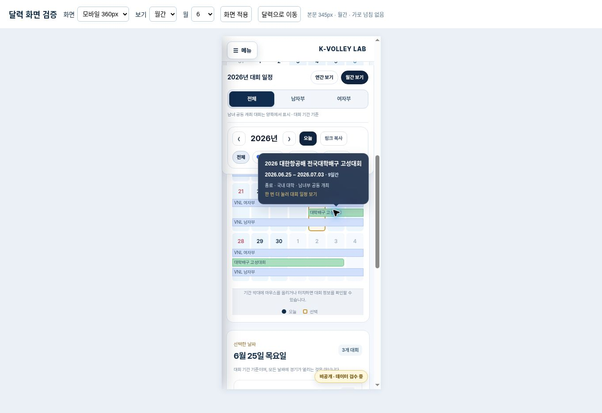

# 달력 기간 막대·반투명 말풍선 보완 — 2026-10-25

Status: PROTOTYPE / VERIFIED / READY FOR REVIEW. **운영 홈페이지 미반영**. 기존 PR #159와 동일한 비공개 시안을 갱신한다.

시안: https://kvl-calendar-korean-cards-v1.blackisle17.chatgpt.site

## 반영 내용

- 사용자가 확인한 흰색 카드, 여백, 12개월/PC 3열, 일요일 시작, 오늘/선택 표시를 유지했다.
- 기존 운영 renderer의 주간 기간 분할·겹치는 일정의 행 배치 방식을 일요일 시작 날짜 격자에 맞춰 재사용했다. 대회별 행을 여러 주에 걸쳐 유지하고, 주/월 경계에서 이어지는 막대 끝을 구분한다.
- 연간은 가는 기간 막대, 월간은 대회명이 있는 기간 막대로 표시한다. 겹치는 대회를 숨기거나 `+n`으로 생략하지 않는다. 중복을 줄이기 위해 날짜 칸의 점/대회 수 대신 막대를 표시하며, 날짜의 접근성 이름과 선택 날짜 목록/월별 대회 수는 유지한다.
- 마우스 또는 키보드 초점에서 대회명·전체 시작/종료일·기간·상태를 반투명 네이비 말풍선으로 표시한다. 배경만 흐리게 하고 텍스트는 선명하게 유지한다.
- 같은 대회의 다른 주 막대도 함께 강조한다. 말풍선은 카드 가장자리에서 잘리지 않도록 별도 고정 레이어에 두고 viewport 안으로 위치를 보정한다.
- 모바일은 첫 터치로 정보 표시, 같은 막대를 한 번 더 터치하면 원래 대회 상세로 이동한다. 바깥 터치/Escape/필터 변경 시 말풍선을 닫는다.
- 기존 성별·분류 필터, URL/공유, 날짜별 전체 대회 목록, 상세/요약 연결 및 실제 날짜가 있는 경기만 집계하는 원칙을 유지했다.

## 검증

기준 main `e71cafc1dae8c99b793e35d2ce4a0d992b2bfe37` 확인 및 작업 브랜치 동기화. 운영 달력/공통 메뉴/이미지/데이터에는 해당 main 대비 변경이 없다. 최신 국내대회 템플릿 변경은 원본 그대로 보존했다.

자동 검사 **22개 통과, 실패 0**. 기존 19개와 기간/말풍선/모바일 상호작용 3개를 검사했다.

- 연간 12개월 및 월간 12개월의 모든 보이는 날짜에 대해 기간 포함 대회와 막대를 전수 비교했다. 주 경계/요일/기간 끝 날짜, 같은 행의 충돌, 링크 일치가 통과했다.
- 고성 6/25~7/3의 전체 기간을 유지하고 6/25~27, 6/28~7/3으로 주를 나눠 연결한다. 연간 6월 카드는 6/30에서 잘라 다음 달로 계속됨을 표시한다.
- hover 이벤트/키보드 초점에서 전체 대회명·기간 및 모든 조각 강조를 확인했다. Escape, 필터 변경, 모바일 첫/두 번째 터치를 검사했다.
- 브라우저: PC 본문 1180px/연간 3열 유지, 360px·390px 가로 넘침 없음 및 말풍선 화면 안 표시. 모바일 두 번째 클릭으로 운영 고성대회 제목까지 실제 연결 확인.
- 실제 화면은 같은 배포 파일의 managed preview에서 검증했다. 캡처는 키보드 초점과 모바일 첫 터치 상태다. 저장소의 기존 선수 등록 CI 문제는 이전 PR 기록과 같으며 이 UI 범위에서 수정하지 않는다.

자료: [자동 검사](calendar-periods-20261025/automated-tests.txt), [브라우저 측정](calendar-periods-20261025/kvl-calendar-period-browser-20261025.json).

## 변경과 복구

UI 변경은 기존 시안의 JS/CSS와 HTML 캐시 버전 세 파일이다. 검증 스크립트와 기록/캡처를 갱신했다. 별도 선수/대회 DB 또는 운영 파일을 추가 변경하지 않았다.

직전 시안은 PR #159의 `0bf4af8d37937d534329afcd22ebd621a872a82d` 및 Sites source `8b50115644acdf1332d3147481876fd60833793c`다. 되돌릴 경우 이 세 UI 파일을 직전 시안으로 복원해 별도 시안만 재게시한다. 운영 적용은 별도 승인 전까지 진행하지 않는다.
