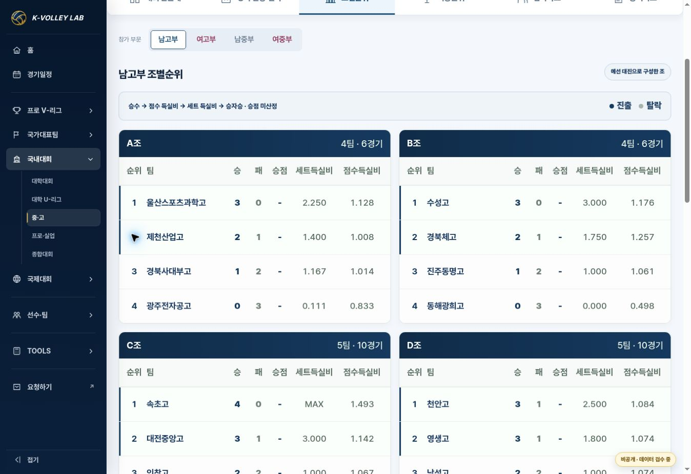

# 국내대회 기본 템플릿 — PC 조 카드 반폭·열 정렬

2026-10-26 · APPROVED / IMPLEMENTED / VERIFIED. 배포 증거는 release PR에 기록.

Base main: `f02838e9ce3e59752045fae596b5b8a78cb21136` (PR169). Branch: `fix/domestic-pool-card-layout`.

## 변경

기존 기본 3열/1080px 이하 1열/학교 전용 2열이 혼재하던 PC 조별순위를 공통 2열로 통일한다. 각 조는 같은 너비이며 홀수 마지막 카드도 반폭을 유지한다. 카드 사이 16px, 헤더/행 열 사이 6px이다.

같은 grid를 헤더와 본문에 적용한다: 36px 순위, 가변 팀, 36px 승/패/승점, 88px 세트득실비/점수득실비. 긴 팀명을 위해 팀 칸 오른쪽에 14px 추가 여백을 두고 말줄임 대신 줄바꿈한다. 기존 17px 글씨 크기를 유지하며 득실비 제목의 두 요소를 inline으로 표시한다.

901px 이상 화면에만 적용한다. 좁은 PC 창에서는 조 카드의 반폭을 유지하면서 최소 480px 표를 카드 내부에서만 가로 스크롤한다. 모바일·인쇄·예선 종합순위·승패/득실비 계산·경기/선수 데이터는 변경하지 않는다. 변경은 공통 v2 CSS와 해당 CSS를 읽는 engine/고성/단양 진입 HTML의 캐시 키뿐이다. 별도 renderer나 복제 템플릿을 만들지 않는다.

## 브라우저 검수

- 고성 남대부 3개 조: 537px 동일 카드 두 개가 첫 행, C조는 다음 행의 같은 반폭. 한 행에 3개가 들어가거나 마지막 카드가 전체 폭으로 늘어나지 않음.
- 단양 여대부 2개 조, U리그 남대부 2개 조, 삼척 남고부 4개 조: 동일한 537px 카드 / 16px 간격. 남녀 기존 색상 유지.
- 위 4개 화면의 모든 카드에서 헤더와 첫 데이터 행의 각 열 x 좌표 차이 0px. 득실비 b/small의 y 좌표 동일: 한 줄 표시 확인.
- 삼척 1440px: 카드 558px / 2열 / 내부 넘침 없음. 1280px: 카드 495.5px / 2열 / 내부 넘침 없음. 긴 울산스포츠과학고가 칸 안에서 읽힘(텍스트 scrollWidth와 clientWidth 동일).
- 1024px: 367.5px 카드 / 2열 유지, 카드 안 480px 표 가로 스크롤. 문서 client/scroll 폭 모두 1009px로 문서 전체 넘침 없음.
- 실제 모바일 너비로 새로 로드한 390/360px: 한 열, 카드 각각 345/315px. 문서 client/scroll 폭 각각 375/345px로 동일. 학교명 아래 기존 승점/득실비 배치 유지.
- `git diff --check` 통과. JS/계산/데이터 변경이 없어 기존 33/19개 데이터·기능 테스트는 재실행하지 않았으며 이 변경의 검증은 실제 브라우저 레이아웃 측정과 화면 확인으로 수행했다.

## 화면

## 복구

해당 release merge commit을 revert하면 이전 CSS와 캐시 키로 복구된다. 원본 경기/순위/학교 데이터는 그대로이므로 데이터 롤백은 필요 없다.
