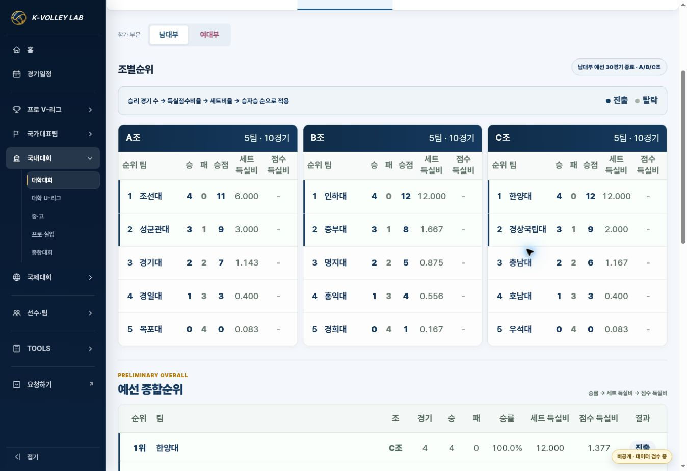

# 국내대회 조별순위 수치 가독성 검수

- 날짜: 2026-10-25 (KST)
- 상태: IMPLEMENTED / VERIFIED. 배포 완료 증거는 release PR에 기록.
- 기준 main: `7ce99fb50875ba5a66c4fad7e3644c93e02bb4a5` (PR #161).
- 사용자 요청: 순위표 본문 숫자·진출 표시는 대학명 크기, 팀·경기 수는 조 제목 크기로 확대. 기존 운영 반영 요청의 후속 편집.

## 범위

운영 공통 CSS `assets/css/kvl-domestic-home-v2.css`, 세 진입 HTML의 CSS 캐시 버전 `20261025-3`, 이 보고서와 결정 기록/검수 이미지. 고성·단양 남녀 4개 선택 적용 config만 영향을 받는다. JavaScript, JSON, 경기 기록, 순위 계산, 팀 링크 및 모바일 표 내부 스크롤은 변경하지 않았다. 외부 원본 자료 검증은 CSS-only 작업에 해당하지 않아 수행하지 않았다.

## 브라우저 검수

| 화면 | 검증 결과 |
| --- | --- |
| 운영 PC 1363px 고성 남대부 | 조별/종합 순위 숫자 및 진출 배지 17px = 대학명. 조 제목과 팀/경기 수 18px. 긴 12.000 값에 맞춰 득실비 열 54→60px, 모든 본문 셀의 scrollWidth≤clientWidth. |
| 운영 390px 고성 남대부 | 조별 수치 17px, 모바일 종합 수치·진출 배지 15px = 각각 대학명. 조 제목/요약 18px. 문서 폭 375=375px. |
| 운영 360px 단양 여대부 | 위 크기 일치. MAX와 소수점 표시 확인. 문서 폭 345=345px. 기존 표 내부 가로 스크롤 유지. |
| 기본 템플릿 PC | 전체 조 선택창/머리글/대학명/본문 수치/진출 배지 16px. 조 제목/요약 14px. |
| 기본 템플릿 모바일 390px/360px | 대학명/본문 수치/진출 배지 14px, 조 제목/요약 13px. 표 폭 345/315px 안에서 수치 표시, 문서 가로 넘침 없음. |
| 기본 템플릿 조 필터 | 전체 조→B조에서 B조 표만 표시, 전체 조 복귀 시 3개 표 표시. |

자동화 DOM 회귀/데이터 테스트는 CSS-only 변경이므로 재실행하지 않았다. `git diff --check` 통과. 기기 검수는 클라우드 Chromium PC와 모바일 폭 iframe으로 수행했으며 실제 휴대전화 검수는 아니다.

## 배포 및 복구

운영은 fix 브랜치→PR→승인된 후속 반영 범위로 merge→Pages 성공 및 실제 CSS/화면 확인. 기본 템플릿은 기존 owner-private Site를 보존해 버전 배포한다. 문제 시 이 변경의 merge commit을 revert하면 직전 PR #161의 크기로 복귀한다. 저장소의 기존 데이터 등록 CI 실패는 이번 CSS 범위와 별개이며 결과는 release PR에 별도 표기한다.
