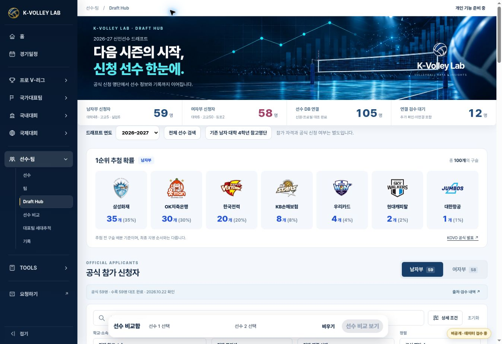
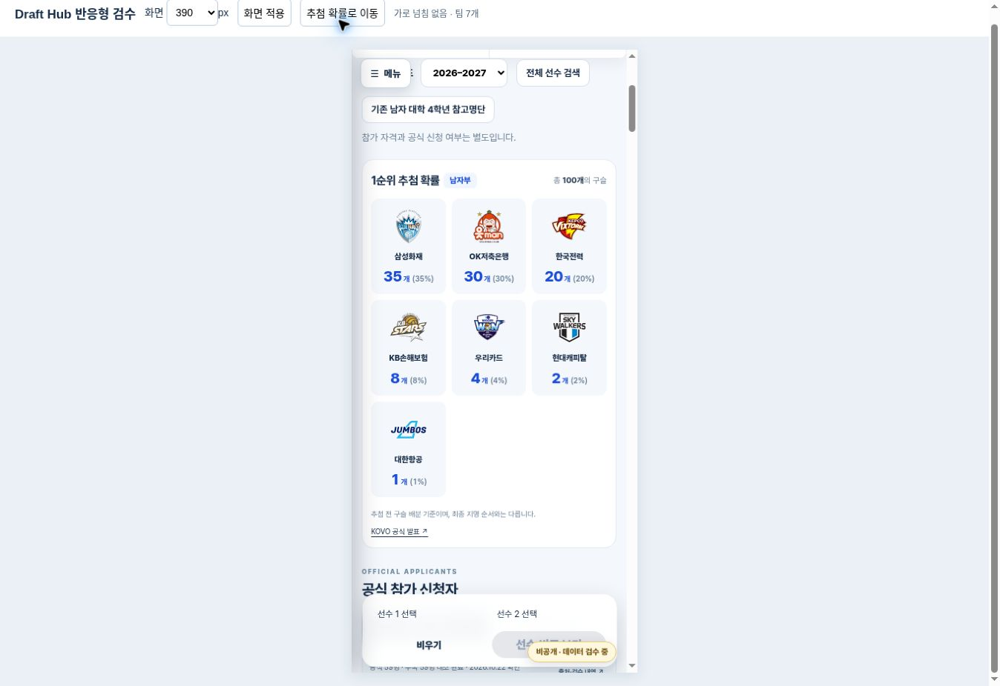

# Draft Hub 팀별 추첨 확률 카드 — 2026-10-26

Status: APPROVED / IMPLEMENTED / VERIFIED. 2026-10-26 사용자 운영 적용 승인. 배포 결과와 실제 페이지 확인은 PR #166에 기록한다.

기준 main: `a986092fd8f4dd0f8ba8c36b7779785f45cd23cf`.
브랜치: `feature/draft-lottery-team-cards`.

드래프트 연도 아래, 공식 참가 신청자 위에 팀 로고 → 팀명 → 구슬 수(확률)를 추가했다. 기존 Home Hero, 공통 메뉴, 검색/정렬/표시 방식 및 프로필 URL은 유지한다. 데스크톱 7열, 중간 폭 4열, 모바일 3열이다.

## 출처와 범위

- Drive `KVL_운영원칙_MASTER_v14`, 기존 드래프트 원본 폴더 `1Ou9m5whZezAYE5kzVHu63p6UMy5u7gnU` 확인. 기존 신청자 PDF와 MASTER는 변경하지 않았다.
- [KOVO 공시 157978](https://kovo.co.kr/news/kovo/press/157978)의 공개 API 본문을 2026-10-26 재확인: 삼성화재 35%, OK저축은행 30%, 한국전력 20%, KB손해보험 8%, 우리카드 4%, 현대캐피탈 2%, 대한항공 1%. API 게시일은 2026-10-22이며 10월 21일 언론 보도와 구분한다.
- 구슬 총 100개는 [스포츠동아 보도](https://m.ezday.co.kr/bbs/view_board.html?q_id_info=1351&q_sq_board=9433073&srh%5Bpage%5D=10&srh%5Bscal%5D=20&srh%5Bsort%5D=date)와 대조했다. 구슬 수 ÷ 전체 구슬 수 × 100으로 확률을 표시한다.
- 로고와 코드는 기존 `data/competitions/v-league-men-2026-27/data.json`의 참가팀 및 SVG를 재사용했다. 자산 변경 없음.
- 요청 URL인 **2026-27 남자부**에만 추가했다. 여자부/미등록 시즌에는 남자부 배분이 표시되지 않는다. 지명권 거래 이후 소유권이나 실제 지명 결과를 추정하지 않는다.
- 추첨 정보 로딩은 신청자 로딩과 독립적이다. 누락·오류·잘못된 합계가 있으면 추첨 영역만 숨긴다.

## 검증

```sh
KVL_JSDOM_PATH=/workspace/scratch/8e56d2ae74d7/kvl-dom-qa/node_modules/jsdom node --test tests/draft-lottery.test.mjs tests/draft-applicants.test.mjs tests/draft-profile-routing.test.mjs
```

**12 passed / 0 failed.**

- 7팀, 총 100개·100%; 기존 팀명/코드/로고 경로 일치.
- 다른 시즌·출처 누락·중복 팀·잘못된 합계·외부 로고 URL 거부.
- 로고/팀명/구슬 수/확률 순서, 여자부 전환 시 제거, 남자부 복귀 시 7팀 복원.
- 추첨 JSON 404·네트워크 오류·잘못된 JSON 내용은 신청자 기능을 차단하지 않음.
- 기존 신청자 **남 59 / 여 58 / 총 117**, 연결 **105 / 검수 대기 12** 유지. 연결된 105건 전부 기존 profile renderer에서 정확한 선수 이름 확인.
- 신청/지명 결과 분리, 필터·정렬·CSV, 미검증 선수 프로필 차단 검사 유지.

브라우저 검수는 실제 파일을 Sites 관리 미리보기에서 실행했다. 모바일은 390px/360px 실제 폭 iframe이며 실물 단말 검사는 아니다.

| 검사 | 결과 |
|---|---|
| PC | 연도 → 추첨 확률 → 신청자 순서, 로고 7개 로딩, 가로 넘침 없음 |
| 390px | 내부 가용 폭 375px = scrollWidth; 팀명·수치 잘림 없음 |
| 360px | 내부 가용 폭 345px = scrollWidth; 팀명·수치 잘림 없음 |
| 성별 | 여자부 58명 전환 시 추첨 숨김, 남자부 복귀 시 59명/7팀 |
| 검색/URL | 윤경 검색 1명; 기존 `KVL-P-000008` 및 필터가 담긴 return URL 유지 |
| 데이터 보호 | 신청자·player-links·results·선수 MASTER·다른 페이지·공통 메뉴·로고 변경 없음 |




## 추가 통합 검사 및 기존 CI 제한

기존 `tests/player-integration.test.mjs`와 신규 추첨 검사를 함께 실행한 결과 **18 통과 / 1 실패**다. 실패는 역사적 전체 사이트 해시 동결 검사이며 첫 불일치는 이번 PR에서 변경하지 않은 `assets/js/kvl-competition-components-v2.js`다. 작업 전 main `a986092`도 같은 스냅샷과 12개 파일이 불일치함을 직접 비교했다. 선수 검색·1842개 ID·신청자 3가지 표시·기존 대학 참고명단·회원 정보 비공개·복귀 URL 검사는 모두 통과했다.

GitHub의 기존 등록 자동화도 별도 실패한다: Kyungil `len(master) == 78`, SKKU `Expected 16 ... got 127`, 대학 batch 저장 `sha` 누락. 원장과 무관한 UI 요청이므로 이 자동화와 과거 스냅샷을 임의로 수정하지 않았다. 전체 GitHub CI가 통과했다고 주장하지 않는다. 구체적인 run 및 최신 결과는 PR에 기록한다.

## 운영 적용과 복구

운영에 필요한 파일은 **5개**다: `draft-hub.html`, `assets/css/draft-hub-v2.css`, `assets/js/draft-hub-v2.mjs`, `assets/js/draft-lottery-v1.mjs`, `data/draft-applicants/2026-27/lottery.json`.

2026-10-26 사용자가 “반영해”로 운영 적용을 승인했다. 최신 main `6fd91376ca7eb1d22e1727240e5bd31066dd7ae1`의 중고대회 변경을 보존하여 통합했다. 기존 원격 검사에서 Python 14개 통과, Node 29개 통과/1개 과거 전체 파일 동결 검사 실패를 확인했다. 선수 1842명 전체 프로필 검사는 통과했다. 기존 실패 원인을 숨기거나 검사 기준을 완화하지 않고, 승인된 추첨 카드만 배포한다. 복구는 이 변경의 PR revert이며 선수 데이터 복구는 필요 없다.
