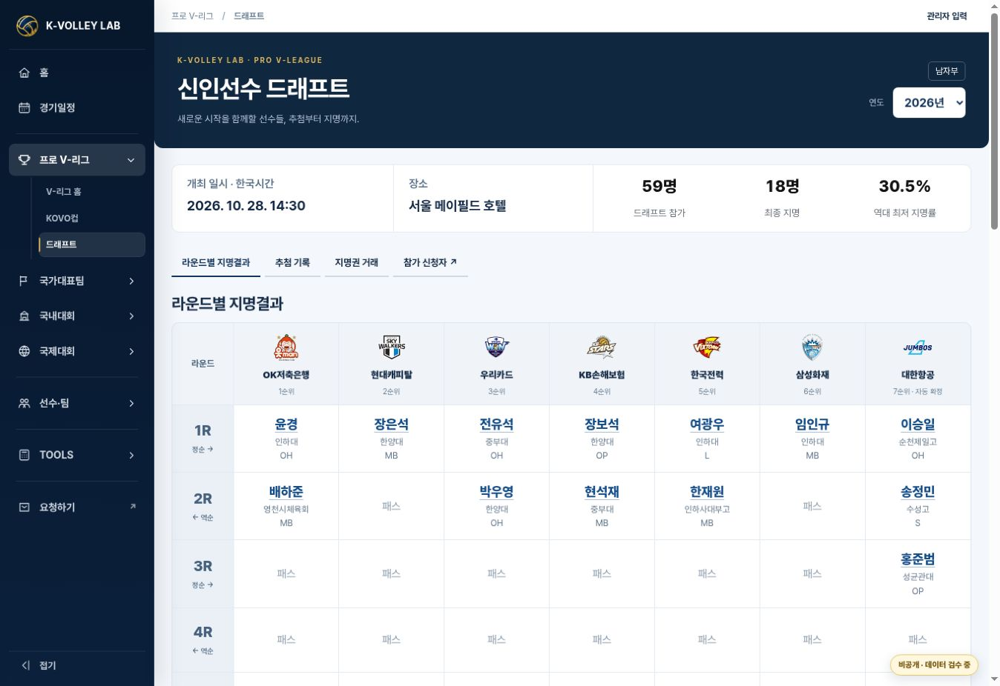
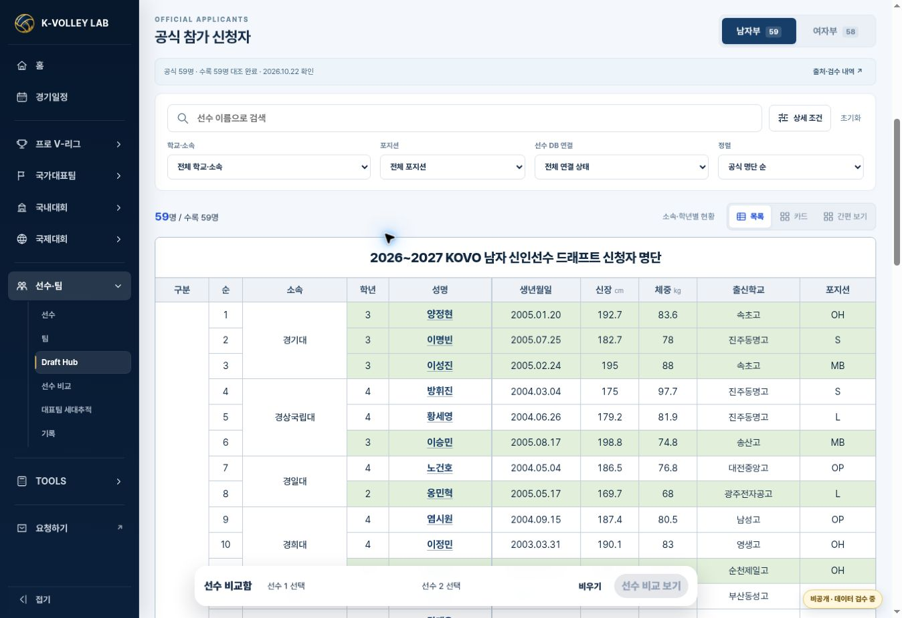
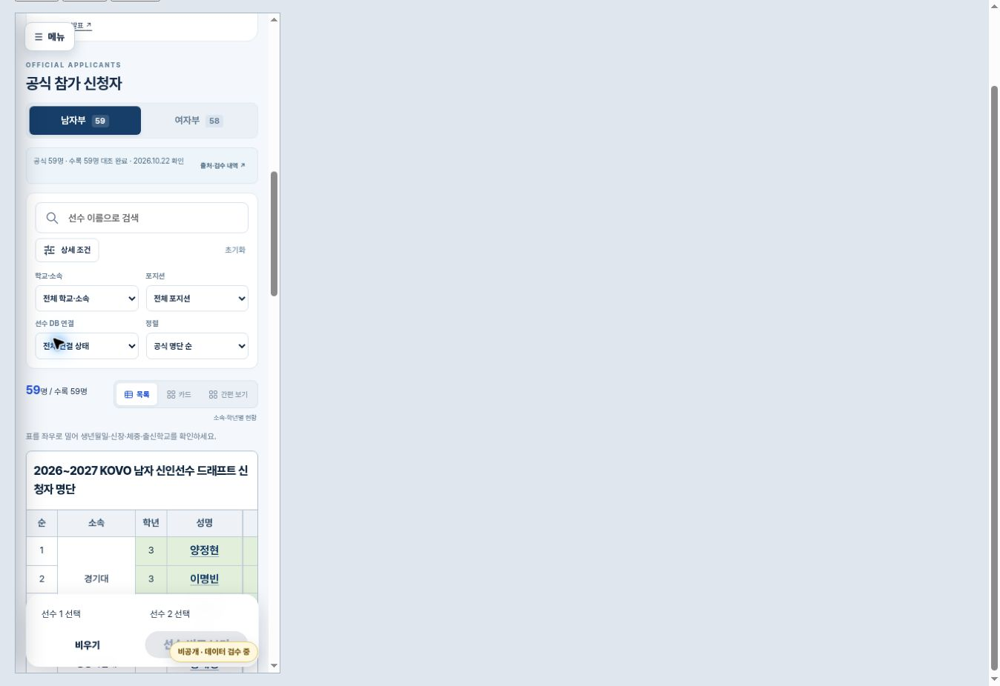

# 드래프트 요약 지표·공식 신청자 목록 검수 · 2026-10-30

Status: IMPLEMENTED / VERIFIED / PRIVATE PREVIEW DEPLOYED / READY FOR REVIEW. 운영 main 병합·kvolleylab.com 배포는 미실시다.

## 요청과 구현

- 사용자 첨부 사진에 따라 기존 신청·지명 문장을 `59명 / 드래프트 참가`, `18명 / 최종 지명`, `30.5% / 역대 최저 지명률`의 3열 숫자·설명으로 대체했다. 숫자는 검증된 신청자 수와 일반 지명+수련선수 결과에서 계산한다. 신청자 수 미확인·0명, 지명 진행 중, 다른 시즌/인원에서는 검증되지 않은 역대 최저 문구를 붙이지 않는다.
- 드래프트의 상단·하단 참가 신청자 링크는 같은 시즌·부문의 `layout=table&sort=source#applicants`로 이동한다. 기존 카드 선택을 저장했더라도 이 진입에서는 공식 명단 순 목록이 열린다.
- 남자 명단은 사진의 10개 열(구분·순·소속·학년·성명·생년월일·신장·체중·출신학교·포지션), 소속별 행 묶음, 대상 선수 29명의 초록 음영을 재현했다. 인쇄 사진의 워터마크는 화면에 넣지 않았다.
- PC는 10열을 비교하고, 모바일은 반복되는 구분 열을 숨겨 순번·소속·학년·이름을 먼저 표시한다. 상세 열은 가로 스크롤하고 이름은 왼쪽에 고정한다. 신청자 수는 기존 명단 상단에 유지한다.
- 검색·필터·정렬·카드·간편 보기·여자부 목록·검증된 프로필 링크를 유지했다. 검색/정렬 뒤 소속 rowspan을 다시 계산하고 원래 명단 순번을 보존한다. 남자 59명 중 기존 검증된 53명만 프로필 링크를 제공한다.

## 대조 자료

이번 요청의 두 첨부 이미지를 직접 확인했다. 지표 사진과 59명 명단 사진의 배치·열·그룹·음영을 대조했다. 이전 2026-10-29 결과표 사진 미확인 기록은 당시의 기록이며, 이번 명단 사진 검수와 구분한다.

- 공식 명단: [KOVO 2026-27 남자 신청자 명단](https://kovo.co.kr/news/kovo/press/157978), 발표 2026-10-22. 기존 [Drive 원본 PDF](https://drive.google.com/file/d/1sGnKB0K3Fj7HanEOWLPAcBW_nmGIzm9I/view?usp=drivesdk)의 59행과 첨부 사진을 대조했다.
- PDF SHA-256: `009c70f46be12eda11939ee84a5e489257ff676f68728d2c1494e3be4d60b26e`.
- 기존 신청자와 이름·소속·순번·생년·학년·신장·포지션을 대조한 뒤 생년월일·체중·출신학교만 별도 `list-details.json`에 추가했다. 현재 선수 프로필의 소속/신체 정보를 신청 당시 사실로 대신 넣지 않는다. 각 행에 원본 신청자 ID·출처 ID·PUBLIC/VERIFIED를 보존한다.
- 역대 최저 지명률: [연합뉴스 2026-10-29 보도](https://www.yna.co.kr/view/AKR20261029156100007)의 남자 59명 중 18명(수련선수 포함), 30.51%와 역대 최저 설명을 확인했다. 화면은 소수점 한 자리 30.5%다. 시즌별 `selection_summary`에 근거와 확인 인원을 보관하고 일치할 때만 표시한다.
- 기존 Drive MASTER v16(최종 수정 2026-10-27) 운영·공개등급·신원 보존 원칙을 읽었다. MASTER 및 기존 신청자/선수 원본에는 쓰지 않았다.

## 검증

관련 Node 검사 **67 passed / 0 failed**. 양도·맞교환·재양도·취소, 권리 수·단일 보유팀, 지명 당시 실제 팀 보존, 중복 추첨·자동 7순위, 관리자 폼·저장·충돌과 기존 신청자·구슬 배분 검사를 포함한다.

추가 검사는 3개 지표의 계산·미확인/0명·상태/시즌/인원에 따른 문구, 59개 상세자료 신원·출처 검증, 행 묶음과 29개 음영, 53개 기존 프로필 링크, 검색/정렬/표시 방식/여자부 전환, 상세자료 503 실패 시 명단 유지와 미확인 표시를 검증한다. 상세자료가 실패해도 현재 프로필 데이터로 빈칸을 임의 보충하지 않는다.

실제 브라우저에서 상단 참가 신청자 클릭 → 공식 순번 목록 진입, 데스크톱 10열·59행·53개 링크, 360px/390px 문서 가로 넘침 없음, 표 내부 가로 스크롤, 모바일 선수 검색(윤경 → 공식 순번25·기존 Player ID)을 확인했다. JavaScript 구문 검사와 `git diff --check`도 통과했다. 물리 모바일 기기 및 원격 소유자 로그인 이후 검수는 NOT VERIFIED다. 동일 정적 코드의 로컬 브라우저를 검수했다.

실행:

```sh
node --experimental-vm-modules --test tests/draft-board.test.mjs tests/draft-board-store.test.mjs tests/draft-board-ui.test.mjs tests/draft-board-observed.test.mjs tests/draft-applicant-list.test.mjs tests/draft-applicants.test.mjs tests/draft-lottery.test.mjs
```

JSDOM은 기존 QA 의존성을 `KVL_JSDOM_PATH`로 지정했다. GitHub Actions의 draft-board 검사에도 새 목록 검사를 추가했다. 원격 CI 결과는 PR에 기록하며 관련 검사 통과를 전체 기존 CI 통과로 표현하지 않는다.

원격 head `c3eade2336adb9b8a675a016726657dd6a774ee0`의 [draft-board 검사](https://github.com/kvolleylab/kvolleylab/actions/runs/40999340131)는 **56 passed / 0 failed**다. 모바일에서 윤경 이름을 클릭해 기존 윤경 프로필과 신청 명단으로 돌아가기 링크도 확인했다.

최신 main의 공개 데이터 gate는 이 PR의 JSON 6개에 검수 manifest가 없음을 감지했다. 공식 59명 상세자료와 경로만 담은 신청자/드래프트 index 2개는 실제 대조 근거·정확한 SHA-256을 manifest에 기록하고 검사 통과를 확인했다. 기존 현장 수입 원본의 `record_status=user_observed`, 현장 결과 men.json 및 관련 sources.json은 공식 최종자료 대조가 남아 있어 **미확인 3개 파일로 유지**한다. 이들을 VERIFIED로 바꾸거나 검사 규칙을 완화하지 않았다. 따라서 전체 공개 export gate 및 운영 release는 통과 상태가 아니다. 기존 전체 감사의 미해결 항목과 이 공개 전 확인 필요 항목은 PR에 구분한다.







## 범위·배포·복구

- 최신 검토 main: `dd49cabf9af4e96b0d7e1a38862ec0213e40455b`. 기존 기능 head: `4f4a29c99fa152ce321011308fe2b0d3e0187d87`. 최신 main의 Quality Audit 및 공지 변경을 보존해 기능 브랜치에 통합했다. 공통 결정 로그는 양쪽 기록을 모두 유지했다.
- 원지명권·추첨·지명·트레이드 저장 자료와 Player ID/MASTER/신청자 원본은 변경하지 않았다. 입력 브랜치는 `e3a16fa8a37b8e2142502a9bf6d0361398de1e70`, revision58을 유지한다. 이번 작업은 런타임 저장 쓰기가 필요 없는 표시·출처 상세자료 변경이다.
- [소유자 전용 미리보기](https://kvl-rookie-draft-review.daewook1029.chatgpt.site/) 배포 succeeded. 접근 범위를 유지했다. Site source `61feb51fc40c7f33e2cab630978eec56014e5800`, deployment `appgdep_6ae4122b81c88191851c1a2413a09898`.
- [Draft PR #199](https://github.com/kvolleylab/kvolleylab/pull/199)에 이어서 보존한다. 운영 배포는 AGENTS.md 7번에 따라 승인 후 진행한다. 이번 작업 완료를 운영 배포 완료로 표시하지 않는다.
- 복구는 이 변경의 표시 코드·상세자료·index 항목을 되돌리는 새 커밋으로 수행한다. 기존 신청자와 운영 입력 브랜치를 초기화하거나 강제 덮어쓰지 않는다. 이전 Site source는 `884f57ef09988a86b7b5a4470c23f4ef1038e93d`다.
