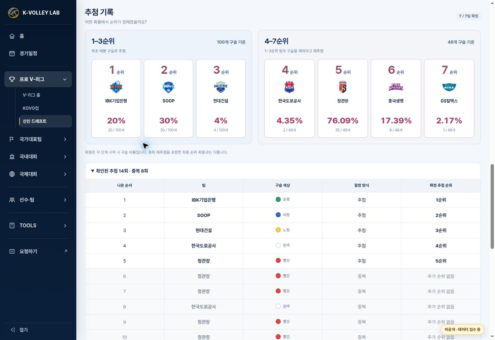

# Women draft observation release evidence — 2026-10-30

Status: DEPLOYED / LIVE VERIFIED.

The owner's previously approved operating-site release was continued for the supplied fourteen-ball video transcription and allocation screenshot. [Implementation and recovery](draft-women-draws-20261030.md).

- PR [#209](https://github.com/kvolleylab/kvolleylab/pull/209), source head `b6aba4eb1dd979bfc7bc05c9c3390c14d3aaa8ef`, merged as `bb2c8a64d0deb739a367483a5add9a2a8d2b79fc`. Source tree exactly matched the locally tested tree `8791b005b6199805f2fcea23bef803837404d6f7`.
- GitHub Pages [41072951039](https://github.com/kvolleylab/kvolleylab/actions/runs/41072951039): build, report and deploy all succeeded.
- Runtime `data/draft-board` commit `76f596a4d8a6e082a85083b2ccae8427d4df1de5`, women revision68, men revision60. Re-read both files from GitHub; bytes equal the reviewed data. All28 original/current/actual-team rights, players, trades, trainees and men data remain unchanged.
- Private review Site source `704173d6454db9d95bc5d7949e166e17e5dad1d7`, deployment `appgdep_6ae4aab07d908191af8ed1e185472ecf` succeeded. Existing owner-only audience unchanged. Temporary snapshot harness removed before packaging.
- Local and CI relevant tests65/65 PASS; [draft-board CI](https://github.com/kvolleylab/kvolleylab/actions/runs/41072386667) job124119548838 succeeded. [Quality Audit](https://github.com/kvolleylab/kvolleylab/actions/runs/41072386562) and public JSON gate succeeded.
- Existing identity-and-routing suite remains29/30: common CSS hash baseline expected7d099226… but actual760e4259…; main and this branch have the same bytes. Existing unrelated registration/university and invalid push workflows remain outside this change.

## Live verification

[Operating women's draft](https://kvolleylab.com/v-league-draft.html?season=2026-27&gender=W#draftDraws) was opened after successful Pages deployment and reloaded. Actual page module version `20261030-women-draws-1` was visible.

- Summary: `확인된 추첨 14회 · 중복 8회`.
- DOM:14 actual draw rows,8 duplicate rows, last row `14 / 흥국생명 / 보라 / 추첨 / 6순위`.
- Colors: 정관장 빨강, SOOP 파랑, IBK 초록, 흥국생명 보라, 현대건설 노랑, 도로공사 흰색, GS 검정.
- Official7 ranks and staged100/46 proportions preserved. No fake GS raw row; seventh determination remains unknown.
- Three historical exchange summaries intact. Public1R/2R/3R and trainees displayed; all-pass4R stays hidden and all28 rights remain stored.
- 390px/360px actual-module responsive checks had no body overflow; table had its own horizontal scroll and sticky round label. Runtime-backed local page also reloaded with14/8, without snapshot interception.

The visible private-review badge is the pre-existing site-wide navigation setting, not a deployment status added by this release. The observation provenance is the supplied transcript and inspected attachment; no claim of direct full-video playback is made.
