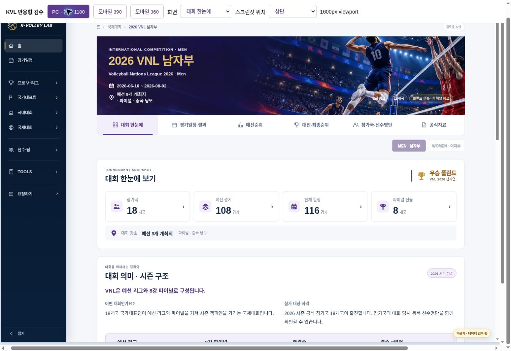
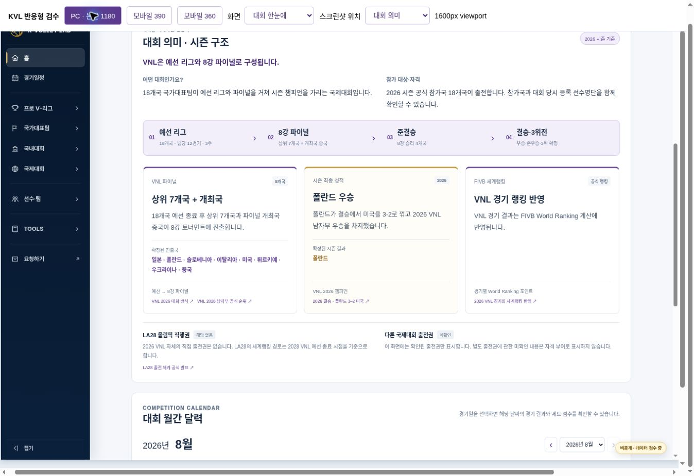
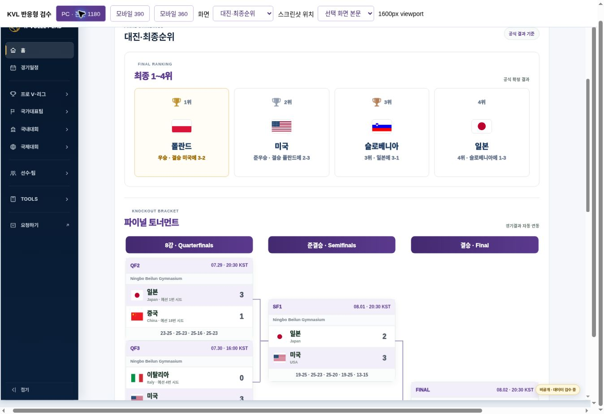
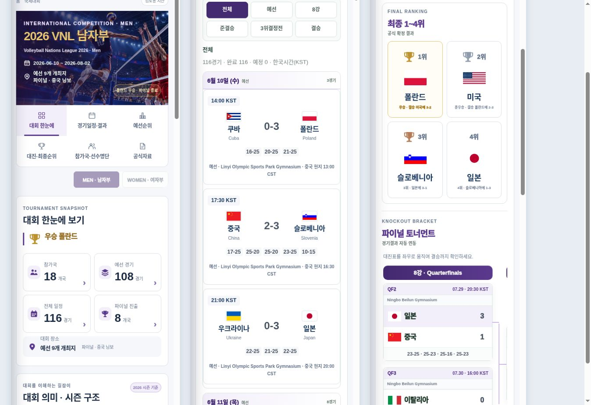

# 2026 VNL 남자부 국제 템플릿 시안 검수

2026-10-31 · **READY FOR REVIEW / KVL 운영 NOT DEPLOYED**

기준 main `757f0d2e668ed79a529e2f9554f5f02e9828253d`. 새 파일만 추가했다. `vnl.html`, AVC 남녀 Production, 국내대회, 공통 V2 CSS/JS, 기존 config/data/ID 및 Drive MASTER는 변경하지 않았다.

시안: https://kvl-international-vnl-review-v1.daewook1029.chatgpt.site

개정안: [international-template-v3-proposal.md](../international-template-v3-proposal.md)

## 검증 결과

| 검증 | 결과 |
| --- | --- |
| PC 본문 1180px / 390px / 360px × 6개 기능 | **18/18 통과**. 활성 탭·표시·이미지와 문서 폭 검사 |
| 문서 가로 넘침 | 없음. PC client/scroll 1585/1585; 390 프레임 375/375; 360 프레임 345/345. 검수 브라우저의 15px 세로 스크롤바 포함 |
| 표·대진표 | 각 영역 내부 스크롤. 360px 순위표 287/940, 대진표 289/826, 명단 267/896 (client/scroll) |
| 경기행 정렬 | 116경기 전체 PC 국기 좌측 x=536, 스코어 x=805, 국기 우측 x=1092, 세트 x=1193으로 동일. 국가명 잘림 0 |
| 스코어 | computed `rgb(75, 85, 99)` = `#4B5563`; 모바일 24px |
| 원문 보존 | meaning 제목·요약 및 qualifications 3개의 brand/pill/title/description/foot/resultTeams 보존. DOM 원문 확인. 기본 닫힌 details 없음 |
| 설명 위치 | 기본 정보·요약 아래, 월간 달력 바로 위. 4단계 흐름 모바일 세로 표시 |
| 달력 | 종료 상태 마지막 경기 월인 8월 기본. 6월 선택·경기일 클릭으로 기존 schedule 날짜 링크 이동 유지. 날짜 링크는 원래의 전체 일정+날짜 위치 이동 동작이며 별도 데이터 필터로 바꾸지 않음 |
| 단계 필터 | 전체 116 → 예선 108 정상; 결선 집계 제외 |
| 예선 데이터 | 108경기만 재집계. 18개국 모두 12경기, 저장된 승수·승점과 일치 |
| 최종순위 | 1~4위 트로피/순위, 전체 18위, 8강 사다리와 3위전 유지. 4위 숨김 충돌 수정. 공동 순위는 실제 rank 중복일 때만 표시 |
| 참가국·선수 | 18개국 가나다순·검색. 폴란드 검색 1개국, 선택 시 16명 및 16개 기존 KVL Player ID 링크. 전체 284명 원본 유지 |
| 프로필 연결 | 기존 `KVL-P-*`에만 `player.html?id=` 연결. 임시 VNL26 ID는 새 프로필을 만들지 않음. 기존 VB/공식 링크 유지 |
| 상태 전환 | 모델 수준 예정/진행/종료 및 부분 확정 순위 검증. 미래 대회에 종료 결과를 노출하지 않음 |
| 다른 국제대회 | AVC/FIVB/GAMES × 남녀 6개 비운영 설정 fixture 검증. VNL 단계/진출 수가 공통 계약에 없음 |
| 자동 검증 | **13/13 통과**, JS 문법 검사 통과 |
| 운영 영향 | 기록한 main 대비 기존 파일 변경 0. 프로토타입 HTML에서만 독립 CSS/JS 및 adapter 로드 |

브라우저 원자료: [18-case JSON](international-vnl-browser-v1.json). 계약·보존 검증: [자동 결과](international-vnl-checks-v1.json). 검증 명령: `node scripts/verify-international-review-v1.cjs`.

## 주요 화면

캡처는 실제 브라우저 화면이다. PC 검수 도구의 축소 프레임/바깥 스크롤바는 운영 화면 요소가 아니다. 모바일 나란히 보기는 동일 데이터를 렌더링한 별도 검수 도구다.

## 기존 화면 대비

- 국내의 카드·탭·정보 위계·여백을 국제용 보라색 토큰으로 구성했다.
- 중요 원문을 유지하면서 요약→단계→원문→확정 결과/근거 순서로 읽는다.
- 3개월 달력을 한 월씩 선택하도록 정리하고 종료 시 마지막 경기 월을 보여준다.
- 국기/국가명/점수/세트의 고정 정렬 축과 모바일 줄바꿈을 적용했다.
- 최종 1~4위와 전체 18위, 검색 가능한 참가국, 기존 선수 프로필을 연결했다.
- 테마는 기존 FIVB purple, 여자부 우선 Rose, 일반 점수 중립색을 따른다. MASTER의 경기·순위·명단 값은 그대로다.

## 남은 사항과 승인 이후

1. Drive 일정 MASTER는 7/21판이다. 최신 종료 JSON과의 정식 동기화는 별도 데이터 작업이며 이번에는 수정하지 않았다.
2. 공식 순위 사이트와 JSON의 세트/점수 비율 절사·반올림 차이는 별도 표시 정책 검토 항목이다. 기존 비율을 바꾸지 않았다.
3. 기존 임시 Player ID·소속팀 미확인 표시를 보존했다. 추가 매핑을 임의로 만들지 않았다.
4. 실제 인쇄/PDF, 모든 브라우저, 다른 대회의 모든 대진 방식 UI는 이번 검수 범위가 아니다. 기존 과거 print gate를 통과했다고 주장하지 않는다.
5. 사용자 승인 후 공통 국제 표시 모듈을 승격하는 별도 release PR과 지정 대회별 선택 적용·회귀 검증이 필요하다. 이 PR은 운영 반영 승인이 아니다.

복구: 현재 프로토타입은 분리된 브랜치·호스트만 제거하면 된다. 운영 데이터 복구가 필요하지 않다. 향후 적용은 대상 config의 presentation 선택 해제로 롤백한다.
