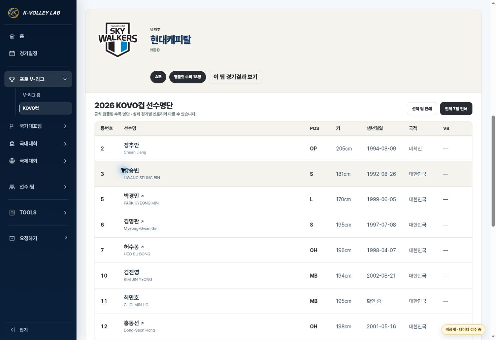
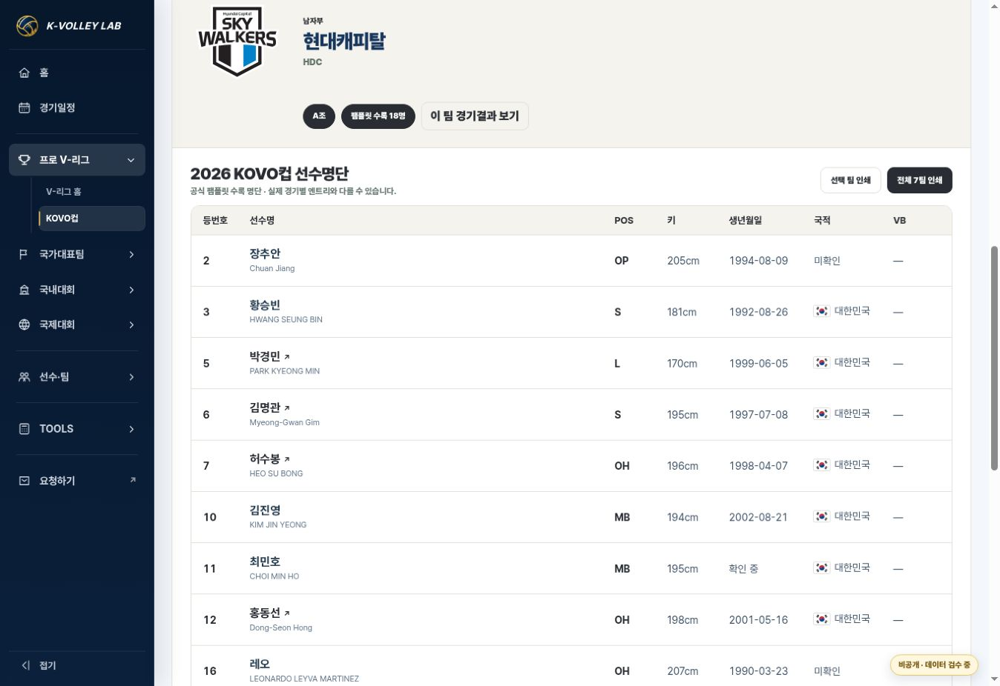

# KOVO컵 참가팀 선수명단 — 2026-10-27

Status: IMPLEMENTED / VERIFIED / RELEASE AUTHORIZED (2026-10-28). Merge, CI and live deployment evidence will be recorded in the release PR.

Base: `b157b31816d8e21fbb922c4605b22e7110c68d59`; branch: `feature/kovo-cup-rosters-20261027`. Implementation commit: `aeee9cb4336cb286a089aae85c0fd2d017ce9b5e`. Release follows the owner's explicit publication approval on 2026-10-28.

## Behavior and scope

- Existing Cup men/women participant cards open a shared club roster below the full team list on desktop and mobile. Selection, close, direct URLs, history, search, team results and print reuse the common engine.
- PC: number, Korean/English name, position, height, DOB, nationality, Volleybox. Mobile 360/390px: number/name/position/height with native details for the remaining fields.
- Two data-only `rosters` modules contain 130 men and 121 women across 14 clubs. Team codes and competition IDs remain unchanged.
- Only the two Cup configs opt into `profile=club` and `placement=below-participants`. School mobile accordion and international roster columns remain as before. V-League season data, matches, standings, Hero assets and Player Masters are unchanged.

## Source review

Current GitHub main, AGENTS/PROJECT_RULES/workflow/design and decision log, Drive operation MASTER v15, existing pro team sheets and archived 56-page official Cup pamphlet were inspected. The existing 2026-10-26 comparison workbook was read without mutation and all 14 player pages (23,25,27,29,31,33,35,37,39,41,43,45,47,49) were visually reviewed against the source.

Source: `KVL-SRC-KOVOCUP-2026-PAMPHLET`. Published audit: `data/sources/kovo-cup-2026/roster-audit.json` contains page references, source/comparison SHA-256, team counts and unresolved identity/source differences. Original PDF/XLSX and authenticated archive URLs are not committed. The reproducible builder is `scripts/build-kovo-cup-rosters-2026.py` (read-only openpyxl input).

English names, explicit country values and valid Volleybox links are supplementary fields from existing team sheets, matched by name + prior DOB. The legacy country field is not a claim that the pamphlet states nationality; absent country values remain unknown. Four extra English names were checked directly in the pamphlet. No nationality or player identity is inferred from a name.

54 links reuse existing active canonical IDs with exact name + DOB. The other 197 names have no profile link. Five differing DOBs (최민호·하승우·박상우·정호영·표승주) and 김채원's lunar-date issue display ‘확인 중’. The UI says ‘공식 팸플릿 수록 명단’ and explicitly distinguishes match-day entries and current membership. No athlete release/absence is inferred.

## Verification

- 10/10 new tests: all 14 team counts and module loading; exact identity links; six DOB holds; desktop/mobile selection and placement; search hiding/restoration; route/history restoration; all-team print preserving 251 rows; source labels; existing VNL and school roster modes.
- 21/21 existing domestic-home-v2 tests passed (six university competitions, VNL non-opt-in behavior, calendar, preliminary standings and six-team final league).
- Existing Cup production data, domestic presentation prototype, pool geometry, desktop matchup alignment, config/module contract and team UX suites passed.
- Browser QA: desktop 1363px; responsive 390px men / 360px women in same-origin preview iframes. No horizontal body overflow. Team click, search, team switch, back navigation, deep link and pending DOB disclosure observed. This is viewport testing, not physical-device or mobile-UA testing.
- Print DOM pagination/content verified; native printer/PDF rendering not tested.
- Preview uses `sites-preview` at `http://terminal.local:4173/`. Only its untracked copy changes `production` to false because the localhost origin is HTTP; production contracts were separately validated with canonical HTTPS URLs. Source `competition-engine.html` remains production:true.

## Changed files and recovery

Common components JS, domestic CSS, engine cache versions, two Cup config/data pairs and roster modules, source audit/builder, focused tests/workflow, and current template/decision documentation. No event-specific renderer or CSS file is added.

Before merge, inspect current main and require production approval per AGENTS.md rule 7. After approval, merge this PR, verify the repository deployment and check both live participant routes. Rollback by reverting the feature commit (restoring the former pending roster config and shared assets); do not delete or renumber any Player IDs.

## Publication approval history

Automatic approval review rejected `git push` because player birth dates and related roster audit data were derived from the private Drive archive and explicit authorization to disclose them to the GitHub destination had not been established. No workaround or alternate upload was attempted. On 2026-10-28 the owner explicitly replied “선수정보 공개 승인” to the request covering roster data including DOB, the `kvolleylab/kvolleylab` repository and the operating website. Publication and production rollout are now authorized for this reviewed scope.

## 2026-10-28 · Nationality flags

Requested: show a flag beside nationality. Updated the common club nationality helper and CSS, including desktop cells, mobile disclosures and print. Reused the existing FlagCDN PNG convention with fixed 22×15px aspect-contained images and Korean country labels. Unknown nationality keeps text only. No player/source data was changed. The desktop country column is 96px; cache versions updated.

Latest remote main is still `b157b31816d8e21fbb922c4605b22e7110c68d59`; local pre-edit base is `a990e19`. Existing roster tests 10/10 and desktop layout smoke passed. Browser: all 16 HDC nationality images loaded; mobile 390px expanded nationality image loaded; women 360px has 13 flags and zero body overflow. Print uses the same renderer and its existing image-ready wait. This flag revision was completed before public upload. The owner subsequently approved publication as recorded above.

Rollback this follow-up by reverting its commit; the prior roster implementation remains intact.
