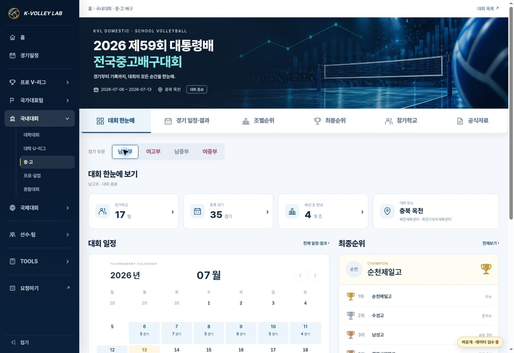
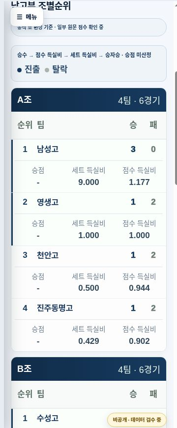

# 중·고 6개 대회 — 국내대회 기본 템플릿 적용

2026-10-26 · K-Volley Lab · APPROVED / IMPLEMENTED / VERIFIED. Production merge/Pages/live evidence is recorded in the release PR.

Base main: `a986092fd8f4dd0f8ba8c36b7779785f45cd23cf` (PR165). Branch: `feature/school-domestic-home-v2`. The user explicitly requested production integration.

## Scope and outcome

| 대회 | 정식 slug prefix | 부문별 등록 경기 (남고/여고/남중/여중) |
|---|---|---|
| CBS배 | cbs-2026 | 31 / 16 / 44 / 23 (부분 기록) |
| IBK배 | school-ibk-2026 | 28 / 22 / 23 / 23 |
| 대통령배 | school-presidents-2026 | 35 / 15 / 25 / 14 |
| 익산 2차 연맹전 | school-iksan-2026 | 39 / 12 / 31 / 20 |
| 삼척 1차 연맹전 | school-samcheok-2026 | 39 / 12 / 20 / 14 |
| 춘계연맹전 | school-spring-2026 | 31 / 14 / 38 / 31 |

Append `-high-men`, `-high-women`, `-middle-men`, or `-middle-women` to the prefix. Canonical entry is `competition-engine.html?competition=<slug>`. All six prior HTML URLs redirect with legacy division and tab parameters retained. Hub links point to the canonical entries directly.

Common engine/controller/presentation extended with four division links, school labels/hub route, optional combined-ranking suppression and accurate empty-state messages. No copied renderer. Shared existing home Hero assets are used, matching the hub; navy/rose division themes remain. School match scores use neutral gray. A missing registered school roster does not link to an unrelated university page.

Mobile standings retain all seven fields: rank, school, wins, losses, points, set ratio, point ratio. The last three appear beneath each school instead of being clipped. PC shows two pools per row. The mobile rank column reserves 42px so 순위 and 팀 remain separated; secondary field labels use 14px for readability. Existing larger fonts, trophies, default calendar month and mobile ladder behavior are retained.

## Data and sources

- `scripts/migrate-school-competitions-v2.cjs` reproducibly reads the deployed JS bundles and existing IBK knockout/group corrections. It generates 20 config/data pairs, then builds catalog summaries from all 24 detail payloads.
- Existing 486 match IDs, dates, stages, final scores and all supplied set points are preserved. The obsolete compact domestic JSON is not used as the detailed source: it lacked later-stage labels and some corrections. Legacy bundles remain in the repository.
- CBS's existing 114 matches, participants, standings, finalRanking and resource arrays are byte-equivalent as parsed JSON. Only presentation/copy/division links changed. No invented missing semifinal/group data. CBS remains explicitly marked partial; unmatched school-name variants are retained pending source review.
- New school codes are deterministic presentation routing keys (`SCH-…`), not newly registered Master IDs. Only aliases already in `school_logo_manifest_2026.json` are used. No player Master/ID/roster mutations.
- President/IBK groups use the existing defined groups. Spring/Samcheok/Iksan use existing match-graph grouping; the existing bundle order (including Samcheok A–D) is retained and the derived nature is disclosed. Group calculations keep win → point ratio → set ratio → head-to-head priority; set separator normalization accepts the existing colon and hyphen formats. No cross-group seeding table or unverified points formula is introduced.
- Four source conflicts: spring-2026-063, spring-2026-028, iksan-2026-056, presidents-2026-012. Original final score remains authoritative for displayed result. Original sets are preserved separately with a visible review note in schedule/calendar/team views. Production score validation is unchanged and still rejects unexplained mismatches.
- Read current Drive operations MASTER v14 (`1iu1aWoTdSf2L7VCco5X7pCPxs9qVlM9rskZ8_hI76FY`). Confirmed existing source archive folders for spring, Iksan, Samcheok, President and IBK and their score/rules inventories. CBS score-file metadata (`11KlT-eC7CWfDdkOQJXiPmT-D9e2HXP0U`) confirms the existing source snapshot modified September 1. No raw files copied, new source folders created or sharing permissions changed. This is a presentation/data-shape migration, not a fresh transcription or full official re-audit.

## Validation

- 33 school tests passed: all 24 production contracts and rendering/links/division themes; participant grouping/sorting/search; calendar dialog; original 486 match identities/scores/sets; every known QF/SF winner linked to its actual next game; 144 old route/tab combinations; source-conflict display/strict validation; Samcheok group order; catalog/detail summaries (600 registered records).
- Existing domestic suite: 19/19 passed. Covers Goseong/Danyang/U-league, international opt-out, KST calendar defaults, 49-match preliminary isolation, and U-league six-team league table.
- CBS core record arrays compared against the base commit; unchanged. Generated 20 payloads reproducible. `git diff --check` clean.
- Browser QA: desktop, 390px and 360px iframe viewports. Four division links retain tab. PC 8-team ladder and mobile six-team/byes preserved; navy/rose and trophy styles visible. Participant cards/record links, calendar dialog, hub links, CBS partial copy and domestic sidebar selection checked. Mobile stats have no document overflow; all ratios remain visible.
- Static local preview uses the production assets/data; preview copy alone disables HTTPS-canonical production validation because preview is HTTP. Production `competition-engine.html` remains `production:true`. 24 data contracts were independently tested with HTTPS canonicals and `production:true`.
- Existing repo data-registration workflow failures are unrelated to this presentation migration; current run evidence is recorded in the release PR. No fixes to unrelated data jobs are included.

## Screenshots

## Files and recovery

Changed shared presentation/controller/component code; school-specific config/data and route adapter; six compatibility wrappers; school hub/catalog; sidebar route recognition and cache keys; generator/tests/docs. University wrapper changes are cache keys only. Protected homepage/player/search files and source match bundles remain unchanged.

Rollback: revert the release merge PR to restore the six legacy pages, hub links/catalog and shared code. Do not delete original bundles or participant/player identities. Next data work is verification of CBS's remaining bracket/groups/name aliases and the four known source conflicts; this is separate from the completed template migration.
