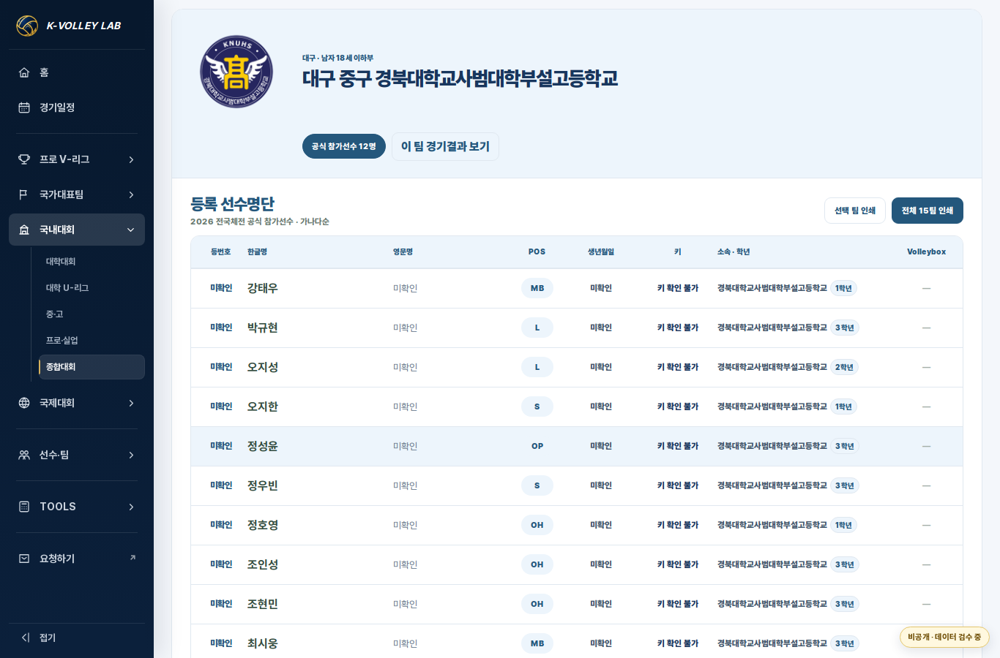
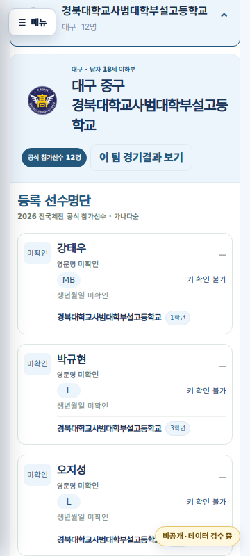

# 2026 확정 학교·대학 로고 연결 및 학교 소재지 표기

Status: APPROVED / IMPLEMENTED / VERIFIED (local). 배포 SHA·Pages 성공·실제 운영 URL 검수는 release PR에 별도로 기록한다.

Base main: `b9f9df95396f32743646dcdc16920e911e2e8a3c` (KOVO Cup preview; tree `05d301ac3c3e56a935fe238f223998c29bb600d6`). Local branch: `feature/verified-school-logos-2026`. 최초 준비 기준은 PR176 `f903465698d5d6f0f65db7f0e5586dbf771af927`이며 동시 작업을 보존해 최신 main 위로 rebase했다.

## 승인 범위와 결과

사용자가 2026년에 확인한 학교·대학·프로팀 로고의 통합 보관, 동일 이미지 규격 기록, 흐린 이미지 개선, 경북사대부고 현행 공식 교표 교체, 학교 소재지 표기, 남은 미확정 항목 설명 및 확정 로고의 실제 홈페이지 적용을 요청했다.

이번 홈페이지 자산은 남고·고등부 클럽 22개, 여고 12개, 남중 20개, 여중 11개, 여자대학부 6개로 총 71개다. 경북사대부고는 사용자가 지정한 남색 원형 안의 KNUHS·학교명·흰 날개 교표를 사용한다. 여자대학부와 같은 대학인 남자부의 표시 자산도 같은 학교 정체성에 따라 연결되며 성별·명단·선수 ID는 바뀌지 않는다.

이미지는 `assets/images/school-logos/2026/`에 기존 학교 이름의 PNG 파일명으로 저장하고 `data/master/school_logo_manifest_2026.json`에서 연결한다. 모두 512×512 RGBA, 실제 도안 긴 변 410px, 최소 바깥 여백 51px, 원래 가로세로 비율 유지, 중앙 정렬, 바깥 배경 투명, 내부 흰색과 분리된 도형·문자 보존 기준이다. 비정사각형 도안은 나머지 방향의 여백이 더 커진다. manifest에 확인 연도·일자, 학교 정식명, 소재지, 공식 출처 및 파일 해시를 보관한다.

기존 프로팀 남녀 14개 SVG는 V-리그와 KOVO컵이 이미 동일 경로를 공유한다. `/assets/img/team-logos/v-league/2026-27/{men,women}/{code}.svg`와 기존 프로팀 resolver는 유지한다. 통합 보관용 PNG 제작은 홈페이지의 정상 SVG 경로를 교체할 이유가 되지 않는다.

품질 개선 검토에서 승인된 3개만 교체했다. 진주동명중은 공식 헤더와 대조한 더 큰 중학교 교표, 중앙여중은 공식 학교·재단 공통 교표, 경북사대부고는 사용자가 지정한 현행 공식 교표다. 부산여중·포항여중·대구여고의 선명한 후보는 공식 게시 도안과 색상 차이가 있어 자동 교체하지 않았다. 하동중·천안청수고·포항여고·전주근영중·광주체육중·광주체육고·제천산업고는 더 나은 동일 도안을 확보하지 못해 기존 검증본을 유지한다. 원래 저해상도인 도안의 모든 세부가 복원됐다고 주장하지 않는다.

## 공통 구현

- 기존 `school-logo-runtime.js`의 manifest를 채우고 해당 runtime을 재사용한다. 새 대회 엔진이나 별도 팀 ID 체계를 만들지 않는다.
- 공통 loader는 국내대회에서 확인한 표시 정보(`logo`, `schoolDisplayName`, `schoolRegion`, `logoVerifiedAt`)만 추가한 뒤 기존 normalize/render 흐름을 실행한다. 프로·국제대회 데이터에는 적용하지 않는다.
- 공통 팀 경기결과, 등록 선수명단, 인쇄 명단 제목과 기존 `team-detail.html` 제목에 확인된 소재지 + 정식 학교명을 사용한다. 예: **경북 영천 금호중학교**. 기존 참가자 표시명, URL의 team code, 원문 지역, 경기·선수·명단 관계는 유지한다.
- 전국체전의 대표 시·도는 기존 `region` 필드로 유지하며, 학교의 상세 소재지는 별도 표시 필드다. 참가 시·도가 학교의 확인된 소재지와 다르면 같은 이름이어도 로고를 임의 연결하지 않는다.
- 기존의 `aliases` 객체는 ID 생성 등 다른 소비자에 영향을 주지 않도록 그대로 둔다. 공식 정식명과 명확한 축약명은 표시용 lookup으로만 읽는다.
- 재사용 DOM 요소의 학교명이 바뀔 때 로고를 갱신하고, 새로 삽입된 로고 요소 자체도 처리한다. 미확정 이름 또는 이미지 로드 실패 시 기존 이니셜로 돌아간다. manifest가 로드되지 않아도 대회 자체는 기존 fallback으로 표시한다.
- 기존 구형 대학 페이지는 `university_brand_sources_2026.json`의 해당 6개 대학 자산을 같은 PNG에 연결한다. 다른 대학의 기존 자산은 유지한다.

## 출처로 확인한 대회별 별칭

별칭은 아래 대회의 기존 `competitionId`에만 적용한다. 참가 레코드를 합치거나 원문 학교명·코드·경기 ID·명단·조·순위를 수정하지 않는다.

| 대회/부문 | 사이트 원문 | 확정 표시 로고 |
|---|---|---|
| CBS 남고 | 화성시체육회 | 화성시-G스포츠클럽 |
| CBS 남고 | 광주전자고 | 광주전자공고 |
| CBS 남고 | 체천산업고 | 제천산업고 |
| CBS 남중 | 찬안쌍용중 | 천안쌍용중 |
| 춘계 남중 | 동명중 | 진주동명중 |
| 춘계 남중 | 경부사대부중 | 경북사대부설중 |
| 춘계 여중 | 근영중 | 전주근영중 |

CBS는 공식 조별현황·대진표 HWP와 원본 점수표 XLSX의 경기 일자·상대·셀을 교차 대조했다. 춘계는 원본 점수표와 발표 조별현황·대진표 재현(secondary)을 교차 대조했다. 특히 ‘화성시체육회’는 다른 대회·종목에도 쓰이는 이름이므로 전역 alias로 등록하지 않는다. 춘계의 기존 사이트 조명과 발표 원조명 차이는 이 로고 작업에서 변경하지 않는다.

## 남은 범위

이번 CBS 기반 원본 목록에서 로고를 확정하지 못한 것은 **모종중·홍천군체육회 U15·목포영화중**이다. 원문 `목퐁영화중`도 임의 연결하지 않는다. 학교 외 클럽이나 체육회 기관 마크를 학교 교표로 대체하지 않는다.

기존 사이트의 다른 대회에는 이번 확인 목록 밖의 학교도 있다. 금정중·제천중·문흥중·함안중, 추가 여자중·고교, 초등부와 동의대 등은 이 작업으로 확인됐다고 주장하지 않는다. 이번에 확인한 학교의 소재지 표기 규칙은 이후 등록 명단에서도 재사용한다. 선수명단 자체를 새로 만들거나 추정하지 않는다.

## 검증

- 로고·별칭·중복 학교명 지역 방어·동적 DOM·fallback·학교 제목·명단/인쇄·기존 ID 보존 테스트 **9/9 통과**.
- 기존 중·고 대회 회귀 **33/33**, 국내대회 회귀 **21/21** 통과. 총 **63개 테스트 통과**.
- 71개 파일 모두 PNG 디코딩, RGBA, 512×512, 도안 긴 변 410px, 최소 여백 51px, 좌우/상하 중앙 오차 1px 이하 및 manifest SHA-256 일치를 확인했다.
- 실제 Chromium에서 13개 대표 경로를 1366px PC와 390px 모바일로 검사했다(**26개 화면**). CBS 참가학교/팀 결과/경기일정, 춘계 조별순위/대진, 전국체전 등록명단/PC 인쇄, 여자 U-리그, 남녀 프로 SVG, 기존 팀 상세 및 최신 main에 추가된 남녀 KOVO Cup 미리보기를 포함한다. 학교 PNG 로드와 학교명·참가 code·명단 수, 프로 SVG 원경로/비율, JavaScript 오류 0 및 가로 넘침 없음을 확인했다.
- **360px** 전국체전의 긴 경북사대부고 공식명도 확인했다. 기존 `word-break:keep-all` 때문에 제목 내부가 잘리던 경우에 한해 공통 학교 identity 제목에 `overflow-wrap:anywhere`를 추가했다. 글자 크기나 기존 배치를 변경하지 않았으며, 제목 자체의 scrollWidth/clientWidth 검사와 실화면으로 전체 교명 표시를 확인했다.
- 검수는 독립 checkout의 실제 운영 파일을 HTTPS origin에 연결한 로컬 렌더이며 `production:true` 계약을 유지한다. 운영 CSS와 동일한 Pretendard 및 한글 fallback을 검수 환경에 공급했다. 실제 사이트 배포 완료를 뜻하지 않는다.
- 다섯 운영 진입 페이지에서 학교 runtime이 loader보다 먼저 실행되는 순서, `git diff --check`, 경기 payload·선수/학교 Master·원본 로스터·프로 SVG 변경 없음을 확인했다.

### 최신 main 동시 작업 보존

`b9f9df9`의 KOVO Cup 미리보기 변경 6개 파일을 보존했다. 겹친 공통 components의 `poolRow`에는 최신 main의 `presentationCategory !== 'pro-cup'` 조건이 그대로 남으며, 나머지 5개 파일(미리보기·workflow·문서·테스트·domestic-home renderer)은 최신 main과 byte-identical이다. 로고 변경 경로도 rebase 전과 동일하다.

통합본에서 위 63개 테스트를 다시 통과했고 `kovo-cup-domestic-presentation-prototype.test.cjs`, `competition-v2-pro-cup-pool-columns.test.cjs` 두 smoke도 통과했다. 남녀 Cup의 각 7팀·12경기·기존 SVG·참가 code 및 PC/모바일 표시를 추가 검증했다. 독립 검토에서도 양 Cup 데이터를 학교 decorator에 통과시켰을 때 원문 참가 정보가 동일하고 학교 표시 metadata가 추가되지 않음을 확인했다. 운영 Cup config/data와 Hero는 변경하지 않았다.

### PC

### 360px 모바일

## 배포·복구

자산 71개와 manifest/runtime/cache 변경을 같은 커밋으로 배포한다. 존재하지 않는 PNG 경로만 먼저 등록하지 않는다. 공개 repository에는 원본 Drive 파일이나 내부 원본 보관 경로를 추가하지 않는다. 원본과 연도별 검수 기록은 사용자가 지정한 통합 로고 보관 체계에서 관리한다.

배포 전 최신 main과 차이를 확인하고 테스트 및 실제 렌더를 검수한다. release PR에는 merge SHA, 해당 SHA의 Pages 성공과 실제 HTTP PNG/manifest 확인, PC·모바일 운영 화면을 기록한다. 복구는 최신 main 위에서 이 release의 표시 코드·manifest·파생 자산만 되돌린다. 경기·선수 원본 및 기존 프로 SVG는 삭제하지 않는다.
