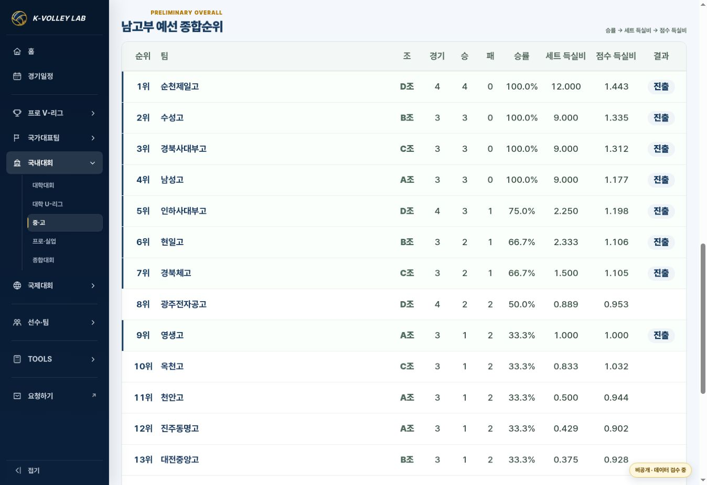

# 중·고 예선 종합순위 누락 복구

2026-10-26 · APPROVED / IMPLEMENTED / VERIFIED. Merge, Pages and live evidence are in the release PR.

Base main: `bc5899bbbc94a4a9924bea64edf53780a73888ea` (PR166; PR167/168 retained). Branch: `fix/school-preliminary-overall-rankings`. This corrects the user's reported omission in the approved production template.

## Cause and scope

PR167 migration explicitly disabled both `structure.standings.overall` and `combined`, leaving only individual pool cards. Enable the existing shared preliminary-overall block for all 20 divisions of spring, Samcheok, Iksan, President and IBK. Each block is titled with its division plus 예선 종합순위. Update the migration generator so regeneration preserves the fix.

The existing renderer, CSS and calculation are unchanged: win rate → set ratio → point ratio. The visible note distinguishes KVL's computed overall comparison from official pool advancement/knockout seeding. Existing group qualification labels and team-result links are retained.

All existing match/data payloads, IDs, scores, participant membership, final rankings and source links are unchanged. This is a display-setting correction, not source re-transcription. The same source snapshot and Drive source inspection from PR167 apply. No new official standings claims are introduced. CBS's four divisions still have no verified pool records and contain unresolved school-name variants; the existing honest pending notice remains. No synthetic CBS ranking is published.

## Validation

- Expanded school regression suite: **33/33 passed**. For each of the 20 divisions, the title/block renders and each team's displayed games/wins/losses matches only its existing 예선/사전경기. Across the divisions there are **368 preliminary games**.
- For every one of those 20 views, removing all later-stage games produces identical preliminary-overall HTML. This proves knockout results cannot contaminate the restored ranking.
- Existing checks continue to cover all 24 production contracts, division/tab links, participant grouping/search, school-result routing, calendar dialog, old routes, all 486 original match identities/scores, source conflict notices and hub summaries.
- PC browser: President 남고부 displays all 17 schools; 순천제일고 is 4 games / 4 wins / 0 losses (its later wins are excluded). School links remain in the table.
- Mobile browser: 390px and 360px. At 360px, document client/scroll width are both 345px. All 17 schools render in the existing mobile table; the table itself scrolls horizontally (315px viewport / 870px content), as in the approved domestic template.
- `git diff --check` clean; generator rerun reproducible; no data.json or shared renderer/style changes. No unrelated regression suite or source re-audit repeated.

## Proof and recovery

Revert the release merge commit to restore the prior configuration. The original match records require no rollback. CBS's source verification remains separate pending data work.
