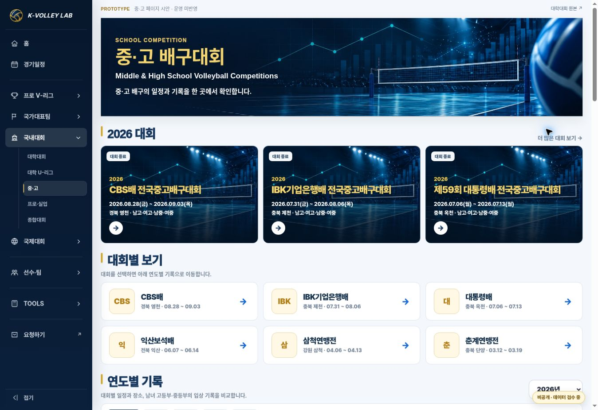
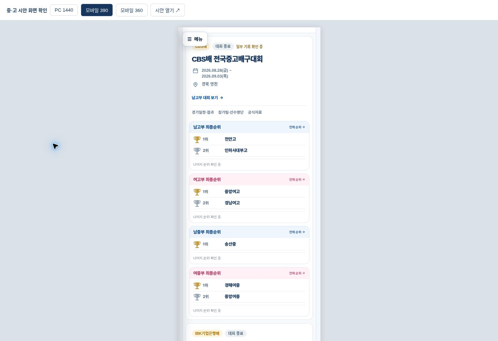

# 중·고 허브 — 대학대회 형식 프로토타입

Status: **PROTOTYPE / READY FOR REVIEW / PRODUCTION NOT AUTHORIZED**

- 요청: 국내대회 메뉴의 중·고 허브를 현재 대학대회 허브와 같은 구성으로 제작. 우선 시안만 제공한다.
- 기준 main: `ff9cd11e4dfe22f9b51a36a1ac1190f5ad4e9a52` (2026-11-01 확인).
- 브랜치: `feature/school-university-hub-v1`. 기존 VNL·AVC·국내 상세 페이지는 변경하지 않는다.
- [검토용 시안](https://kvl-school-university-preview-v1.daewook1029.chatgpt.site/) — 소유자 전용, ChatGPT 로그인 필요.
- Sites 소스 커밋: `753cf2ffbee4a097359b9b92df0fb886a0a50976`, 게시 상태 `succeeded`.
- 위 게시 결과는 **별도 검토 사이트**의 결과이며 kvolleylab.com 운영 배포가 아니다.

## 적용 기준과 구현

대학대회 `university-competitions.html`의 **2026 대회 → 대회별 보기 → 연도별 기록** 흐름을 사용한다. 2026-10-26 승인·배포된 PR #173의 카드 형태와 트로피를 재사용한다. 같은 대학 허브 CSS와 국내 카드 스킨을 변경 없이 로드하고, 중·고의 네 부문에 필요한 배치만 시안 전용 CSS로 확장했다.

| 요소 | 적용 |
| --- | --- |
| Hero | 기존 승인된 중·고 공용 Hero. 대학 허브 제목 PC 42px / 모바일 29px, 기존 금색·남색 |
| 주요 대회 | 최신 3개 대회 이미지 카드. 대학 허브의 높이·테두리·간격 사용 |
| 대회별 보기 | 연결된 6개 대회 바로가기. 해당 연도·기록으로 이동하며 검색 조건 해제 |
| 연도별 기록 | 대회 정보 왼쪽, 고등 남녀 / 중등 남녀 순위 2×2. 모바일은 같은 순서로 세로 배치 |
| 순위 | 원본 공동 3위 모두 유지. CBS 일부 기록은 미확인 상태 명시 |
| 탐색 | 4부문·전체 선택, 대회/개최지/입상 학교 검색, 상태·정렬, 연도, URL 복원 유지 |
| 상세 연결 | 기존 Competition Engine V2의 대회·부문 ID와 overview / schedule / knockout / rosters / resources 연결 |
| 메뉴 | 공통 사이드바 유지. 중·고는 시안 내부, 다른 메뉴와 상세 페이지는 운영 사이트 새 창 |

주요 색상은 대학 허브 원본의 본문 남색 `#17365d`, Hero 제목 `#f6d670`, 구분선 금색 `#d5aa2c`, 카드 테두리 `#e0e8f0`, 남자 순위 헤더 `#eef5fc`, 여자 헤더 `#fff1f5`, 트로피 `#bd912d / #8e9cad / #b37b56`이다. Arial과 기존 한글 대체 글꼴을 유지한다.

## 파일과 데이터 범위

- `previews/school-university-v1/index.html`: 새 허브 시안.
- `previews/school-university-v1/school.css`: 시안 클래스 안에서만 적용하는 확장.
- `previews/school-university-v1/school.js`: 기존 카탈로그의 표시·필터·연결. 데이터 쓰기 없음.
- `previews/school-university-v1/qa.html`: 1440 / 390 / 360px iframe 확인 화면.
- `scripts/build-school-university-preview-v1.py`: 별도 Sites 정적 출력 생성.
- `scripts/validate-school-university-preview-v1.cjs`: 이 시안에 한정한 DOM 검증.
- 입력은 기존 `data/competitions/school-years.json`과 여기에 연결된 카탈로그. 2026에는 6개 대회 / 24부문 / 600등록경기 / 87개 입상 행이 있다.
- 순위는 기존 `divisionResults`를 직접 읽는다. 순위를 재집계하거나 중복 저장하지 않는다.
- 운영 HTML·CSS·JS, 모든 config/data, MASTER, 경기/팀/선수 ID와 이미지 파일은 변경하지 않았다.

## 검수 결과

2026-11-01, 관리형 로컬 미리보기와 Cloud Chrome에서 확인했다. 게시물은 같은 소스 상태의 Sites 커밋과 정적 패키지로 저장했다.

| 항목 | 결과 |
| --- | --- |
| 1440px에서 본문 폭 | 1180px 확인 |
| 모바일 390px / 360px | 페이지 가로 넘침 없음, 학교명 잘림 없음. 각각 스크롤바를 제외한 375 / 345px에서도 확인 |
| Hero 제목 | PC 42px / 모바일 29px |
| 카탈로그 일치 | 6대회·24부문·87입상 행과 순위/공동순위 원문 일치 |
| 링크 | 24개 대회 config 존재. 부문별 ID와 최종순위 view 연결 검사 통과 |
| 동작 | 학교 검색+여고부 조합, 전체 복귀, 상태·정렬, 연도 선택, 빈 결과 초기화, URL 재진입·popstate 검증 통과 |
| 모바일 메뉴 | 열기·국내대회 중·고 항목·닫기 확인 |
| 데이터 실패 | 실패 문구 표시 검증 통과 |
| 페이지 콘솔 | 시안 앱 오류 없음. 브라우저 확장 metadata 오류는 앱과 무관 |
| 운영 보호 | 기준 main 대비 운영 경로 변경 없음. 별도 시안 경로·빌더·검수 문서만 추가 |
| 게시 확인 | Sites `succeeded`. 게시 URL의 소유자 로그인 게이트 확인. 인증 후 공개 호스트 UI 검수는 수행하지 않았으며 동일 패키지의 관리형 미리보기에서 화면 검수 |

재현:

```sh
python3 scripts/build-school-university-preview-v1.py --output /absolute/separate-site/dist
KVL_JSDOM_PATH=/path/to/jsdom node scripts/validate-school-university-preview-v1.cjs
```

### 검수 화면





## 확인한 기준과 남은 사항

- `KVL_운영원칙_MASTER_v16` 수정 시각 2026-10-27 16:24:09Z 확인. 앞선 확인본 이후 변경 없음.
- Hero guide v1 수정 시각 2026-10-13 23:03:08Z 확인. 새 이미지 제작 없이 승인된 공용 자산 재사용.
- Drive `03_중고` 아카이브와 현재 카탈로그 대조. 춘계·삼척·익산의 폴더명 시작일과 카탈로그 시작일이 다르다. 이는 도착일/실제 경기일 구분인지 확인되지 않았다. **디자인 시안에서는 카탈로그를 그대로 사용**하고 MASTER나 날짜를 임의 수정하지 않았다.
- CBS배 일부 순위와 2025~2023 기록 준비 상태를 그대로 유지한다. 미등록 기록을 창작하지 않는다.
- 전체 경기/선수 MASTER의 공식 원문 재검증과 기존 상세 엔진의 전 기능 재시험은 이번 허브 디자인 범위에 포함하지 않았다.
- 이번 시안은 대학 허브 전용 CSS에 의존한다. 승인 후 대학·중고 공용 허브 스타일로 추출할지는 별도 변경으로 검토하고, 현재 대학 화면의 시각적 회귀를 확인한다.

## 승인 후 적용과 복구

현재 PR은 Draft이며 운영 병합·배포하지 않는다. 시안 승인 후 운영 중·고 진입점에만 연결하는 별도 변경을 준비하고, 공통 메뉴·대학/VNL/AVC 회귀와 최신 카탈로그를 재확인한다. 현재 단계의 복구는 검토 사이트 사용 중단 또는 시안 브랜치 폐기로 충분하며 운영 롤백은 필요 없다.
