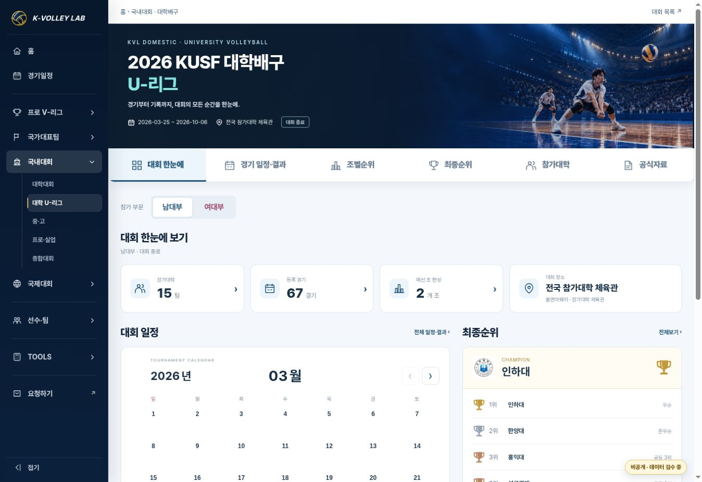
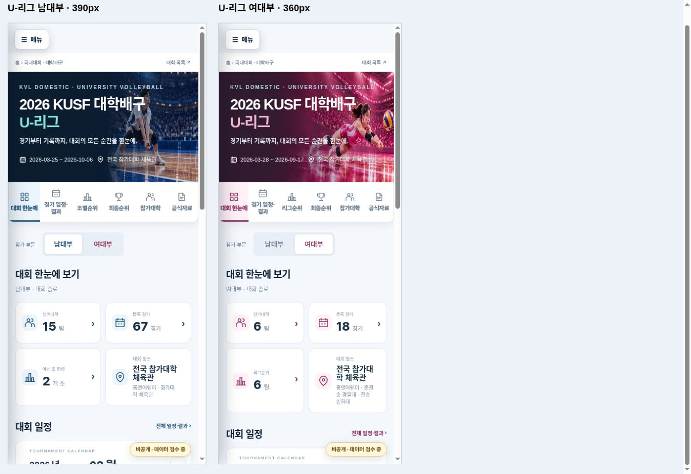

# 대학 U-리그 국내대회 템플릿 v2 적용 검수

- 날짜: 2026-10-26 (KST)
- 기준 main: `d5f32e1591a472b556459e13755f1d6d44081754` (PR #162)
- 상태: IMPLEMENTED / VERIFIED. merge·Pages·live 완료 증거는 release PR 기록.
- 사용자 요청: 승인된 시안으로 대학 U-리그 페이지도 변경. 남녀 정식 페이지 반영 범위.

## 변경

- U-리그 남녀 config에 presentation 선택만 추가. 두 config의 나머지 속성은 기준 main과 완전히 동일하다.
- 공통 v2 JS에서 설정된 순위 탭 명칭과 단일리그 KPI 연결을 유지하고, flat 참가대학에 가상 조를 붙이지 않는다.
- 공통 v2 CSS에서 기존 모바일 Hero 자산을 사용하고, 긴 순위 안내문이 카드 안에서 줄바꿈되도록 한다. 기존 v2 선택 적용 화면만 영향받는다.
- 세 진입 HTML의 v2 JS/CSS 캐시를 `20261026-1`로 갱신한다.
- 기존 U-리그 남자 67경기/여자 18경기 data.json, rosters.json은 기준 main과 byte 단위 동일. ID·선수 데이터·경기 점수·순위 계산·브래킷 연결·공식자료·Hero 경로는 변경하지 않았다. 이번 UI 작업에서 Drive/외부 경기 사실 재검수는 수행하지 않았다.

## 검수 결과

- `node --check assets/js/kvl-domestic-home-v2.js` 통과.
- 기존 `tests/domestic-home-v2.test.cjs` 확장: 8/8 통과. 고성·단양·U-리그 남녀의 데이터/순위 DOM/사다리 DOM/학교 링크 동일, 검색·중복 적용 방지, VNL 미선택 화면 무변경 검증. U-리그 여자부 리그순위 탭·6팀 카드→groups·flat 목록·3~9월 달력/결승일/월 이동 경계 검증.
- PC 1363px: 기존 남녀 Hero, 달력/최종순위/참가대학 카드와 확대 글씨 확인. 남자부 3월→10월 이동, 10/6 결승 dialog의 인하대 3:1 한양대 및 4세트 득점 표시 확인.
- 남자부 경기일정 `6강리그` 필터: 완료 15경기. 남녀 전환 시 선택한 groups view 유지.
- 여자부 단일리그 6개교 순위, 대학명/표 수치 17px. 남자부 A조 7팀/21경기·B조 8팀/28경기 및 수치 17px. 긴 설명문 수정 후 PC 문서 1348=1348px.
- 참가대학: 남자부 A/B조 내 가나다순, 여자부 경일대/광주여대/단국대/목포과학대/우석대/호남대. 여자부 ‘광주’ 검색→광주여대 1개→초기화 확인. 대학 상세 링크 유지.
- 남녀 최종순위 트로피 각 4개, 공동 3위와 준결승→결승 사다리 유지.
- 모바일 iframe 390px 남자부/360px 여자부: 문서 375=375px /345=345px. 조별 대학명/수치 17px, 모바일 종합/단일리그 대학명/수치/배지 15px.
- 모바일 사다리 574px(270/34/270) 유지, bracket만 내부 가로 스크롤(347/317px 표시 영역, scrollWidth578). 문서 가로 넘침 없음.
- 실제 휴대전화 검수는 수행하지 않았다.
- `git diff --check` 통과. 변경 파일만 push/검수 후 배포한다.

## 화면

## 배포/복구

기존 정식 URL `competition-engine.html?competition=university-league-men-2026` 및 `university-league-women-2026`를 유지한다. 이 PR의 merge를 revert하면 기존 v1 디자인으로 복귀한다. 신속한 대회별 복구는 해당 두 config의 presentation 속성만 제거한다. 기존 GitHub 데이터 등록 워크플로 오류가 반복될 경우 UI 변경과 구분해 release PR에 기록한다.
