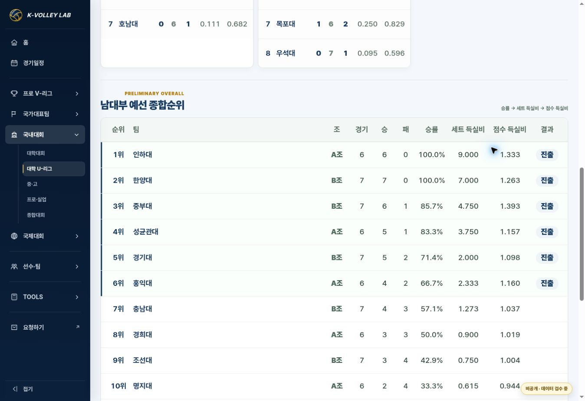

# U-리그 예선 집계·달력 기본 월 수정 검수

- 날짜: 2026-10-26 (KST)
- 기준 main: `e02651c6ee1a534a41942bf9c046b8dca2ff708d` (PR #163)
- 상태: IMPLEMENTED / VERIFIED. merge·Pages·live 결과는 release PR에 기록.
- 사용자 요청: 진행 중 현재 월/종료 후 마지막 경기 월 달력 표시, 남대부 예선 종합순위에 이후 경기가 포함되는지 확인.

## 원인과 변경

- 기존 `domesticOverallRows`는 pool 값과 점수가 있으면 모두 합산했다. 남자 U-리그 예선 A조 21경기/B조 28경기 외에 pool `6강`의 15경기도 포함됐다. 4강·결승은 pool 값이 없어 원래 합산되지 않았다.
- 예선 standings에 등록된 양 팀과 해당 예선 조가 일치하는 경기만 집계하며 QF/SF/FINAL/BRONZE/3RD는 제외한다. 예선 49경기, 팀별 경기 수 합계 98. A조 각 6경기/B조 각 7경기.
- 수정 후 상위 6팀: 인하대, 한양대, 중부대, 성균관대, 경기대, 홍익대. 기존 승률 → 세트 득실비 → 점수 득실비 기준은 그대로다.
- 인하대: 기존 11경기/11승 → 예선 6경기/6승, 세트 9.000/점수 1.333. 한양대: 기존 12경기/11승/1패 → 예선 7경기/7승, 세트 7.000/점수 1.263.
- 공통 한눈에 보기 달력은 한국시간 기준 현재 월을 대회 범위 안에서 선택한다. 종료 상태이거나 기간이 지난 경우 마지막 등록 경기 월, 시작 전에는 첫 월. 예정 종료일이 뒤에 있어도 완료 상태에서는 마지막 경기 월을 선택한다. 수동 월 이동과 날짜 상세는 그대로다.
- 세 진입 HTML에서 domestic JS `20261026-2`, components JS `20261026-preliminary-1`로 캐시 갱신. 기존 CSS/디자인은 변경하지 않았다.
- `data/`의 config/data/rosters, 선수 ID, 점수, 공식자료 및 사다리 연결은 변경하지 않았다. 이번 범위는 기존 데이터의 집계 오류 수정이며 Google Drive MASTER/외부 공식 경기 사실은 **NOT VERIFIED**(재검수하지 않음).

## 검증

- JavaScript 구문 검사: 운영 JS 2개, 검토 Site app.js 통과. `git diff --check` 통과.
- `KVL_JSDOM_PATH=/workspace/scratch/8e56d2ae74d7/kvl-dom-qa/node_modules/jsdom node --test tests/domestic-home-v2.test.cjs`: **16/16 통과**.
- 포함 사례: 기존 6개 대회 데이터·학교 링크·사다리·검색 회귀, VNL 미적용 유지, 시즌 전·시즌 중 휴식 월·KST 월 경계·종료 상태·예정 종료일과 마지막 경기 월 불일치, 여자 U-리그 9월↔3월 이동, 예선 49경기·상위 6팀·각 조 경기 수, 이후 경기 점수 변경/미등록 팀 추가가 예선 PC/모바일 DOM에 영향 없음.
- 기준 main의 components JS와 현재 JS로 전체 standings HTML을 비교: 고성/단양 남녀, KOVO컵 남녀, VNL 남자 **7/7 동일**.
- PC 1363px: 남자 U-리그 10월로 시작, 10/6 결승 상세 열기/닫기, 예선 종합순위 상위 6팀 및 경기·승패·승률·득실비 확인.
- 모바일 iframe 390px 남자/360px 여자: 처음 달력은 각각 10월/9월. 남자 모바일 예선 표도 PC와 같은 15팀/수치. 문서 가로 넘침 없음(남자 clientWidth=scrollWidth=375px). 실제 휴대전화 검수는 수행하지 않았다.
- 기존 기본 템플릿 Site: 고성 남자 07월로 시작 → 이전 06월 → 다음 07월, 7/3 결승 상세 한양대 1:3 인하대와 세트 점수 확인. 기존 owner-private 공개 범위 유지.

## 화면

## 배포와 복구

실제 운영은 기존 남녀 U-리그 및 고성/단양 경로에서 사용한다. 관련 없는 기존 데이터 등록 워크플로 오류는 release PR에서 구분한다. 이 PR의 merge를 revert하면 두 동작과 캐시 버전을 함께 되돌릴 수 있다. 기본 템플릿 검토 Site는 이전 소스 `073f5a552a3cf8fcaf9d6c361a1e061493168cff` 버전으로 복구한다.
