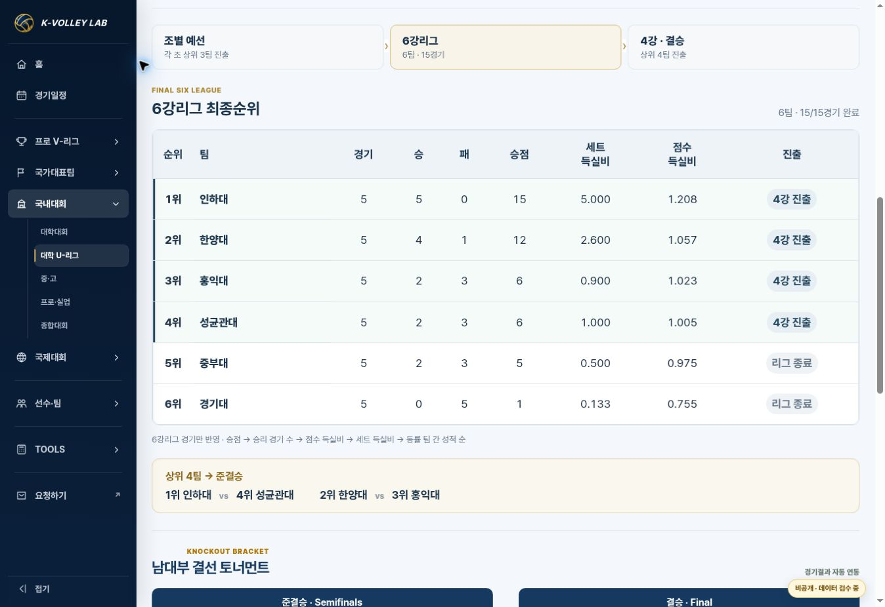
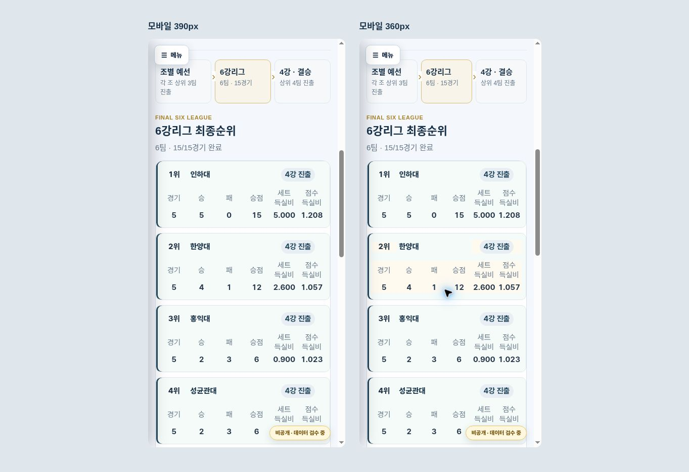

# 대학 U-리그 6강리그 최종순위 추가 검수

- 날짜: 2026-10-26 (KST)
- 기준 main: `843871b2330345319de041c86b9127eeddaf2a90` (PR #164)
- 상태: IMPLEMENTED / VERIFIED. merge·Pages·live 증거는 release PR에서 갱신한다.
- 요청: 최종순위의 4강 대진표 위에 6강리그 최종순위를 넣어 진출 과정을 연결.

## 구현과 근거

- 남자 U-리그 config의 `structure.knockout.leagueStage`만 선택 활성화했다. 공통 엔진에 선택형 렌더러를 추가하며, 다른 대회의 DOM은 바꾸지 않는다.
- 최종 1~4위 카드 → 예선/6강/4강 흐름 → 6강리그 순위표 → 준결승 조합 → 기존 사다리 순서.
- 기존 경기 JSON의 stage=`6강리그` 15경기만 집계한다. 원본 경기/선수/팀 ID/예선 standings/finalRanking 및 67경기 데이터는 기준 main과 동일하다. 별도 순위 숫자를 데이터에 중복 저장하지 않는다.
- [Google Drive 공식 요강](https://drive.google.com/file/d/1hkFfG8cVt6WcZgov8GibDEJXsE0SsV-X/view), 파일명 `2026_KUSF_대학배구_U-리그_요강.pdf`, 대회별 기존 폴더 `1H1p2qS20og3tlSX9nhgvGDX37--ZE1XP`에서 읽음. 3:0/3:1=3점, 3:2 승=2점/패=1점. 동률은 승수 → 점수 득실비 → 세트 득실비 → 해당 팀 간 성적. 예선 종합순위의 KVL 승률 산식과 별개다.
- 공식 연맹 6강 일정/준결승 대진도 직전 확인 자료와 일치한다: https://kuvf.co.kr/31/?bmode=view&idx=173194129 / https://kuvf.co.kr/31/?bmode=view&idx=174405403 . 이미 검수된 개별 경기 점수는 이번에 외부 원본 전수 재수집하지 않았다.
- 상위 네 행은 실제 준결승 참가 코드와 연결하여 `4강 진출`, 나머지는 `리그 종료`로 표시한다. 인하대–성균관대(1–4), 한양대–홍익대(2–3) 연결 표시.
- 모바일은 동일한 table 데이터를 학교별 카드로 재배치한다. PC 17px/모바일 15px 대학명·본문 수치와 네이티브 팀 경기기록 링크 유지.

| 순위 | 팀 | 경기 | 승 | 패 | 승점 | 세트 득실비 | 점수 득실비 |
|---|---|---|---|---|---|---|---|
| 1 | 인하대 | 5 | 5 | 0 | 15 | 5.000 | 1.208 |
| 2 | 한양대 | 5 | 4 | 1 | 12 | 2.600 | 1.057 |
| 3 | 홍익대 | 5 | 2 | 3 | 6 | 0.900 | 1.023 |
| 4 | 성균관대 | 5 | 2 | 3 | 6 | 1.000 | 1.005 |
| 5 | 중부대 | 5 | 2 | 3 | 5 | 0.500 | 0.975 |
| 6 | 경기대 | 5 | 0 | 5 | 1 | 0.133 | 0.755 |

## 검증

- JS 구문, JSON assemble/normalize/production validate 및 `git diff --check` 통과.
- `KVL_JSDOM_PATH=/workspace/scratch/8e56d2ae74d7/kvl-dom-qa/node_modules/jsdom node --test tests/domestic-home-v2.test.cjs`: **19/19 통과**.
- 새 검증: 6팀 순서·전체 수치·진출 4팀·실제 준결승 조합·팀 링크·대진표 앞 위치·중복 렌더 방지, 예선/결선 점수 변경 시 6강 집계 불변, 미완료 시 현재 순위 표시, 선택하지 않은 대회 미표시/해제 시 제거.
- 기준 main components JS와 비교: U-리그/고성/단양 남녀, KOVO컵 남녀, VNL 남자 **9/9**에서 기존 standings/knockout/final-top4/participants/schedule-list HTML 모두 동일.
- PC 1363px: 표 전체 폭, 6개 행, 배지, 준결승 연결과 기존 사다리 확인. 인하대 클릭 → `view=team&team=INHA` 및 `인하대 경기결과`, 뒤로 가기, 남녀 전환 시 knockout 탭 유지 및 여자부 새 표 없음 확인.
- 모바일 iframe 390px/360px: 6개 학교 카드, 대학명·숫자 15px, 문서 가로 넘침 없음(375=375 /345=345). 실제 휴대전화 검수는 수행하지 않았다.
- 캐시: components JS `20261026-sixleague-1`, domestic CSS `20261026-2`. 세 진입 HTML에만 해당 버전 반영. 기존 domestic JS 달력/예선 집계 수정은 유지한다.
- private 기본 템플릿 Site에는 U-리그가 없으므로 변경하지 않는다.

## 화면

## 배포 및 복구

기존 남자 U-리그 `view=knockout` 경로 유지. 사용자 최신 요청은 운영 수정 범위이며 승인된 국내대회 스타일을 유지한다. PR merge revert로 복구하거나 남자 config의 leagueStage만 제거하여 즉시 표시를 해제할 수 있다. 기존 데이터 등록 CI 오류와 Pages 배포 결과는 release PR에 구분하여 기록한다.
