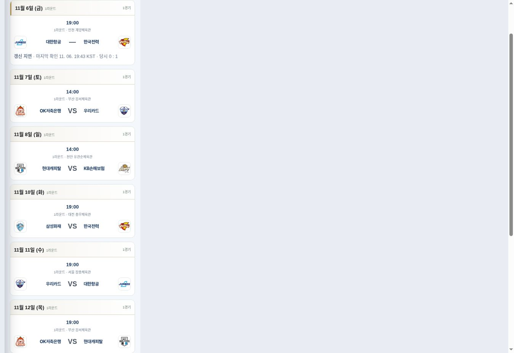
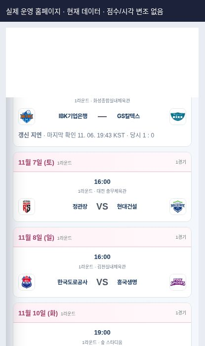

# Approved deployment observation — 2026-11-07 KST

Status: application code DEPLOYED; automation recovery NOT COMPLETE.

- User approved PR #262 deployment in this session.
- Merge: `ef239869b3bc303f711228f146011b367668f0d3` at 2026-11-07 00:15:35 KST.
- Pages [42241369531](https://github.com/kvolleylab/kvolleylab/actions/runs/42241369531): success.
- Production HTTP 200 bytes for `kvl-competition-data-v2.js` and `kvl-domestic-home-v2.js` exactly match the approved source. Both responses advertise max-age=600; versioned asset requests use the new version.

## Actual production browser checks

The responsive harness loaded unmodified https://kvolleylab.com pages in Chrome. No score fixture, clock override, production configuration override or DOM style mutation was applied. The outer iframe hides its scrollbar to provide exact CSS viewport widths.

| Page | 1440px | 390px | 360px | Observed data |
|---|---|---|---|---|
| Home | pass | pass | pass | Both genders; Nov 5 final results, Nov 7 upcoming fixtures |
| V-League overview | pass | pass | pass | Same results and fixtures as home |
| Men's schedule | pass | pass | pass | Nov 6 central score —; 갱신 지연; 19:43 KST; 당시 0 : 1 |
| Women's schedule | pass | pass | pass | Nov 6 central score —; 갱신 지연; 19:43 KST; 당시 1 : 0 |

Every measured document has clientWidth=scrollWidth equal to the requested width. Recorded console errors were browser extension metadata messages, not application errors. Images show actual stale production observations, not a fresh score or completed recovery.

## Incomplete steps and continuation

1. Manual `workflow_dispatch` with publish=true and match_only=true has NOT run. The GitHub connector does not expose dispatch. GitHub browser sign-in is pending the user's selected Google device authentication. Do not rerun an old workflow revision or bypass the existing publisher gate to work around sign-in.
2. Google MASTER and public final data have NOT been updated in this deployment. Home still shows Nov 5 as its latest completed result. The prior Nov 6 official final candidate is not evidence of publication.
3. Cloudflare dashboard presents a login screen. Worker, cron, credential, issue alerts and Worker failure alerts remain NOT ACTIVATED. Approval has been given; account access and secure credential configuration are still needed.
4. A bounded follow-up verification task was created for Nov 7 starting 14:30 KST, hourly for four observations. It checks recent consecutive publisher/API/MASTER/JSON/Pages/browser evidence. This hourly verification is not the 15-minute backup scheduler.
5. Keep #257 and #259 open until at least two real match-time publication cycles and screens are verified. Native cron remains unchanged, so its original scheduling limitation remains until the backup is active.
