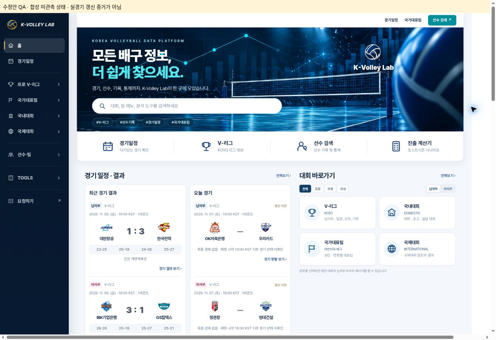
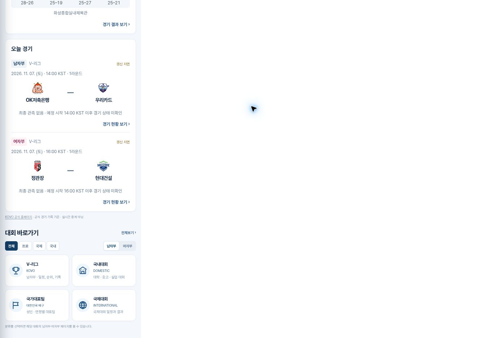

# V-League missing-observation repair — 2026-11-07

Status: IMPLEMENTED / LOCAL QA PASSED / NOT DEPLOYED / LIVE RECOVERY NOT VERIFIED.

Base main: `208b7babc27d15697e5b55cca934ab1e6a1bf0a1`. Branch: `fix/vleague-missing-observation-v2`.
This follows PR #262 and Issues #257/#259 after the owner requested actual repairs. New production merge/deployment and Cloudflare activation remain separate release steps. This report does not close either incident.

## Actual operating evidence

- Read the current issue/PR discussions, current workflow and scheduler config, repository operating rules and the exact Google 경기일정 MASTER before editing.
- Publisher [42344602418](https://github.com/kvolleylab/kvolleylab/actions/runs/42344602418) was created at **14:53:21 KST**, followed by [42361619533](https://github.com/kvolleylab/kvolleylab/actions/runs/42361619533) at **18:53:32 KST**: **4h 00m 11s**, despite a 15-minute cron definition. Missing runs were not queued publishers waiting for execution. GitHub's internal reason for dropping/delaying individual triggers is not exposed by these records.
- The 18:53 publisher's job `128371279882` records `checked_at=2026-11-07T18:54:58+09:00`, `master_changed_cells=8`, `master_readback_verified=true`; deployment verification at 18:55:41 and built SHA `208b7ba…`. [Pages 42361739381](https://github.com/kvolleylab/kvolleylab/actions/runs/42361739381) succeeded.
- Direct read of spreadsheet `180no_j27R_uw2adWH2BiWbbZ6QUWKVblqymIqNvkBU8`, `경기일정_MASTER!A14:S15`, confirms final M007 **OK저축은행 1–3 우리카드** (27–25,17–25,22–25,18–25), final W007 **정관장 3–1 현대건설** (21–25,27–25,25–19,25–19). Final values were caught up by the existing publisher, not by this repair branch or manual MASTER writes.
- Earlier actual official observations, artifacts, public JSON and 1440/390/360 browser results are preserved in [PR #262](https://github.com/kvolleylab/kvolleylab/pull/262#issuecomment-6704601590). Only one match-time publication had been observed; the late final publication is not a second consecutive 15-minute live cycle.
- The checked-in Cloudflare default is inert (`false` approval flags, `crons: []`). No activation evidence was found in PR/issues. This session reached the Cloudflare sign-in page; account runtime, existing worker/credential, billing availability and scheduled invocations remain **NOT VERIFIED** until authenticated access.

GitHub documents that scheduled events can be delayed or dropped under load: [official schedule reference](https://docs.github.com/en/actions/reference/workflows-and-actions/events-that-trigger-workflows#schedule). This is a documented limitation, not proof of the internal cause of these specific missing events. The independent Worker is therefore the planned trigger path; changing another native cron does not provide independence.

## Defects and changes

1. A started `scheduled` fixture with no first observation remained `상태 확인 중` indefinitely. The common summary state now changes official season-023 V-League fixtures to **갱신 지연** exactly 30 minutes after KST scheduled start. It shows **최종 관측 없음 · 예정 시작 HH:MM KST 이후 경기 상태 미확인**, with `—` for score. It never substitutes start time or `updatedAt` for a real observation timestamp.
2. Invalid/missing live observations take the same conservative path after 30 minutes. Existing valid live values, historical stale-score labeling and verified final results retain their existing rules. Cancelled/postponed/suspended and other competitions retain their existing behavior.
3. The watchdog used `updatedAt` as a fallback observation time. A metadata rewrite could hide missing score collection. It now only accepts `liveScore.observedAt` for live games, otherwise counting from scheduled start.
4. Home omits an empty set-score strip when there are no verified set points. Both HTML entry points use a new helper cache version.
5. `infra/vleague-scheduler/wrangler.active.jsonc` provides an explicit reviewed activation config with the existing worker name, Durable Object storage, 5-minute watchdog cron and approval flags. The default config stays inert. No automatic deployment workflow is added. This file alone does not enable Cloudflare; account access, a dedicated scoped secret and an explicit approved deploy are still required. See the scheduler README for exact deployment/rollback commands.

No source parser, official score policy, Google connection, workflow publication gates, concurrency group, match/player IDs, rosters, standings, international data or Cup data was changed. Current-player modules are not rewritten by this patch.

## Validation

| Check | Result |
|---|---|
| Existing workflow's JS regression set: Cup alignment, calendars, rosters, standings, summaries, postseason, live recovery, scheduler | 96 passed |
| Home/live-recovery suite after removing the empty strip | 8 passed |
| `python -m unittest discover -s tests -p 'test_kovo_vleague_*.py'` | 183 passed |
| `python -m unittest discover -s tests -p 'test_kvl_competition_lifecycle.py'` | 45 passed |
| Active config: Wrangler 4.158.0 `deploy --dry-run` | Success; 9.25 KiB, durable binding and both flags resolved; nothing uploaded |
| `git diff --check` | Passed |

New meaningful boundaries: 29 vs 30 minutes; recent metadata cannot reset age; missing/invalid live observation; previous-day unresolved fixture; protected non-V-League/cancelled/postponed/suspended behavior; both genders across home, overview, schedule and calendar dialog; no score or empty set strip for unobserved games.

### Actual browser QA of the repair (synthetic data, not live evidence)

Chrome loaded a local copy of the branch in fixed-width iframes, 1440/390/360 CSS px. Only the preview copy of Nov 7 fixtures was changed to missing observations. The local HTTP preview disables production HTTPS-canonical validation; repository production mode stays true. No production payload, time or score was changed.

| Surface | 1440 | 390 | 360 |
|---|---|---|---|
| Home, both genders | Delay + no observation + `—` | Same | Same |
| Men overview, both genders | Same | Same | Same |
| Women overview, both genders | Same | Same | Same |
| Men schedule M007 | Same | Same | Same |
| Women schedule W007 | Same | Same | Same |

All 15 combinations had equal document clientWidth and scrollWidth at the specified viewport. Screenshots were visually inspected; this is responsive Chrome QA, not physical-phone testing. Console checks found an initial preview-only HTTP canonical error, corrected only in the local preview; no site error after that correction. Browser extension diagnostics are unrelated to the site.

## Remaining release gates

1. Review and explicitly approve the patch's production merge/Pages deployment; verify its deployed SHA and live screens separately.
2. Authenticate the existing Cloudflare account, verify plan/worker/binding, securely install the dedicated repo-only GitHub Actions+Issues credential, deploy the reviewed active configuration and confirm a real Cron Trigger invocation. Never print credentials or put them in source/chat/logs. Confirm independent Cloudflare failure notification availability; Issue #257 notifications cannot report a worker that never runs.
3. Verify actual worker dispatch → publisher → official KOVO response → MASTER write/readback → JSON commit → Pages → both genders/screens for at least two consecutive match-time cycles. Record the actual observed KST timestamp, values and links in PR #262. Repeated API reads or synthetic tests are not substitutes.

Rollback the application with a reviewed revert of this patch, without reverting newer data commits. Deactivate the Worker by deploying the inert `wrangler.jsonc` (same durable storage). Neither rollback requires changing player MASTER, match IDs, international or Cup records.
