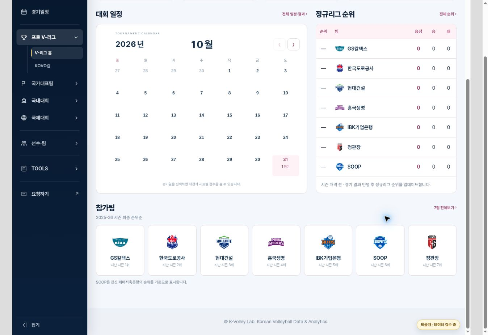
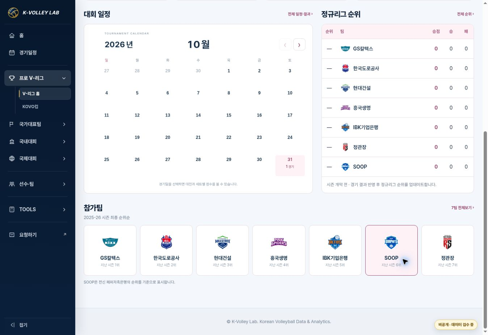

# V-리그 대회 한눈에 — 순위표와 전 시즌 순서

Status: DEPLOYED / LIVE VERIFIED. PR #190, merge `9139634058313722efd8b7e52a138c4822b7aaee`, Pages run `40542453121` success. 운영 남녀 페이지에서 순위표 7행·참가팀 최종순위순 7팀 한 줄·가로 넘침 0·시즌 안내 제거를 확인했다. 미확정 경기 카드는 추가하지 않았다.

기준 main: `d9ae7a085c30e5a90cf5d717371a9c3fcbbf7d09` (PR #189). 브랜치: `feature/vleague-overview-20261028`.

## 요청과 적용 범위

사용자가 시즌 안내 대신 시즌 순위표, 참가팀의 작년 순위 정렬과 PC 한 줄 표시를 요청했다. 동일 대화에서 승인하고 진행한 V-리그 운영 페이지의 후속 수정이다. 남녀 대회 한눈에에 적용하며, 앞선 #189의 시즌 안내 패널 결정을 이 범위에서 대체한다.

- 공통 domestic-home-v2 presenter에 `overviewSummary.mode=standings` 옵션을 추가한다. 순위/팀/승점/승/패를 기존 정규리그 순위 탭과 동일한 `standings.rows`로 표시한다. 별도 계산·자동 수집을 만들지 않는다.
- 개막 전 순위는 `—`, 승점/승/패는 기존 값 0이다. 누락 값과 0을 구분하고 출처 안내를 유지한다. 시즌 중에는 공식 데이터의 행 순서와 수치를 그대로 반영한다.
- 참가팀만 2025-26 최종 순위(포스트시즌 포함)로 정렬하고 각 카드에 지난 시즌 N위를 표시한다. 현재 순위와 전 시즌 순위를 분리한다.
- PC 901px 이상에서 7팀 한 줄, 모바일은 기존 3열이다. 기존 팀 클릭→선수명단·국기, 상세 순위 및 경기 결과 경로를 유지한다.
- 국적·선수명단·Player ID·현재 순위·경기·공통 메뉴·Hero는 변경하지 않는다. Cup/대학/중고교는 해당 옵션을 사용하지 않아 기존 화면을 유지한다.

## 순서의 공식 근거

KOVO 공식 보도자료 [남자 157978](https://kovo.co.kr/news/kovo/press/157978), [여자 157977](https://kovo.co.kr/news/kovo/press/157977)를 공개 API 원문으로 읽었다. 두 문서가 최초 추첨 확률 배분을 전 시즌 최종순위의 역순이라고 명시하므로 해당 순서를 역산했다. 지명권 트레이드 후 보유권과 혼동하지 않는다. Source ID·원문 body SHA-256·검수 방식은 `data/sources/v-league-2026-27/previous-season-ranking.json`에 기록한다.

- 남: 대한항공 → 현대캐피탈 → 우리카드 → KB손해보험 → 한국전력 → OK저축은행 → 삼성화재.
- 여: GS칼텍스 → 한국도로공사 → 현대건설 → 흥국생명 → IBK기업은행 → SOOP → 정관장.
- SOOP은 전신 페퍼저축은행의 순위를 승계하며 화면에 이를 명시한다.

현재 GitHub main을 재확인했다. 동일 대화에서 읽은 Drive 운영원칙 MASTER v15는 modifiedTime `2026-10-27T06:19:00.409Z`로 변경 없음을 확인했다. 전 시즌 최종순위는 Drive 검색에서 별도 최신 표를 찾지 못해 위 KOVO 1차 자료로 검증했다. Drive 원본은 수정하지 않았다.

## 검증

- V-리그 17 + Cup 명단 10 + 국내대회 21 + 중고교 33 = **81/81 통과**.
- Cup production, prototype, pool columns, PC matchup geometry smoke **4/4 통과**. CSS geometry 검사는 실제 geometry 구간까지만 검사하도록 경계를 지정했다. 그 뒤 새 overview CSS의 좁은 화면 규칙을 Cup 경기 카드 변경으로 오인하던 false positive를 수정했으며 geometry assertions는 유지했다.
- 추가 시나리오: 시즌 진행 중 순서/승점 변경 반영, 개막 전 rank null/points 0, 일부 값 누락, 반복 렌더 데이터 불변, 전 시즌 순서 고정, 명단 deep link.
- 브라우저: 남자 PC iframe 1280/1024 및 390px, 여자 PC 1280 및 360px 확인. 문서·카드 가로 넘침 0, PC 7팀 동일 y좌표, 모바일 3열. 전체 순위 링크 7행, SOOP 명단 링크 17명·국기 17개 확인.
- 기존 전역 table display/background 스타일과 충돌하던 부분을 overview에 한정해 수정했다. 남자/여자 기존 색상 유지.
- 남녀 data.json에서 추가한 previousSeasonRanking을 제거하면 기준 main 데이터와 완전히 동일하다. Cup 데이터, AVC/VNL, 선수 MASTER, 공유 메뉴 변경 없음.
- 미리보기 서버가 기존 루트를 제공한 경우 재시작 후 변경된 UI를 확인했다. 실제 운영 확인은 배포 후 별도로 기록한다.

## 미확정 제안

**PROPOSED / NOT IMPLEMENTED:** 순위표 아래 남자부·여자부 카드 각 1개, 각 카드 안에 최근 완료 경기 1개와 다음 예정 경기 1개를 함께 표시한다. 오늘 경기가 있으면 강조하고 전체 일정으로 연결한다. 결과/예정 중 하나만 교체하는 방식보다 휴식일에도 최근 흐름과 다음 일정을 함께 알 수 있다. 사용자가 고민 중이라고 했으므로 이번에는 경기 영역을 추가하지 않는다.

## 복구

해당 PR만 revert한다. 전체 공통 엔진을 과거 버전으로 덮어쓰지 않는다. 현재 시즌 순위의 갱신은 기존 공식 데이터 검수/반영 과정으로 계속 수행한다.

## 운영 확인

- [남자부](https://kvolleylab.com/competition-engine.html?competition=v-league-men-2026-27&view=overview)와 [여자부](https://kvolleylab.com/competition-engine.html?competition=v-league-women-2026-27&view=overview)를 직접 확인했다.
- PR 집중 회귀 run `40542211165` 성공. 기존 Player Master 16/78명 고정 assertion 및 batch commit SHA 누락, VNL/timeline workflow 오류는 이 변경과 무관한 기존 실패로 PR에 기록했다. 전체 CI green으로 표현하지 않는다.
- 브라우저에 노출된 오류 로그는 확장 프로그램 metadata 전송 오류였으며 사이트 스크립트 오류는 관찰하지 않았다.

