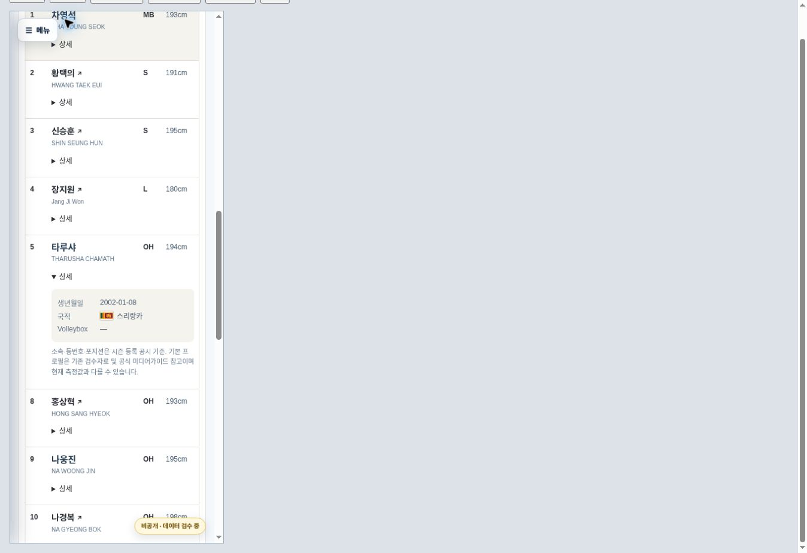

# V-리그 대회 화면 및 시즌 선수명단 — 2026-10-28

Status: IMPLEMENTED / VERIFIED / RELEASE AUTHORIZED. 실제 merge SHA·Pages 배포·운영 화면 확인 결과는 이 변경의 release PR에 기록한다.

사용자 요청: “V-리그도 대회 페이지 수정하고 선수명단 반영해줘”. 같은 대화에서 선수정보 공개와 KOVO컵 운영 반영을 승인한 뒤 V-리그에도 적용하도록 요청했다. 해당 남녀 대회 화면과 공개 프로필 항목의 운영 반영 범위로 해석하며 추가 승인 대기로 멈추지 않는다.

기준 main: `a90881e3d8ffbbb87859389f34220950e5d5f362` (Cup PR #187). 배포 기준 main: `461cb1f420eba2ce5e43080de332df85da581f8a` (동시 배포된 종합대회 Hero PR #188 보존). 작업 브랜치: `feature/vleague-rosters-20261028`.

## 구현

- 기존 `competition-engine.html?competition=v-league-{men,women}-2026-27` 주소와 공통 엔진을 유지한다. 별도 대회 JS/CSS 엔진을 만들지 않는다.
- 국내대회 기본 템플릿의 카드·달력·탭·참가팀 검색을 선택 적용한다. 남자 charcoal/white/gold, 여자 rose/gold와 기존 v08 PC/mobile Hero를 유지한다.
- 시즌 대회는 overview 오른쪽에 정규리그·포스트시즌·명단 기준을 표시한다. 순위·6라운드 필터·준PO/PO/챔피언결정전 기능은 유지한다.
- 전체 팀 카드 아래 명단을 펼친다. PC는 등번호/한영 이름/POS/키/생년월일/국기+국가명/VB, 모바일은 4개 주요 열과 상세 펼침을 사용한다.
- 선수 252명(남 131, 여 121), 기존 프로필 exact match 55개. 신규 Player ID 발급 또는 Player MASTER 수정 없음.
- 전원 국적/국기 및 키 표시. DOB 자료 상충 5명(최민호·하승우·박상우·정호영·표승주), 음력 표기 1명(김채원)은 확인 중으로 유지하고 프로필을 연결하지 않는다.
- 인쇄 제목은 컵대회 팸플릿 대신 시즌 등록 공시 기준으로 표시한다. `정규리그조`처럼 잘못 붙던 조 접미사는 단일리그 명단/인쇄에 붙이지 않는다.

## 자료 및 검수

Google Drive 최신 `KVL_운영원칙_MASTER_v15`와 남녀 2026-27 선수 MASTER(최종 수정 2026-10-16), 팀별 명단과 신원 검수 자료를 직접 읽었다. Drive 원본은 이번 홈페이지 변경으로 수정하지 않았다.

등록 구성은 기존 공식 공시 projection(251명, 10월 20일 해외임대 반영)에 직접 열람한 후속 공시를 대조한다. 공식 API 목록 첫 페이지에서 10월 27일 공시 2건이 기존 최신 157881보다 앞선 것을 확인했다.

- [158242](https://kovo.co.kr/news/official-notices/158242): 대한항공 이준 전역 등록, 13번/OH 추가.
- [158241](https://kovo.co.kr/news/official-notices/158241): 대한항공 송민근 자유신분. 등록 명단에 포함하지 않는다.
- [157881](https://kovo.co.kr/news/official-notices/157881): 최원빈 해외임대. 컵대회 당시 명단과 시즌 명단을 구분한다.
- [157686](https://kovo.co.kr/news/official-notices/157686): 김영태 OH→MB. 기존 공시 parser의 수련선수 접미사 불일치를 원문 직접 검수로 해소한다. 이번 변경은 시즌 snapshot에만 적용하며 수집기 parser는 수정하지 않는다.
- 외국인/아시아쿼터 28명 전원의 KOVO 등록 공시 원문에서 국적·등록명을 확인했다. 국기 코드 16종을 공통 명단 렌더러가 지원한다.
- 이준 영문명/DOB/키는 Drive에 보관된 2024-25 공식 미디어가이드 57쪽 기록, 기존 `KVL-P-001542` exact match. 국적은 기존 한국 U19 공식 경기 문서 연결 기록을 함께 대조했다. 오래된 키 자료는 현재 측정값으로 주장하지 않는다.
- 시즌 MASTER에 없는 신규 외국인 4명의 기본 프로필은 같은 구단의 등록 공시상 등록명과 컵 공식 팸플릿을 대조해 보완한다. 명단 소속은 컵 자료에서 가져오지 않는다.

재현: `python scripts/build-vleague-rosters-2026-27.py men-drive.txt women-drive.txt public-notices.json`.
입력 파일은 비공개 작업 영역에 유지한다. 공개 자료는 `data/sources/v-league-2026-27/`의 Source ID, 공시 URL, 원문 텍스트 해시, 변경 사실 및 검수 결과뿐이다. 급여·관찰메모·인증된 Drive 주소·PDF/XLSX 원본은 업로드하지 않는다.

| 부문 | 팀별 인원 |
|---|---|
| 남자 | 대한항공 19, 현대캐피탈 18, 우리카드 20, KB손해보험 19, 한국전력 15, OK저축은행 17, 삼성화재 23 |
| 여자 | GS칼텍스 17, 한국도로공사 15, 현대건설 18, 흥국생명 20, IBK기업은행 18, 정관장 16, SOOP 17 |

## 검증

- V-리그 11 + Cup 명단 10 + 국내대회 회귀 21 = 42/42 통과.
- 기존 Cup production, prototype, pool columns, PC matchup geometry smoke 4개 통과. 캐시 검사 및 스타일 적용 범위를 명시적인 pro-league opt-in에 맞게 갱신했다.
- PC 1348px: 남자 overview, 카드 선택·명단·국기·프로필·가로 넘침 0 확인.
- iframe 390/360px: 남자 19명 명단, 팀 변경, 스리랑카 국기와 상세 펼침, 가로 넘침 0. 여자 순위 7팀 및 포스트시즌 3단계 로딩/가로 넘침 0 확인.
- 자동 검사는 양 부문/PC·mobile의 선택·검색·해제·history·deep link·시즌 인쇄 라벨·전체 명단·국기·55개 기존 ID 무결성을 검증한다.
- 실제 프린터/PDF 출력은 미실시. 인쇄 DOM 및 페이지별 선수 누락 여부는 검증했다.
- 추가 PC 여자 미리보기 도중 preview daemon이 중지되어 연결이 끊겼다. 재시작 후 error-page reload는 브라우저 URL 정책에서 차단되어 재시도하지 않았다. 운영 HTTPS 주소 확인은 배포 후 별도 수행한다.
- 기존 남녀 126경기씩, 순위, 최종순위 JSON을 기준 main과 비교해 변경 없음 확인. AVC/VNL 운영 HTML, Cup data/config, 선수 MASTER, 공유 메뉴는 변경하지 않는다.

## 변경 파일 / 복구

남녀 config/data/rosters, `data/sources/v-league-2026-27/`, 재현 builder, 공통 components/presenter/CSS와 엔진 cache tag, 회귀 검사/workflow, 결정 기록 및 이 보고서.
문제 발생 시 해당 PR을 revert한다. 전체 공통 엔진을 과거 파일로 덮어쓰지 않는다. 이후 공시 동기화는 snapshot 생성 전 원문 검수와 현재 main/Drive 대조를 다시 수행한다.

