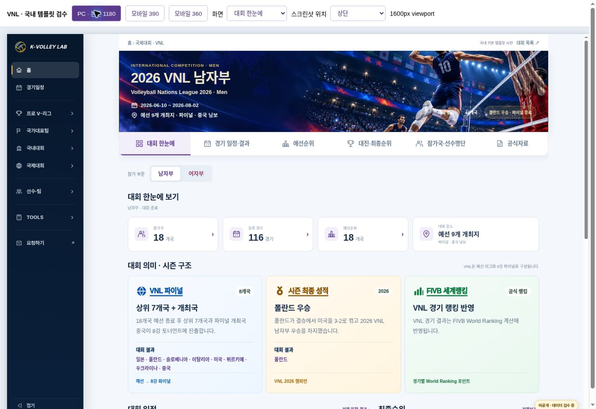
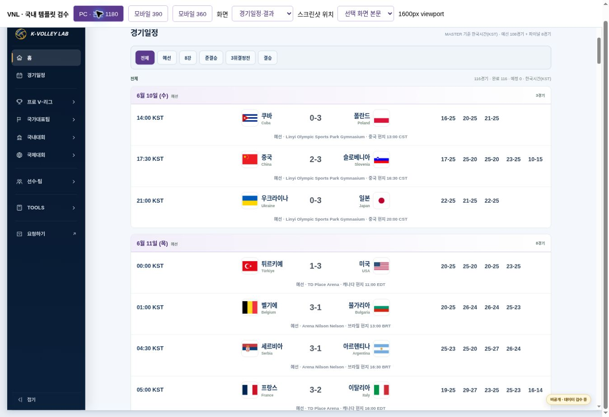
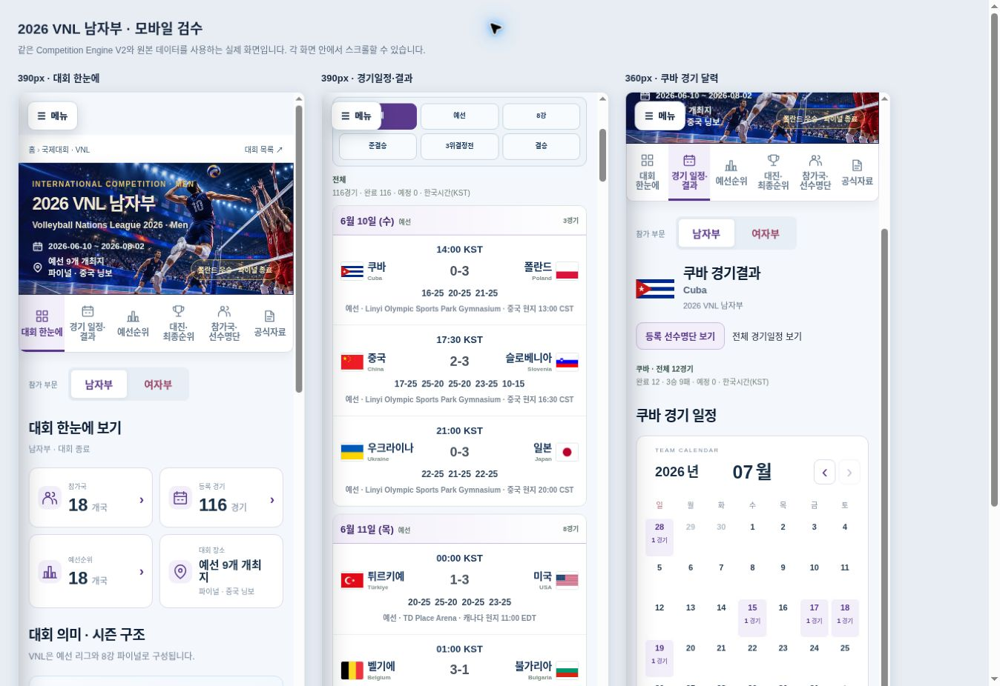

# 2026 VNL 남자부 · 국내 기본 템플릿 수정 시안

상태: **READY FOR REVIEW / 운영 미반영** · 2026-11-01

국제 기본 템플릿 개정(PR #212)은 보류 상태다. 국내 `domestic-home-v2`를 사용한 VNL 시안에 사용자 피드백 8개를 반영하고, 국내 템플릿의 경기행·부전승 연결선·선택 팀 달력도 같은 브랜치에서 보완했다.

- 비공개 시안: https://kvl-vnl-domestic-template-v1.daewook1029.chatgpt.site
- Draft PR: https://github.com/kvolleylab/kvolleylab/pull/216
- 브랜치: `feature/vnl-domestic-template-v1`
- 비교 기준 main: `2791e93f730a13c7f64e209d802b7e1df43b4758`
- 화면: `previews/vnl-domestic-v1/index.html`; 반응형 검수: `qa.html`, `mobile-qa.html`





## 8개 요청 반영

| 요청 | 결과 |
|---|---|
| 1. 기존 VNL Hero | 국내 Hero 덮어쓰기를 분리했다. 원래 이미지·그라데이션·위치·제목 색상/크기/굵기·날짜·장소·상태 배치를 사용한다. PC cover, 모바일 auto 100%로 비율을 유지하고 승인된 WebP와 내장 자산을 그대로 사용한다. |
| 2. 설명 카드 색상 | 파이널의 연한 파랑, 랭킹의 연한 초록과 원래 브랜드/제목/각주 색상을 복원했다. 시즌 최종 성적의 연한 금색도 원래 값이다. |
| 3. 경기행 중앙 정렬 | 시간 150px / 가변 대진 / 세트 285px로 구분하고 대진을 가운데 영역 중앙에 둔다. 세트는 5칸을 항상 확보해 3·5세트 경기의 로고·국가명·스코어 위치가 같다. 국내 기본 템플릿도 같은 규칙이다. |
| 4. 보조 정보 한 줄 | 단계·경기장·현지시간을 한 줄로 표시한다. 좁은 화면에서는 해당 행 내부 스크롤만 허용한다. |
| 5. 중국 표기 | 표시용 어댑터에서 ‘개최국’으로 변경했다. 원본 순위/진출 상태/설명은 수정하지 않았다. |
| 6. 사다리 실선 | 일반 연결은 실선, 실제 부전승/직행이 있는 쌍만 기존 점선이다. VNL에는 부전승이 없으므로 일반 연결 전체가 실선이다. 국내 고성대회 실제 부전승 점선도 확인했다. |
| 7. 가나다순 | 전체 18개국을 한국어 이름순으로 정렬했다. 선택·검색·명단·기존 프로필 연결을 유지한다. |
| 8. 선택 팀 달력 | 경기 목록의 국기/로고·팀명을 누르면 그 팀 경기만 월간 달력에 표시한다. 날짜 팝업에는 해당 팀 경기와 세트 점수를 표시하고, 목록 이동에서도 팀과 날짜를 유지한다. 전체 목록은 달력 아래에서 펼친다. 국내와 VNL이 같은 렌더러를 사용한다. |

## 적용 기준과 색상

국내 템플릿 문서 및 10월 26~27일 승인 기록, 운영원칙 MASTER v16(Drive 수정 2026-10-27T16:24:09Z), DESIGN_SYSTEM, Theme Policy v1, Competition Page Template v2, Hero 가이드와 개발 워크플로를 기준으로 한다. 기존 시안에서 확인한 자료를 재사용하고, 이번에는 최신 main의 실제 경로 `competition-engine.html?competition=vnl-men-2026`와 비교했다. 오래된 `vnl.html`은 비교 기준이 아니다.

| 용도 | 값 |
|---|---|
| VNL 보라 / 연한 배경 | #5B3A8E / #F3EFFA |
| Hero 제목 | 원래 #F2E8CF, PC 38px / 모바일 24px, 굵기 800 |
| 파이널 카드 / 브랜드 | #F8FBFF → #EDF6FF / #0455AD |
| 세계랭킹 카드 / 브랜드 | #F5FCF8 → #E9F8EF / #08783E |
| 일반 스코어·세트 | 중립 #4B5563 |
| 글꼴 | Arial, Noto Sans KR, Malgun Gothic, sans-serif 유지 |

Hero 제목 스타일과 배경 비율·위치·그라데이션은 PC/390/360에서 원본과 일치한다. PC 원본의 계산 글꼴은 Pretendard 우선 스택이며, 시안은 요청된 Arial 기준을 유지해 Hero 총높이가 약 2px 다르다. 모바일 Hero 높이는 원본과 같다. 이미지 파일이나 해상도는 변경하지 않았다.

## 원문과 운영 보호

`data/competitions/vnl-men-2026/data.json`의 `meaning`·`qualifications`를 그대로 사용한다. 기존 V2 설명 DOM을 **요약 카드 아래, 월간 달력 위**에 배치했다. 파이널 진출 방식과 실제 진출 8개국, 폴란드 우승·결승 결과, 세계랭킹 설명 및 제목·브랜드·보조 표시·각주·결과 국가를 모두 보존한다. 설명과 결과는 겹치지 않으며 접힌 영역에 숨기지 않는다. 설명 중복 저장도 없다.

**공통 소스 4개 파일은 이 feature 브랜치에서만 수정했다.** 앞선 시안의 ‘공통 파일 수정 0건’은 초기 버전 기록이며 이번 수정본에는 적용되지 않는다. 운영 main/Pages, wrapper/config/data, MASTER, Hero 자산, 경기/국가/팀/Player ID·명단은 변경하지 않았다. 운영 AVC·VNL·국내 화면은 기존 main을 계속 사용한다.

| 변경 범위 | 파일 |
|---|---|
| 국내 공통 제안 | `assets/js/kvl-domestic-home-v2.js`, `assets/css/kvl-domestic-home-v2.css`: 팀 달력/독립 월 상태, 경기행 정렬, 선택적 Hero 보존 |
| 공통 엔진 최소 보완 | `assets/js/kvl-competition-components-v2.js`: 선택적 팀 후처리 한 줄; `assets/css/kvl-competition-components-v2.css`: 부전승 선택자 |
| VNL 표시 설정 | `previews/vnl-domestic-v1/bridge.js`, `vnl.css`: 원문 DOM 배치, 국가 정렬, 중국 상태 문구, VNL 색상 |
| 국내 기준 문서 | `docs/domestic-template-v2.md`의 2026-11-01 보완안 |
| 빌드/검증/회귀 | `scripts/build-vnl-domestic-preview-v1.py`, `scripts/verify-vnl-domestic-preview-v1.py`, `tests/domestic-team-calendar.test.cjs` |

빌드는 별도 호스팅 폴더에 현재 브랜치 자산을 복사하고 정확한 VNL ID·연도·FIVB 계열의 시안에서만 국내 실행 조건과 CSS 선택자를 연결한다. `competitionFamily=fivb`를 유지하며 독립 엔진 사본을 관리하지 않는다. 생성된 `provenance.json`에 공통 4개 파일과 VNL config/data의 입력 해시를 남긴다. 원본 비교/국내 검수 wrapper는 로컬 canonical 검증만 끈 QA 전용 산출물이며 운영 wrapper는 수정하지 않는다.

## 검수 결과

- PC 본문 1180px, 모바일 390px·360px × 6개 화면, 총 18개 조합 통과. 페이지 가로 넘침 없음.
- 원본 Hero의 이미지 배치·제목 스타일, 파랑/초록 설명 카드 색상은 세 폭에서 일치한다.
- 쿠바–폴란드 3세트와 중국–슬로베니아 5세트의 대진 x좌표·폭이 같고, 세트 영역 285px 및 보조 설명 한 줄을 확인했다.
- 중국은 개최국만 표시, 참가국 가나다순, VNL 일반 연결 실선, 고성 실제 부전승 점선을 확인했다.
- 쿠바 12경기 달력 → 7월 15일 벨기에–쿠바 1경기 팝업 → 선택 팀/날짜를 유지한 목록 이동. 고성 목포대 4경기 달력도 브라우저에서 확인했다.
- 기존 국내/중고 회귀 54개, 신규 달력 회귀 5개, KOVO컵 표시·순위 회귀 2개 등 61개 통과. 비선택 국제 화면 불변, 팀 변경·빈 일정·원본 데이터 불변·두 달력 월 상태 독립성을 포함한다.
- 원본 VNL 18개국·116경기(예선108/결선8)·284명 보존. 단일 예선순위 18행은 각각 12경기이며 결선 합산 없음.
- 기존 v1의 필터(예선108/결승1), 한눈에 보기 달력/팝업, 폴란드16명 명단/프로필 링크 검수는 재사용했다. 앱 콘솔 오류는 관찰되지 않았다.

증빙: `vnl-domestic-v2-browser-evidence.json`, `vnl-domestic-v2-checks.json`(45항목 PASS). v1 증빙은 초기 이력으로 보존한다. 검증 스크립트는 브라우저 관찰 파일과 소스/데이터를 대조하며 브라우저 실행을 대신하지 않는다.

실물 모바일·인쇄·외부 링크 전체 응답은 재검수하지 않았다. 미확인 데이터·소속팀·Player ID를 보완하거나 MASTER를 수정하지 않았다. 이번 요청 범위에서 남은 기능 오류는 발견하지 못했다.

## 재현과 승인 후 범위

```sh
python scripts/build-vnl-domestic-preview-v1.py /absolute/separate-preview/dist
python scripts/verify-vnl-domestic-preview-v1.py /absolute/separate-preview/dist
KVL_JSDOM_PATH=/path/to/jsdom node --test tests/domestic-home-v2.test.cjs tests/school-domestic-home-v2.test.cjs tests/domestic-team-calendar.test.cjs
```

시안 승인 후 국내 공통 4개 파일의 보완과 지정된 VNL 표시 설정을 별도 운영 변경으로 적용한다. 운영 적용 시 공통 파일의 캐시 버전과 대상 대회 범위를 확인한다. 비선택 국제대회에는 국내 Hero/팀 달력을 강제하지 않는다. 국제 기본 템플릿 개정·확정·다른 국제대회 적용은 계속 보류한다. 현재 복구는 브랜치/비공개 시안만 이전 버전으로 되돌리면 되며 운영 파일 복구는 필요하지 않다.
