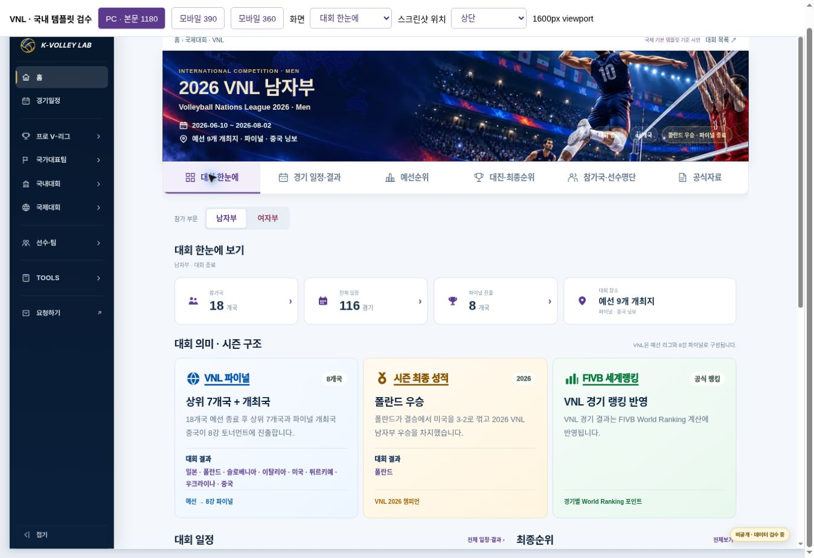
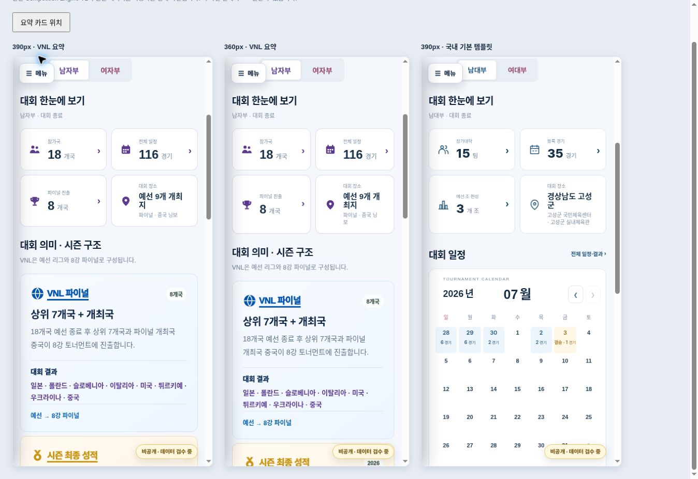
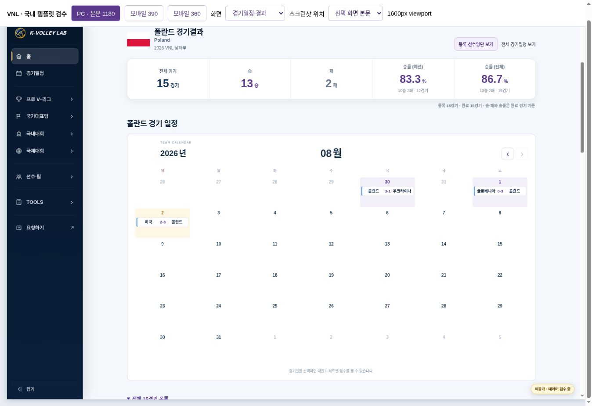
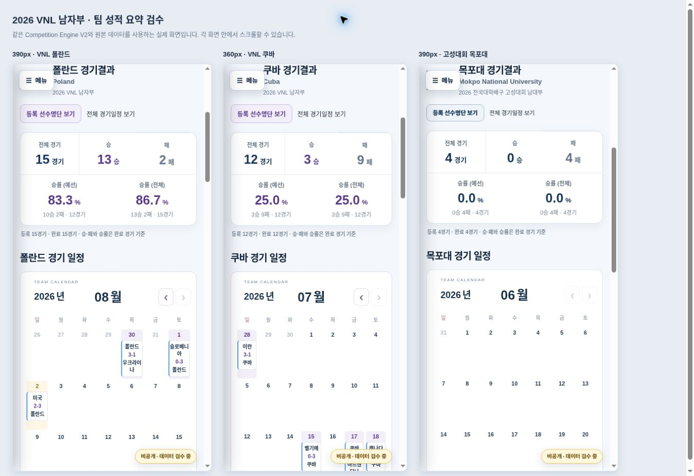
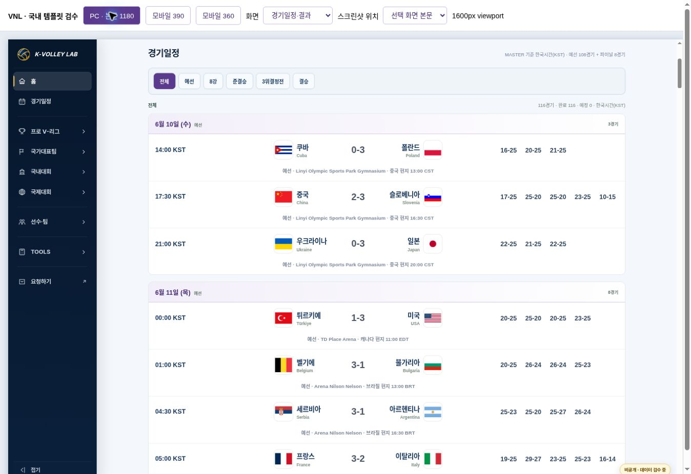
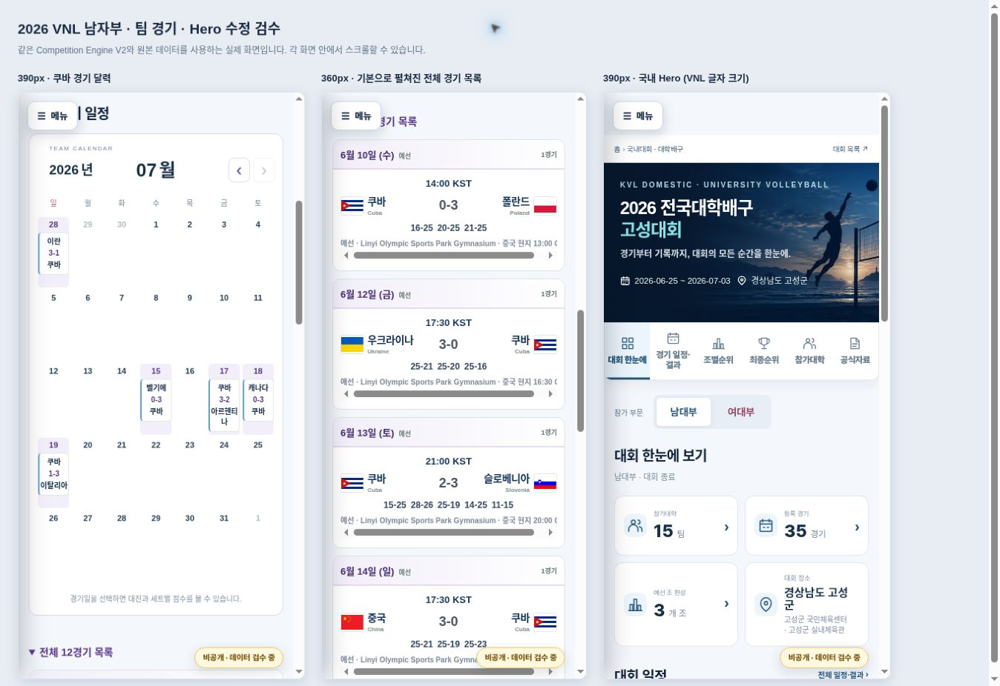
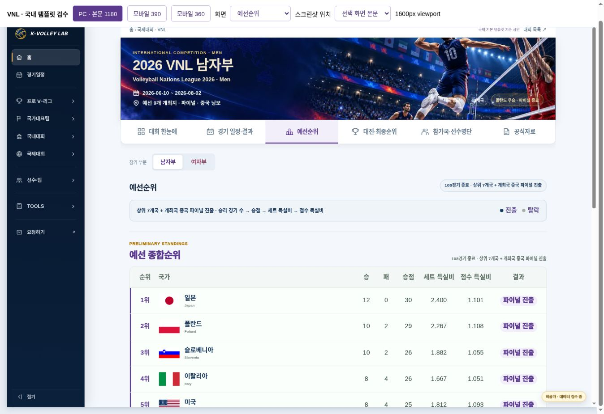

# 2026 VNL 남자부 · 국제 기본 템플릿 기준 시안

상태: **DESIGN BASELINE ADOPTED / REVISION 5 READY FOR REVIEW / 운영 미반영** · 2026-11-01

사용자가 현재 2026 VNL 시안을 국제대회 기본 템플릿의 기준으로 지정했다. 국내 기본 템플릿과 공통 Engine V2를 함께 사용하며, 국내 Hero 크기도 VNL과 맞춘다. 별도 대안 PR #212는 재개하지 않는다. 팀 성적 요약에 이어 한눈에 보기 요약 항목과 아이콘을 수정했다.

- 비공개 시안: https://kvl-vnl-domestic-template-v1.daewook1029.chatgpt.site
- Draft PR: https://github.com/kvolleylab/kvolleylab/pull/216
- 브랜치: `feature/vnl-domestic-template-v1`
- 비교 main: `2791e93f730a13c7f64e209d802b7e1df43b4758`
- 국제 기준: [international-template-v2.md](../international-template-v2.md)
- 국내 기준: [domestic-template-v2.md](../domestic-template-v2.md)
- 화면/검수: `previews/vnl-domestic-v1/index.html`, `qa.html`, `revision-qa.html`, `team-record-qa.html`

## Revision 5 · 한눈에 보기 요약과 아이콘 (최신 요청)

운영 VNL의 실제 화면과 공통 shell을 비교해 **참가국18개국 / 전체 일정116경기 / 파이널 진출8개국 / 대회 장소**로 수정했다. 사람·달력·트로피·위치핀은 운영 SVG symbol을 그대로 참조한다. 기존 시안 보라색 #5B3A8E와 카드 크기·간격을 유지하고 아이콘 배경만 없앴다. 파이널 진출은 원본 `knockoutTeamCount`를 읽고 대진·최종순위로 연결한다. 국내 기본 템플릿은 아이콘 배경만 제거하고 선형 모양과 색상(#24577C, 고성 남자 기준)을 유지한다.

구현: `assets/js/kvl-domestic-home-v2.js`, `assets/css/kvl-domestic-home-v2.css`, `previews/vnl-domestic-v1/bridge.js`. 선택 설정은 국내/국제 기준 문서에 기록했다. VNL·국내 데이터를 중복 저장하거나 수정하지 않았다.

검수: PC1600/본문1180, VNL390·360, 국내390의 요약 항목·수치·아이콘·색상·투명 배경·가로 넘침을 확인했다. 파이널 카드에서 대진 화면 이동 정상. 국내/중고/팀 달력 기존 회귀66개 PASS, JS 문법·diff 공백 검사 PASS, 관찰된 앱 오류0건. 다른 탭·Hero·설명·명단의 변경 없는 영역은 이전 증빙을 유지한다. 실물 기기/인쇄 검수 미수행.

main은 `2791e93f730a13c7f64e209d802b7e1df43b4758`로 동일하며 Drive MASTER v16의 수정 시각도 이전과 같다. VNL config/data와 공통 shell이 main과 동일함을 바이트 비교했다. 운영 main/Pages에는 적용하지 않았다. 직전 복구 commit은 `35f7c368d2fba8e4d5d8c823e542f0ab588968c9`다.

증빙: `vnl-domestic-v5-browser-evidence.json`. 검수 화면: `previews/vnl-domestic-v1/overview-qa.html`.




## Revision 4 · 팀 성적 요약

경기일정·결과의 국기/로고를 선택하면 대학배구와 같은 성적 카드에 **전체 경기·승·패·예선 승률·전체 승률**을 표시한다. 기존 대학 공통 렌더러를 확장했고 VNL 시안은 표시 설정으로 선택했다. 카드 → 팀 달력 → 기본으로 열린 전체 목록 순서이며 팝업·명단 연결을 유지한다. PC 5칸, 모바일 3+2칸이다.

| 등록 데이터 사례 | 전체 경기 | 승 | 패 | 예선 승률 | 전체 승률 |
|---|---:|---:|---:|---:|---:|
| VNL 폴란드 | 15 | 13 | 2 | 83.3% (10승2패/12경기) | 86.7% |
| VNL 쿠바 | 12 | 3 | 9 | 25.0% | 25.0% |
| 고성 목포대 | 4 | 0 | 4 | 0.0% | 0.0% |

전체 경기는 등록 일정 수, 승·패/승률은 완료 경기 기준이다. 예정·진행중·취소·미등록/동점 점수는 분모에서 제외한다. 예선 승률에는 결선이 포함되지 않으며 대학 U-리그의 6강리그도 제외한다. 완료 경기 없음/예선 해당 없음/단계 확인 중을 구분한다.

변경 파일: `assets/js/kvl-competition-components-v2.js`, `assets/css/kvl-competition-components-v2.css`, VNL의 `bridge.js`, `tests/domestic-team-calendar.test.cjs`, 국내/국제 기준 및 결정 로그. 같은 common 컴포넌트를 사용하며 별도 엔진은 만들지 않는다.

검수: VNL PC1600(본문1180)·390·360 및 국내 목포대390에서 카드 수치·이동·가로 넘침·열린 목록을 확인했다. 폴란드 로고 클릭과 결승 날짜 팝업도 정상이다. 국내/중고54개, 팀 달력/성적12개, KOVO컵2개 등 최종68개 회귀 통과. 기존 여섯 탭/Hero/설명·명단 검증은 변경하지 않은 영역의 이전 증빙을 재사용한다. 관찰된 앱 콘솔 오류0건. 인쇄/실물 기기 검수는 하지 않았다.

원본 VNL config/data, 고성·U-리그 data를 최신 main `2791e93`과 바이트 비교해 같음을 확인했다. Drive 운영원칙 MASTER v16의 수정 시각(2026-10-27T16:24:09Z)도 이전 확인과 같다. 운영 홈페이지/MASTER는 변경하지 않았다. 이번 범위에서 미해결 기능 오류는 발견하지 못했다.

증빙: `vnl-domestic-v4-browser-evidence.json`, `vnl-domestic-v4-checks.json`. 격리 검수 화면: `previews/vnl-domestic-v1/team-record-qa.html`. 직전 복구 기준은 feature commit `cc88626a5bee27f9af90ea3ebaef96e43b5f0813`이다.




## Revision 3 · 기존 검수 이력





## Revision 3의 네 가지 요청

| 요청 | 반영 내용 |
|---|---|
| 국제 기본 기준과 국내 Hero | 현재 VNL 시안을 국제 디자인 기준으로 문서화했다. 국내 Hero 제목·상단 영문 분류·부제·날짜·장소·상태 글자 크기를 VNL과 맞췄다. 국내 색상·이미지·글꼴·제목 줄 배치는 유지한다. |
| 경기장 안내 정렬 | PC의 단계·경기장·현지시간 안내를 전체 세트 스코어와 같은 중심축에 정렬했다. 쿠바–폴란드 3세트 및 중국–슬로베니아 5세트 경기 모두 스코어/설명 중심 x=830px로 일치했다. 한 줄과 해당 행 내부 스크롤을 유지한다. |
| 팀 달력 및 목록 | 국기/로고 또는 팀명 선택 시 팀 달력과 전체 목록이 둘 다 펼쳐진다. 날짜에는 `이란 vs 쿠바` / `이란 3-1 쿠바` 형식으로 표시한다. 실제 등록 스코어 유무를 사용하며 날짜로 종료를 추정하지 않는다. 한 날짜의 여러 경기도 모두 표시한다. PC는 가로, 모바일은 이름/점수/이름을 세로로 놓고 긴 이름을 줄바꿈한다. |
| 예선순위 중복 제거 | `structure.standings.showStatus: false`로 상태 열만 생략한다. 결과·모든 원래 순위 수치·중국 ‘개최국’ 표기는 유지한다. 다른 대회의 기본 상태 열과 조별순위의 조 열은 바꾸지 않는다. |

## 공통 개선과 VNL 설정

공통 코드는 `assets/js/kvl-domestic-home-v2.js`와 CSS의 Hero 글자 크기·경기행·팀 달력, `assets/js/kvl-competition-components-v2.js`와 CSS의 선택적 순위 열이다. 기존 선택 모듈을 사용하며 국내/국제 엔진을 복제하지 않는다.

`previews/vnl-domestic-v1/bridge.js`는 정확한 VNL 2026 남자 ID·시즌·계열에만 표시 선택을 적용한다. 원본 Hero 보존, 참가국 가나다순, 중국 문구, VNL 메뉴 명칭과 단일 예선순위의 상태 생략은 이 어댑터의 선택이다. VNL 예선·8강 파이널 방식은 다른 대회의 기본 규칙으로 지정하지 않는다. 새 국제 기준은 표시 항목과 대회별 입력·적용 절차를 별도로 문서화한다.

국제 기준 문서 `docs/KVL_COMPETITION_PAGE_TEMPLATE_V2.md`의 새 승인 기록과 `docs/international-template-v2.md`가 최신 기준이다. 아래쪽 기존 AVC geometry와 인쇄 검증 상태는 역사적 기준으로 명시했다. 국내 문서와 결정 로그도 같은 범위를 기록한다.

## 유지한 Hero·설명·색상

원래 VNL의 승인 Hero 이미지, 비율, 그라데이션, 제목 #F2E8CF와 글자 크기를 유지한다. 국내 Hero도 PC 제목 `clamp(30px,2.45vw,38px)` / 모바일24px, 부제15/12px, 날짜·장소14/11.5px, 영문 분류11/10px, 상태11/9px로 일치한다. PC/390/360 실제 계산값을 모두 비교했다.

`data/competitions/vnl-men-2026/data.json`의 `meaning`·`qualifications`를 그대로 사용한다. 기존 설명 DOM은 **한눈에 기본 정보·요약 카드 아래, 월간 달력 위**에 있다. 파이널 진출 방식·시즌 최종 성적·세계랭킹 관련 원문 전체를 보존하고 결과와 설명을 구분한다. 기본 닫힘이나 중복 저장이 없다. 원문·숫자를 수정하지 않았다.

| 용도 | 기준값 |
|---|---|
| FIVB 남자 보라 / 연한 배경 | #5B3A8E / #F3EFFA |
| Hero 제목 | #F2E8CF, PC 최대38px / 모바일24px |
| 파이널 카드 / 브랜드 | #F8FBFF → #EDF6FF / #0455AD |
| 세계랭킹 카드 / 브랜드 | #F5FCF8 → #E9F8EF / #08783E |
| 일반 경기 스코어·세트 | #4B5563 |
| 팀 달력 | 국가명 #142B45, 흰 카드, 표시선 #5D9EE8, 결과는 계열색 |
| 글꼴 | Arial, Noto Sans KR, Malgun Gothic, sans-serif |

운영원칙 MASTER v16(Drive 수정2026-10-27T16:24:09Z), Theme Policy v1, DESIGN_SYSTEM, Hero 가이드, 최신 국내 승인 기록과 기존 운영 VNL을 참조했다. 이번 확인에서 MASTER 수정 시각은 이전 읽은 최신본과 같았다.

## 검수 결과

- 실제 브라우저: PC 본문1180px, 모바일390/360 × 6개 화면, 18조합에서 탭 이동·본문 가로 넘침 없음.
- VNL/국내 Hero의 다섯 텍스트 크기 모두 세 폭에서 일치. 기존 VNL 이미지 배치와 제목색 유지.
- 3·5세트 경기에서 스코어 중심과 안내 중심 일치 및 안내 한 줄 확인.
- PC 순위표8열, 모바일6영역에서 상태 생략·결과 유지. 18개국과 중국 ‘개최국’ 유지.
- 쿠바12경기의 기본 펼침, 대진/결과 셀, 6월/7월 이동, 7월15일 벨기에–쿠바 팝업 및 팀·날짜를 유지한 전체 목록 이동 확인. 고성 목포대4경기도 동일 공통 동작 확인.
- 자동 회귀: 기존 국내/중고54개, 팀 달력·순위 선택8개, KOVO컵 표시/정렬2개, 총64개 통과. 경기 전후 표시·같은 날 여러 경기·긴 이름/HTML 문자·빈 일정·팀 변경·기존 데이터·조 열 보존을 포함한다.
- 소스/관찰 대조37항목 PASS: `vnl-domestic-v3-browser-evidence.json`, `vnl-domestic-v3-checks.json`. 브라우저 자동화 확장 자체의 metadata 전송 오류77건은 앱 오류와 구분했고, 관찰된 앱 콘솔 오류는0건이다.
- 기존 v2의 사다리 실선/실제 부전승 점선, 파랑·초록 카드색 복원, 가나다순 및 v1 명단/프로필 연결 검증을 재사용했다. 해당 변경은 이번에 다시 수정하지 않았다. 이전 v1/v2 증빙은 이력으로 보존한다.

## 운영과 데이터 보호

운영 main/Pages·AVC·VNL·국내 페이지에 적용하지 않았다. 공통 소스4개는 이 feature 브랜치와 별도 비공개 시안에서만 바뀐다. wrapper/config/data·MASTER·Hero 자산·기존 ID를 수정하지 않았다. VNL18개국·116경기(예선108/결선8)·284명 명단을 보존하며 예선순위18행은 각12경기다. 생성된 `provenance.json`에 원본 데이터와 공유 소스의 해시를 남긴다.

이번 범위에서 미해결 기능 오류는 발견하지 못했다. 실물 기기·인쇄/PDF·외부 링크 전체 응답 및 다른 국제대회 운영 전환은 이번 검수 범위가 아니다. 현재 공유 렌더러를 사용하는 국내 대회까지 자동 회귀했지만 다른 국제대회의 표시 선택/운영 연결을 완료한 것으로 주장하지 않는다.

## 재현과 운영 반영 범위

```sh
python scripts/build-vnl-domestic-preview-v1.py /absolute/separate-preview/dist
python scripts/verify-vnl-template-v3.py /absolute/separate-preview/dist
KVL_JSDOM_PATH=/path/to/jsdom node --test tests/domestic-home-v2.test.cjs tests/school-domestic-home-v2.test.cjs tests/domestic-team-calendar.test.cjs
node --test tests/kovo-cup-desktop-matchup-alignment.test.cjs tests/kovo-cup-domestic-presentation-prototype.test.cjs
```

디자인 기준 지정은 기록했으며 실제 운영 반영은 사용자 확인 후 별도 수행한다. 승인 시 선택한 국제대회부터 표시 설정/공유 컴포넌트를 순차 적용하고, 국내 공통 변경 영향도 함께 확인한다. main 병합·운영 배포·기타 대회 일괄 변경은 이번 작업에 포함하지 않았다.
