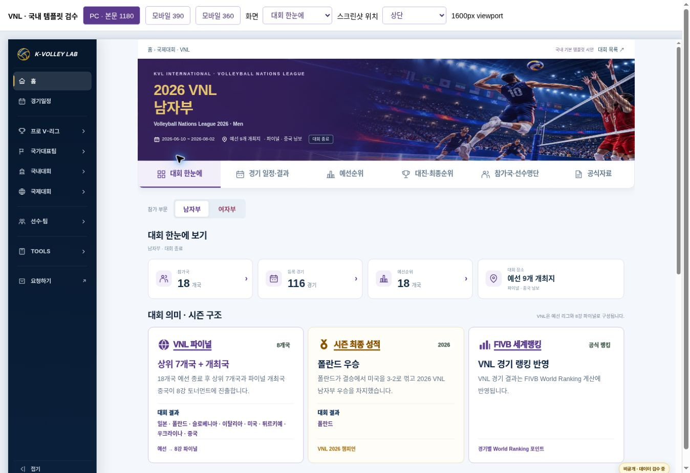
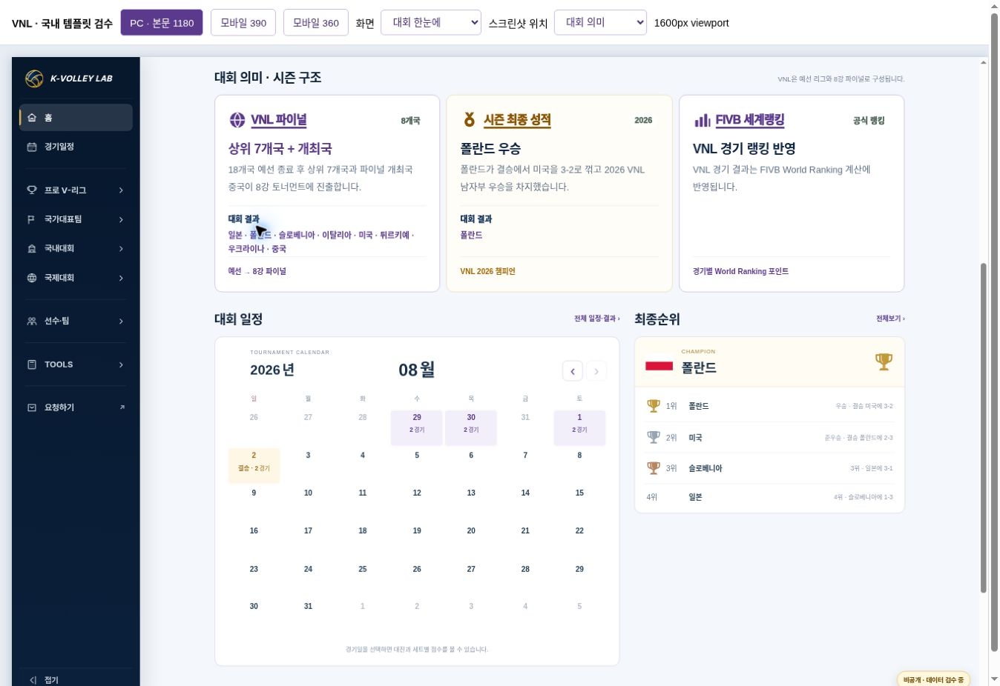
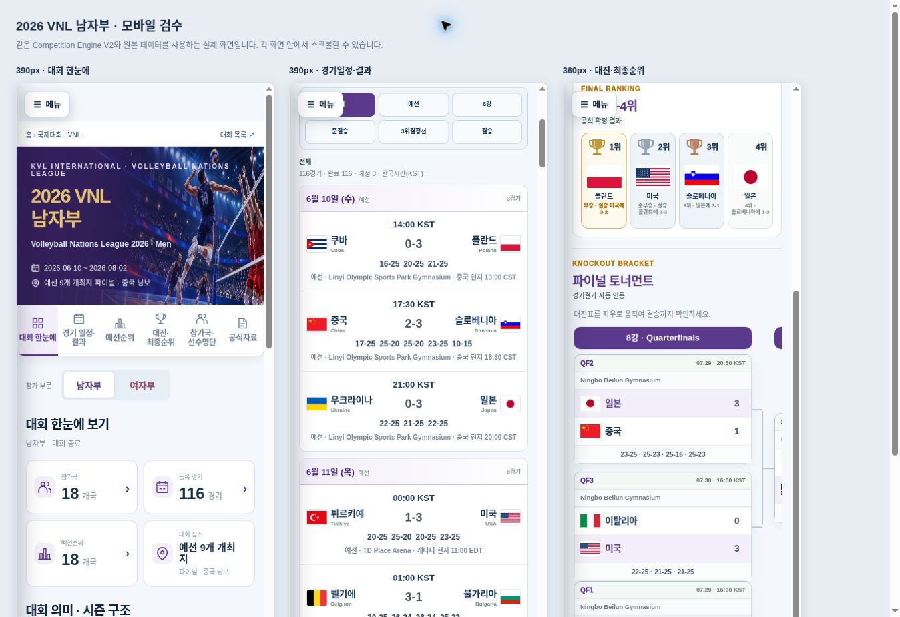

# 2026 VNL 남자부 · 국내 기본 템플릿 시안

상태: **READY FOR REVIEW / PROTOTYPE** · 2026-11-01

최신 사용자 지시에 따라 국제 기본 템플릿 개정 작업(PR #212)은 잠시 보류한다. 이번 결과는 승인된 국내 기본 템플릿을 실제로 사용한 VNL 비교 시안이다. 국제 공통 기준을 새로 확정하거나 다른 국제대회에 일괄 적용하는 작업은 포함하지 않는다.

## 확인할 결과

- 비공개 시안: https://kvl-vnl-domestic-template-v1.daewook1029.chatgpt.site
- 별도 브랜치: `feature/vnl-domestic-template-v1`
- 기준 main: `2791e93f730a13c7f64e209d802b7e1df43b4758`
- 기본 화면: `previews/vnl-domestic-v1/index.html`
- PC / 390 / 360 검수 화면: 같은 디렉터리의 `qa.html`, `mobile-qa.html`





## 적용 기준과 범위

`docs/domestic-template-v2.md` 및 최신 10월 26~27일 승인 기록을 기준으로 `assets/js/kvl-domestic-home-v2.js`와 `assets/css/kvl-domestic-home-v2.css`를 직접 재사용한다. 카드 형태를 흉내 낸 별도 국제 화면을 만드는 대신, 국내 템플릿의 Hero·탭·4개 요약 카드·월간 달력/최종순위 2열·참가국 요약을 사용했다.

운영원칙 MASTER v16(Drive 수정 시각 2026-10-27T16:24:09Z), `DESIGN_SYSTEM.md`, 공통 Theme Policy v1, Competition Page Template v2, Hero 가이드, 개발 워크플로와 최신 운영 CSS/config를 확인했다. 오래된 일반 기준보다 현재 승인된 국내 v2 선택 적용 범위를 우선했고, 최신 사용자가 요구한 VNL 보라색을 유지한다.

| 항목 | 사용한 값 / 방식 |
|---|---|
| VNL 기본 / 진한 보라 | `#5B3A8E` / `#442A70` |
| 연한 배경 / 테두리 | `#F3EFFA` / `#CDBCE7` |
| Hero 배경 / 제목 | `#35205A` / 기존 특수 강조 `#E7C472` |
| 일반 스코어·세트 점수 | `#4B5563` |
| 금색 | 우승·트로피·결승 강조 및 기존 Hero 제목 |
| 글꼴 | Arial, Noto Sans KR, Malgun Gothic, sans-serif |
| Hero 이미지 | 기존 승인 VNL PC/모바일 자산과 config 참조 유지 |

국내 네이비 테마를 VNL 전체에 복사하지 않았다. 참가대학/팀 명칭은 참가국으로, 단일 예선순위는 예선순위로 표시한다. 공통 메뉴와 6개 기능, 실제 국가/경기/선수 식별자는 유지한다. 국가명은 말줄임 없이 읽을 수 있고, 모바일 국기 폭을 줄여 이름 공간을 확보했다. 트로피는 실제 1~3위에만 표시하고 4위 일본은 4위로 표시한다.

## ‘대회 의미 · 시즌 구조’ 보존

원본은 `data/competitions/vnl-men-2026/data.json`의 `meaning` 및 `qualifications`이다. 같은 설명을 새 설정이나 JS에 복제하지 않았다. 기존 V2가 렌더링한 설명 DOM을 **요약 카드 아래, 월간 달력 위**로 이동했다.

- 파이널 진출 방식과 실제 진출 8개국
- 시즌 최종 성적·폴란드 우승과 결승 결과
- FIVB 세계랭킹 설명
- 각 카드의 제목·브랜드·보조 표시·본문·각주·결과 국가

위 내용은 원문 그대로 유지했다. 설명과 확정 결과 행이 겹치지 않도록 카드 높이를 내용에 맞추고, 중요한 설명을 접힌 영역에 숨기지 않았다. 기존 경기 결과·순위·명단의 공식 사실을 이번 디자인 작업에서 새로 확정하거나 수정하지 않았다.

## 구현과 운영 보호

`scripts/build-vnl-domestic-preview-v1.py`가 별도 호스팅 디렉터리에 원본 자산과 VNL config/data를 복사해 시안을 조합한다. 국내 presentation의 실행 조건 한 곳에 해당 미리보기 ID + VNL ID + 2026 + FIVB 조건을 추가한 **빌드 산출물**을 생성한다. CSS도 국내 선택자를 미리보기 마커에 연결한 빌드 산출물이다. 원본 국내 JS/CSS나 공통 엔진을 수정하거나 독립 엔진으로 복사 관리하지 않는다.

`bridge.js`는 표시용 어댑터와 원본 DOM 배치만 담당한다. `competitionFamily=fivb`는 유지하며, 국내로 위장하지 않는다. `vnl.css`의 변경은 `#kvl-vnl-domestic-preview` 아래에만 적용된다. 생성된 공통 자산은 `generated/`에 있고, Git에는 생성기만 관리한다. `provenance.json`에 입력 파일 SHA-256을 기록한다.

운영 AVC 남녀, VNL, 국내대회 wrapper/config/data, MASTER 및 공통 JS/CSS의 수정은 **0건**이다. 기존 국제 템플릿 개정안 파일도 수정하지 않았다. 선수명단은 기존 Player ID가 있는 경우 기존 KVL 선수 프로필에 연결하고 새 ID를 만들지 않았다.

## 검수 결과

브라우저의 실제 iframe 뷰포트 1600px(본문 1180px), 390px, 360px에서 6개 화면 총 18개 조합을 확인했다. 스크롤바가 있는 경우 clientWidth는 뷰포트보다 15px 작다.

| 검수 | 결과 |
|---|---|
| 6개 화면·탭·본문 가로 넘침 | 18/18 통과; 문서 scrollWidth ≤ clientWidth |
| PC 본문 | 6개 화면 모두 1180px |
| 원문 보존 / 설명·결과 겹침 | 전체 문구 일치; 닫힌 details 0; 겹침 없음 |
| 월간 달력 | 종료 후 마지막 경기 월 8월; 이전/다음 달 이동 정상 |
| 8월 2일 팝업 | 3위전·결승 2경기와 실제 세트 점수 표시 |
| 경기 필터 | 예선 108경기 / 결승 1경기 |
| 예선순위 | 원본 단일리그 18행; 각 12경기; 결선 합산 없음 |
| 참가국·명단 | 폴란드 검색·선택, 16명 명단과 16개 기존 프로필 링크 확인 |
| 대진·최종순위 | 기존 8강 사다리 / 1~4위 유지; 대진표 내부 스크롤 |
| 데이터 | 18개국, 116경기, 284명 원본 그대로 |
| 운영 보호 | 원본 config/data·국내 JS/CSS·공통 components CSS 해시 일치 |

검수 증빙: `vnl-domestic-v1-browser-evidence.json`, `vnl-domestic-v1-checks.json`. 자동 확인 22항목 통과 및 `node --check` 통과. 앱 오류는 관찰되지 않았고 브라우저 확장 자체 로그는 앱 오류와 구분했다.

실물 모바일 기기, 인쇄물, 외부 선수 프로필/공식자료 사이트의 전체 응답은 이번 범위에서 재검수하지 않았다. 기존 데이터의 미확인 소속팀이나 Player ID 없는 행은 보완하지 않았다. 시안 확인 후 디자인 승인과 별도의 운영 반영 범위를 결정하면 된다.

## 재현·후속·복구

```sh
python scripts/build-vnl-domestic-preview-v1.py /absolute/separate-preview/dist
node --check previews/vnl-domestic-v1/bridge.js
python scripts/verify-vnl-domestic-preview-v1.py /absolute/separate-preview/dist
```

수정 파일: `previews/vnl-domestic-v1/`의 HTML·어댑터·스타일·검수 화면, 위 빌드/검증 스크립트, 이 보고서와 검수 증빙, 결정 로그의 이번 범위 기록이다. 검증 스크립트는 저장된 브라우저 관찰과 원본을 비교하며 브라우저 검수를 대신 실행하지 않는다.

현재 단계는 시안 검토다. 국제 기본 템플릿 개정은 보류 상태이며 이 VNL 시안을 새 국제 기본 템플릿으로 지정하지 않는다. 운영 반영은 사용자 승인 후 별도 변경으로 준비한다. 복구 시 이 feature 브랜치/비공개 시안만 중단하면 되며 운영 파일 복구는 필요하지 않다.
